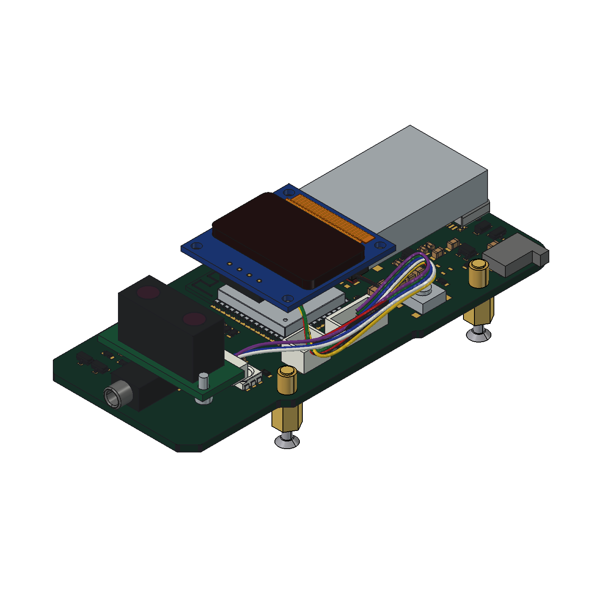

# DT Trainer CAD

- [DTT.FCStd](DTT.FCStd) — editable FreeCAD assembly (FreeCAD 1.1+).
- [DTT.step](DTT.step) — STEP assembly.
- [enclosed-case/](enclosed-case/README.md) — case variant with PCB edge walls, sliding switch cover, and a screwed rear cover.
- [molded-case/](molded-case/README.md) — the enclosed case redrawn for injection moulding (first pass).
- [Body + diffuser 3MF](../production-exports/cad/integrated-diffuser/DTT-Outer-Body-Print-in-Place.3mf) — two material regions printed together.

The assembly includes the housing, diffuser, PCB, OLED, sensor, 702035 battery,
ribbon cable, harness, screws, and loop backing. Groups separate the parts;
`AssemblyParameters` holds dimensions. Hide the housing to see the interior.
Show `ExplodedView` for the exploded assembly.

Edit the assembled parts and update their exploded copies before exporting STEP.
Hidden construction geometry and exploded copies are excluded from STEP.
Fit items: battery retaining bars, PCB edge, and sensor flange overlap the housing.

Hardware: CERN-OHL-S v2. Package models: [KiCad 3D libraries](https://gitlab.com/kicad/libraries/kicad-packages3D),
CC BY-SA 4.0 with the [design-output exception](https://www.kicad.org/libraries/license/index.html).
