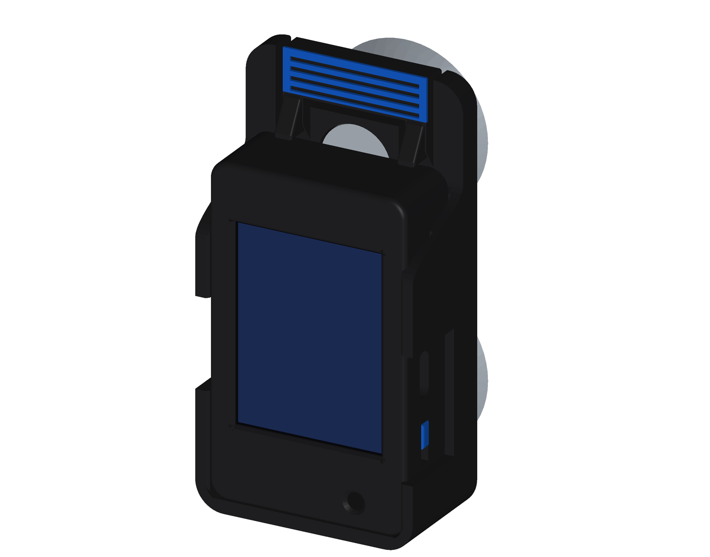
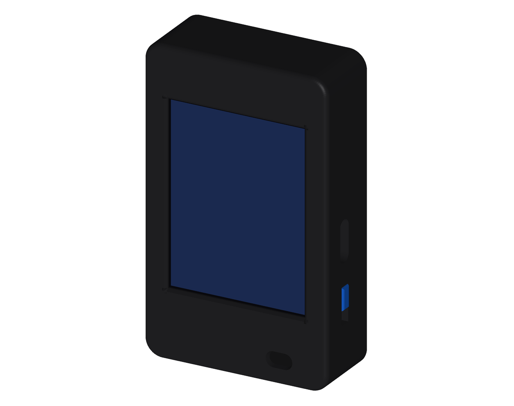
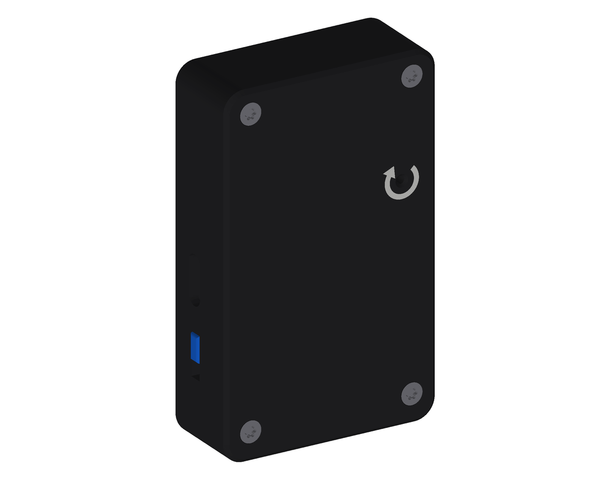
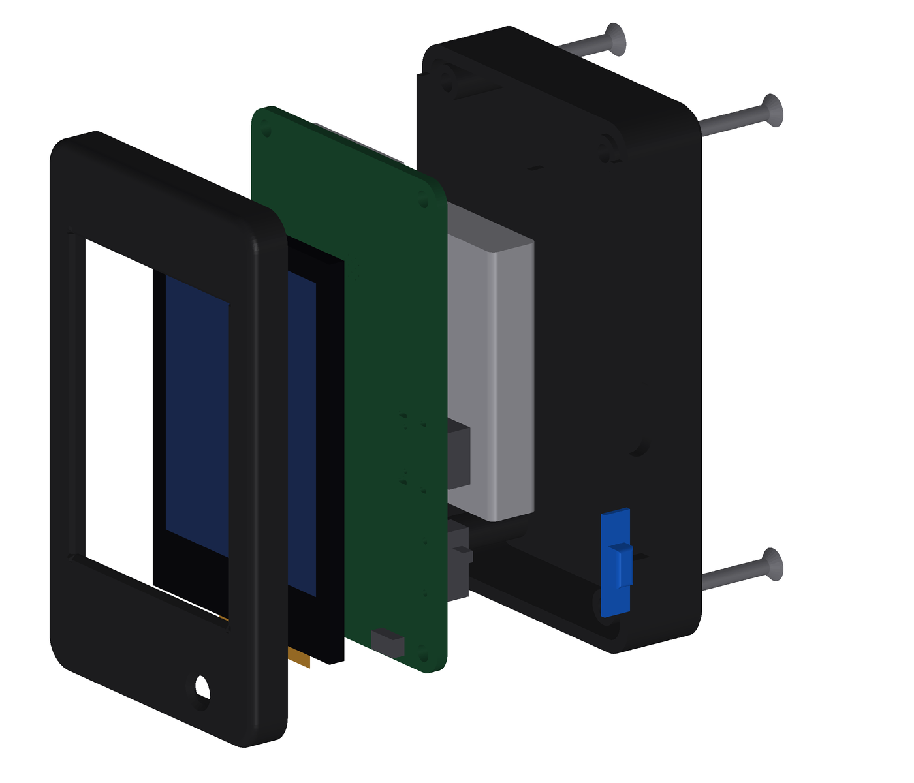
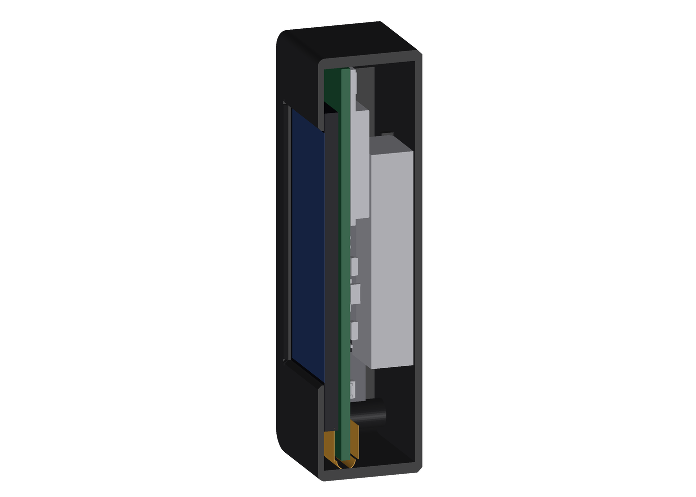
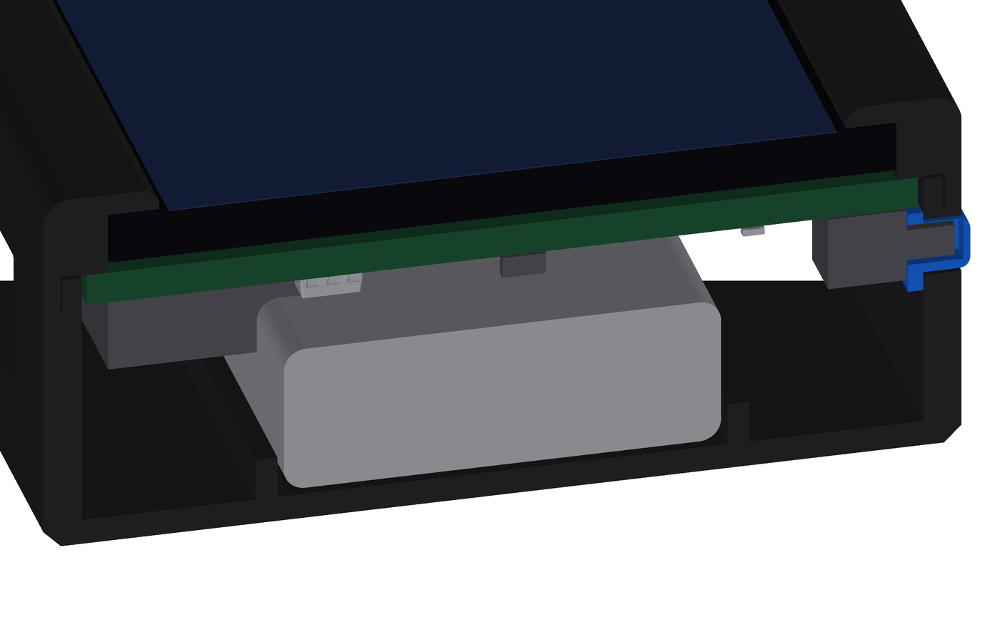
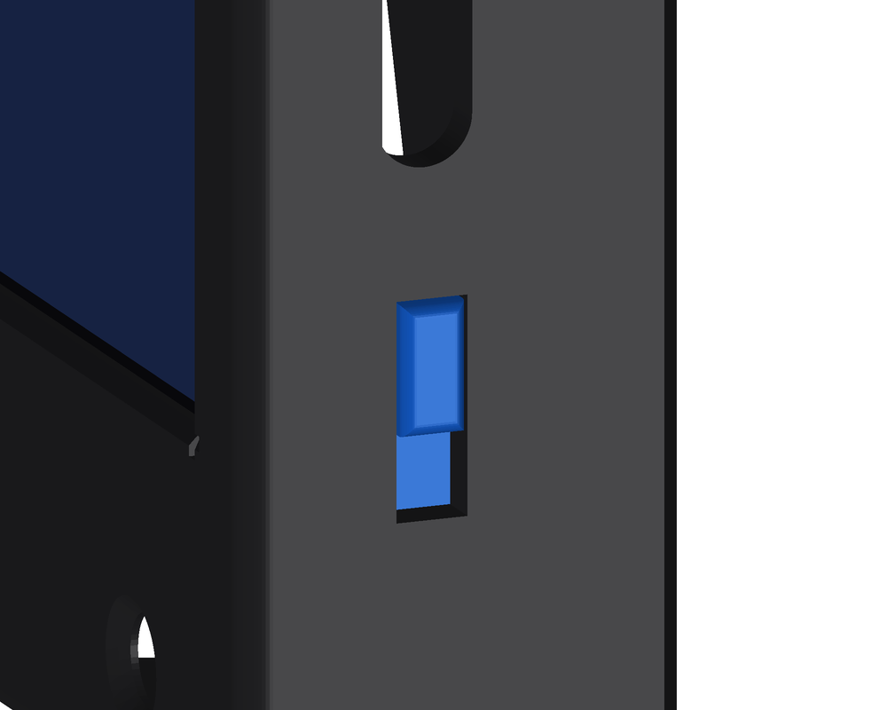
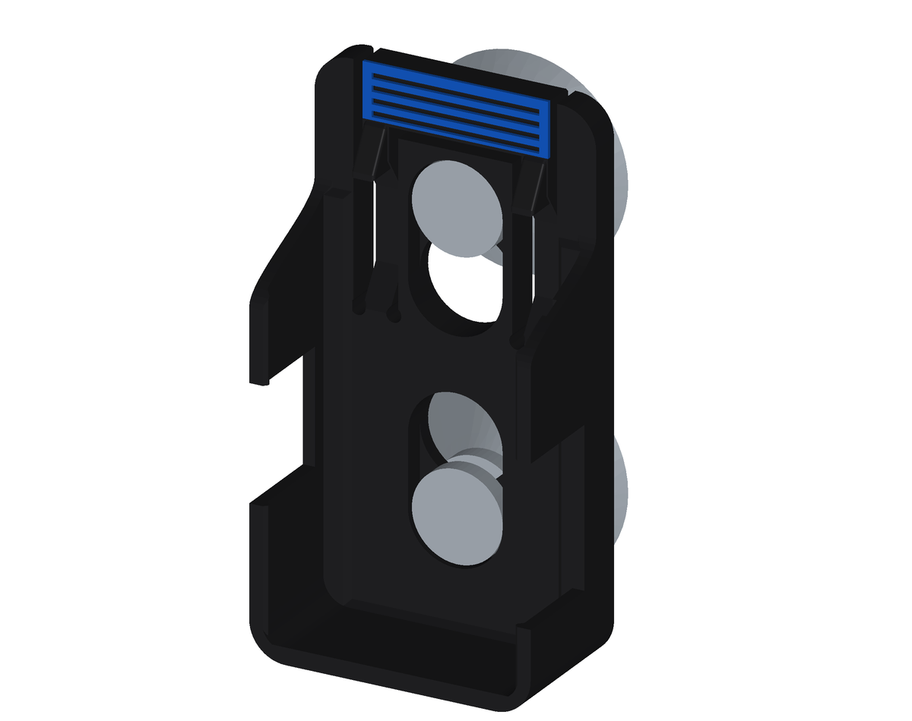
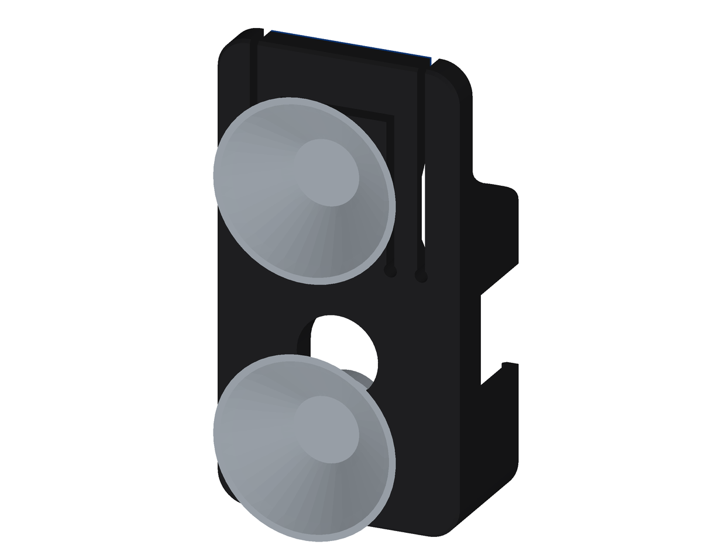
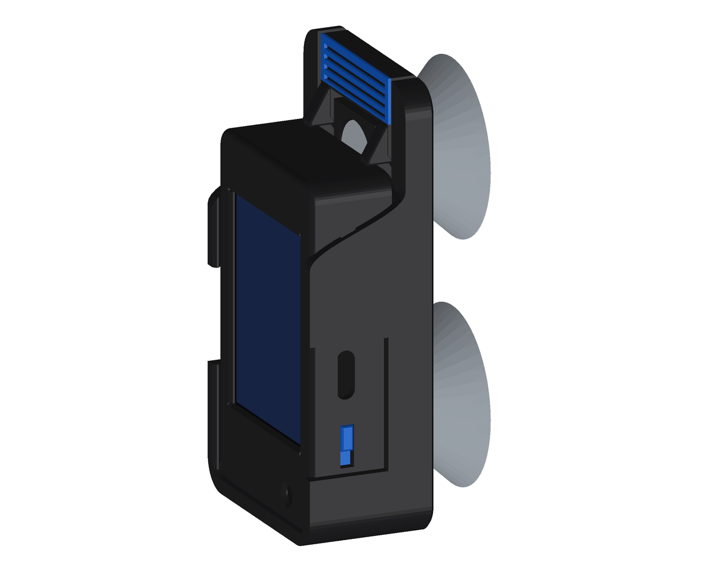

# DTT v2 assembly

The whole DTT v2 in one model: the [rev 5 board](../../pcb/kicad-rev5/dtt_v2/)
with its parts, the 2.0 in touch panel, a 702035 LiPo, a two-part printed case
with a blue switch cover, and the cradle it slides into.
42 x 69 x 17.4 mm (the rev 4 case is 50 x 95 x 22).



| Front | Rear | Exploded |
| --- | --- | --- |
|  |  |  |

| Section | Section at the switch | Switch side |
| --- | --- | --- |
|  |  |  |

| Cradle | Cradle, wall side | In the cradle |
| --- | --- | --- |
|  |  |  |

## How it goes together

- The glass sits on a 0.5 mm foam gasket under the front shell bezel. The
  board screws up to the front shell with four M2 x 16 flat-head screws
  through the rear cover, countersunk flush.
- The seam is at the back of the PCB, so USB-C, the PH6 port, the reset hole
  and the switch window are all in the rear cover.
- The battery lies behind USB-C and the module, on two ribs in the rear cover.
- The ToF looks out through a 3.6 mm countersunk window at the bottom right
  of the bezel.
- Cradle: 46 x 88 mm, no wider than the case needs. Slide the case in bottom
  end first, under the hood, until the lever clicks behind its top end. Press
  the blue tab toward the wall to release. The walls are low beside USB-C, the
  switch and the PH6 port; the switch grip rides in a groove along the right
  wall on the way out.
- Two suction cups sit in line down the middle, both hidden behind the
  cradle. Fit them before the case: push each head through its round hole and
  slide it into the small end until it clicks. The lower cup slides down and
  the upper one up, so on the wall the cradle can't shift either way. The
  upper cup sits on a fixed tongue inside the U-shaped lever, so pressing the
  tab never pulls on it.

## Print

| Part | File | Colour | Orientation |
| --- | --- | --- | --- |
| Front shell | `parts/Front-Shell-Black.stl` | black | bezel face down |
| Rear cover | `parts/Rear-Cover-Black.stl` | black | outer face down |
| Switch cover | `parts/Switch-Cover-Blue.stl` | blue | flange face down |
| Cradle | `parts/Cradle-Black.stl` + `parts/Cradle-Blue.stl` as one object | black + blue | wall side down |

## Hardware

| Qty | Part |
| --- | --- |
| 4 | M2 x 16 flat head self-tapping screw |
| 1 | 702035 LiPo, 7 x 20 x 35 mm, 400 mAh, PH 2.0 plug |
| 2 | Suction cup, 35 mm, 15 mm head on an 8.5 mm neck (as the rev 4 backplate) |

## Source

`build_dtt_v2_assembly.py` builds everything in FreeCAD from
`parts/DTT-v2-Board.step` (the KiCad export). Every dimension and its basis is
in `PARAMS`. It writes `DTT-v2.FCStd` (one group per subassembly plus a
parameter sheet), `DTT-v2.step`, `parts/` and the checks: no interference
anywhere, the case slides out clean, the teeth and lips hold.
`render_dtt_v2.py` then makes the images.

```
FreeCADCmd hardware/cad/dtt-v2/build_dtt_v2_assembly.py
python3 hardware/cad/dtt-v2/render_dtt_v2.py
```

## Open items

- Thickness is set by the 7 mm battery behind USB-C. A 502035 (5 mm, 250 mAh)
  makes the device 15.4 mm.
- ToF sight line through the bezel window: check on the first print.
- Panel glass outline (36 x 52 mm) and FPC exit are assumed until a sample
  arrives.
- The screws reach 2.5 mm into the front shell bosses. Check they hold.
- No logo inlay yet, and the cradle has no stop fingers.
