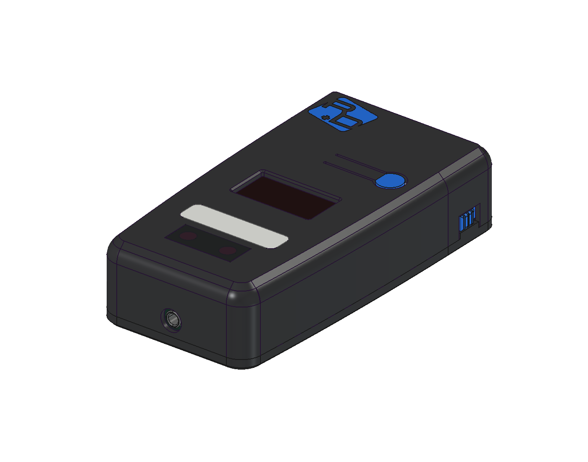
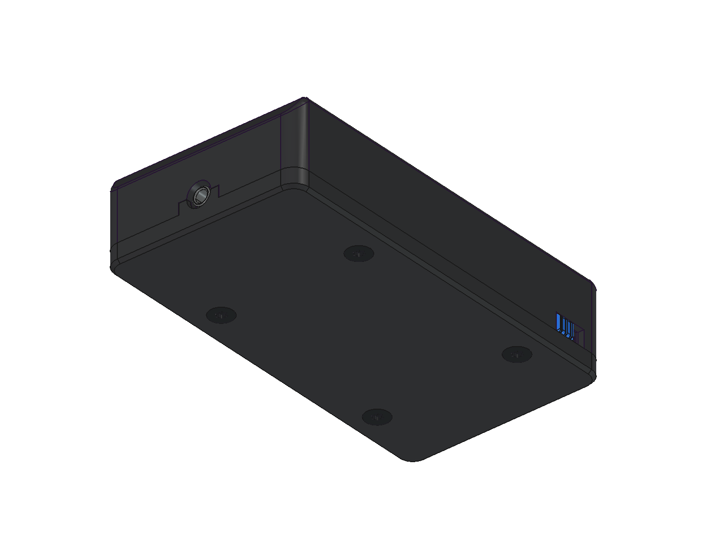
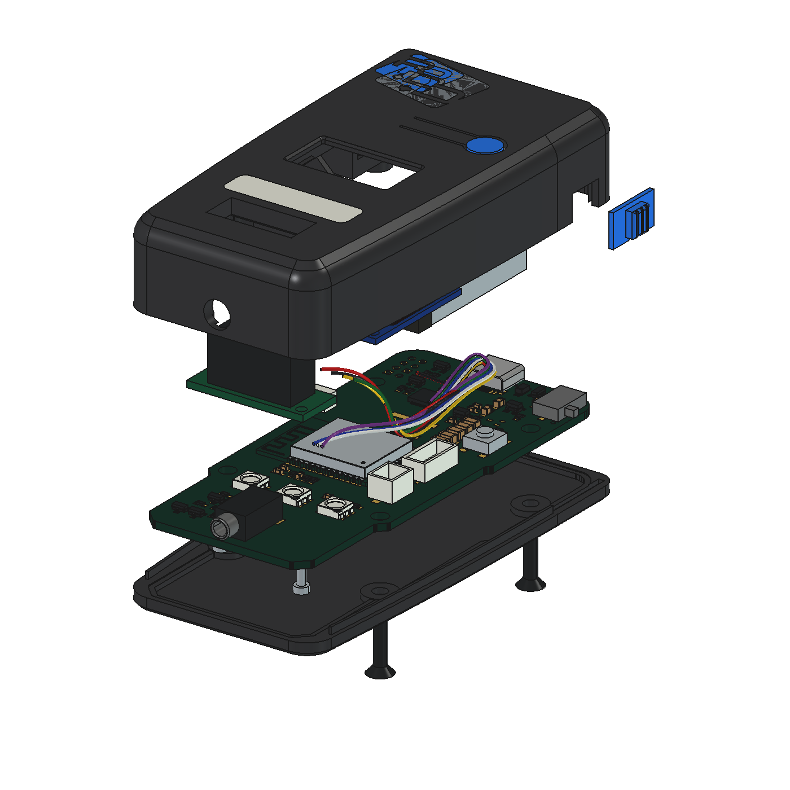
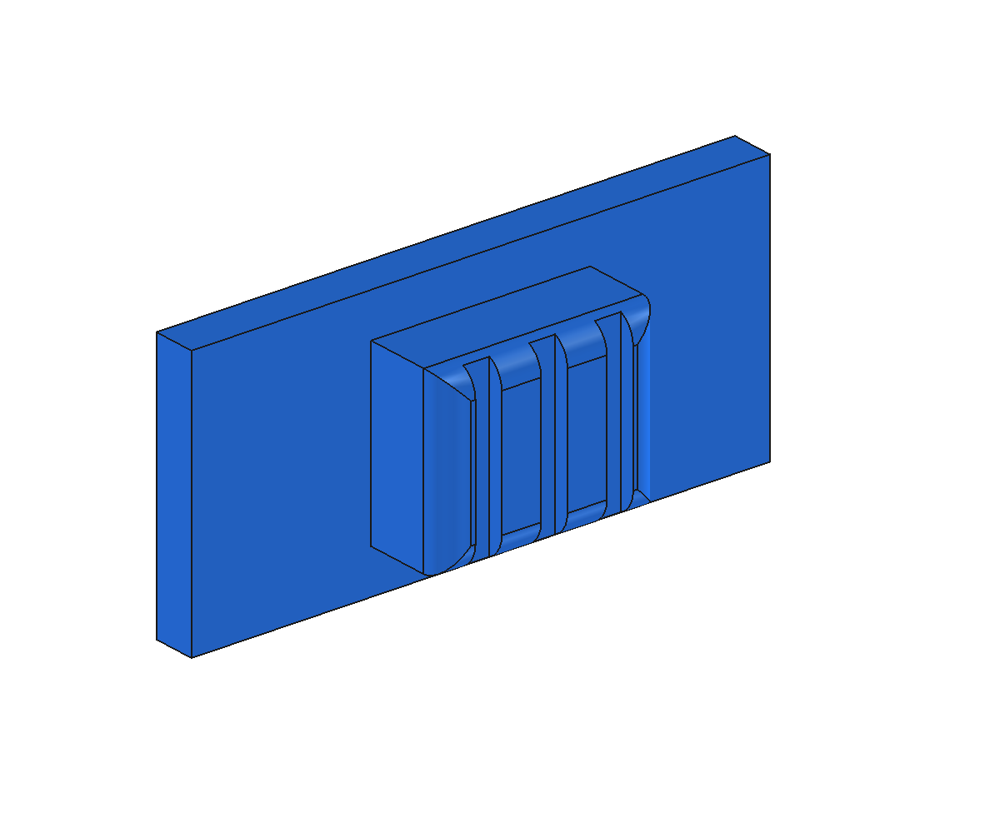
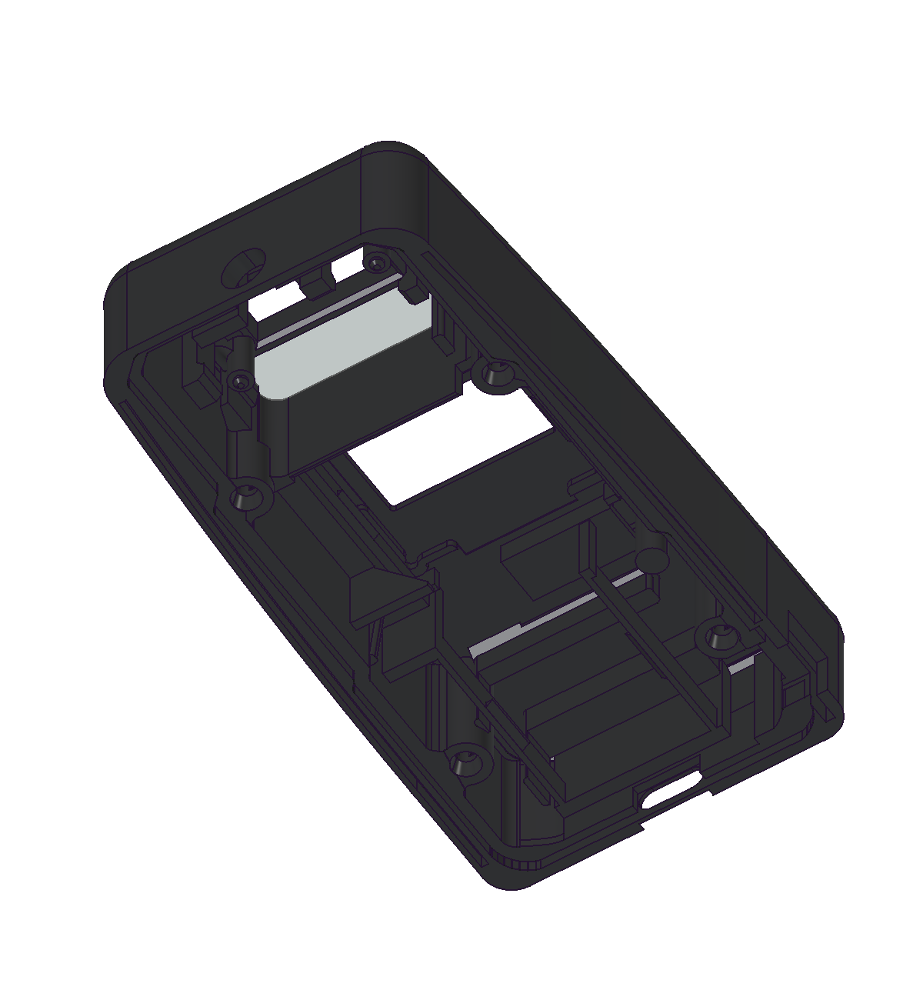
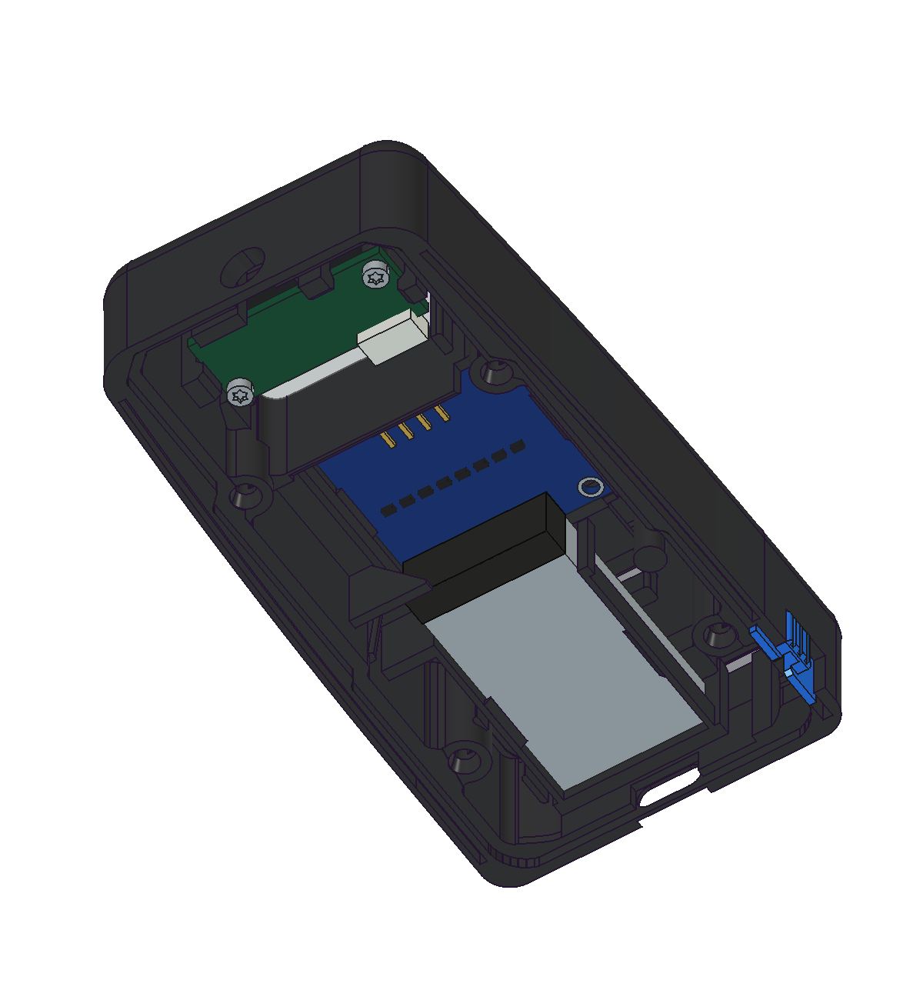
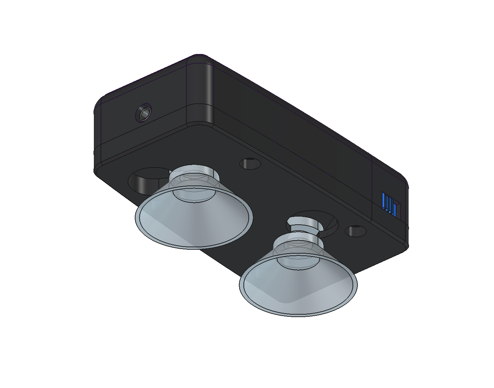

# Enclosed case

The DTT case, 50 mm wide at the USB-C end and curving in to 44 mm at the jack,
with a 5 mm round all round the top edge and a blue switch cover that slides S1.
The PCB drops into a pocket in the housing, so the rear cover is a flat cap. A
tongue along each long side holds it in place until the original four PCB
screws go in, flush in its countersinks. It replaces the loop backing, and slides into
the [snap backplate](../snap-backplate/).

| | |
| --- | --- |
|  |  |
|  |  |
|  |  |
|  |  |
|  |  |

## Suction-cup rear cover

Swap the rear cover for `Rear-Cover-Cups-Black` to stick the case straight on
a wall with two suction cups. Push each cup's head in through the round hole
and slide it along its slot until it clicks. The slots run sideways in
opposite directions, so the case can't come off its cups whichever way you
pull it. They rise 30° so both cups end up on the centreline and the case's
weight keeps them clicked in. The keyholes fit a stem with a Ø15 x 3 mm head
and a Ø8.5 x 2.5 mm groove. The cover is 4 mm thicker so the heads fit under
the PCB, with a roof over each, and the case no longer fits the snap backplate.

| | |
| --- | --- |
|  |  |
|  | |

## Print

| Part | File | Colour | Orientation |
| --- | --- | --- | --- |
| Housing | `parts/Housing-Black.stl` (+ `Housing-Diffuser-White.stl` in white, `Housing-Inlays-Blue.stl` (logo and button) in blue) | black | top face down |
| Rear cover | `parts/Rear-Cover-Black.stl` | black | outer face down |
| Suction-cup rear cover (instead) | `parts/Rear-Cover-Cups-Black.stl` | black | outer face down |
| Switch cover | `parts/Switch-Cover-Blue.stl` | blue | flange face down |

## Hardware

| Qty | Part |
| --- | --- |
| 4 | The original short self-tapping PCB screws, 0408LTFB (#4 × 1/2" Torx flat head) |
| - | Hot glue, for the sensor |

## Assemble

1. With the housing upside down, push the OLED module in, glass first and
   header toward the jack, until both clips click over its board. A rib under
   the plate stops it going in the other way round. No glue.
2. Press the distance sensor into its mount, connector toward the screen,
   pushing on its two silver screws until it sits flush. Hot-glue it. A rib
   by the jack stops it going in the other way round.
3. Push the battery in between its two clips until it clicks, leads toward
   the screen.
4. Drop the switch cover into its channel, grip outwards, at the same end as
   S1's lever.
5. Plug the battery and harness into the PCB. Put the PCB in jack end first,
   tilted, with the jack's nose in its hole, then lower the USB-C end into the
   pocket. S1's lever drops into the switch cover from underneath.
6. Press the cap on; its tongues hold it. Drive the four screws into the
   original bosses. Snug them; do not strip the bosses.

Size: 50.0 (44.0 at the jack end) × 95.2 × 22.3 mm (26.3 with the suction-cup cover).

## Source

- `build_enclosed_case.py` builds the parts from `../DTT.FCStd`. Dimensions are
  in `PARAMS`. `top_round` is the round along the top edge. It turns into a
  45° face for its last 1.5 mm (`round_stop`), so it prints top face down
  without support. Under it the walls are filled out to 1.6 mm from inside. Set `outline` to `"conformal"`
  for walls that follow the PCB's three widths (50 / 48 / 44 mm); its step
  corners keep a 1.2 mm fillet. Set `lean` to `(3.0, 2.5)` for sides that
  curve in 3 mm toward the top. The snap backplate only fits the upright taper.
- `make_assembly.FCMacro` writes `DTT-Enclosed.FCStd`, `DTT-Enclosed.step`,
  `parts/` and `images/`: `xvfb-run -a freecad make_assembly.FCMacro`.
- The PCB is unchanged; the screws use its existing 3.6 mm holes.
- The housing's PCB pocket, the clips, keys and posts inside it are in
  `build_housing()`; their sizes are in `PARAMS` beside the part they hold.

## Check on a test print

- S1 actuator position and travel. The cover follows the KiCad F.Fab drawing
  (actuator at Y 82.4, 1.5 mm wide) and allows 3.2 mm of travel. The old CAD
  switch model put the actuator 5 mm further along, so check the real part.
- The switch cover slides freely (0.15 mm clearance) in its grooves in the
  housing and the cap, and its base hides the window at both ends of its travel.
- The PCB drops into its pocket (0.3 mm a side, 0.1 at the USB-C end) with the
  jack tilted in, and the 0.5 mm skin in front of its USB-C edge prints.
- The cap's 0.6 x 1.6 mm tongues drop into their grooves without forcing (0.2 mm
  a side) and hold the cap on before the screws.
- The screw heads sit flush in the 82° countersinks (5.9 mm). The screws
  reach 8 mm into the bosses.
- USB-C: a plug passes the 9.2 x 3.6 mm opening and seats fully. Its overmould
  stops 0.6 mm short of the receptacle, in a 13 x 7 mm recess.
- 3.5 mm jack: a plug seats fully through the 1.3 mm wall.
- The button: a 4 mm black bar to a blue round pad right over S2. The post
  under the pad is 1.2 mm above S2's plunger, as before.
- The viewport (23.2 x 12.2 mm) frames the screen's lit area.
- The OLED clips: the module clicks in and its glass sits flat on the plate.
  Each clip is a spring strip in a slot in a wall that runs out to the side
  wall. It bends 0.5 mm to let the board in; the wall stops it at 0.95 mm.
  The lips' catch faces are 20° from flat, so they hardly let go, and set to
  lift the board 0.1 mm past its seat, so the strips stay sprung against it.
- The battery clicks past the two lips (0.65 mm over its edges) and sits
  against the cross bars; a gusset and an end block stop it lengthwise.
- The sensor's lenses sit on the case's centreline.
- Suction-cup cover: the cups click in and sit tight (`cup_snap`, `cup_land`),
  and the heads slide under the roofs. Each roof is a 15.6 mm bridge onto
  2 mm walls (`cup_roof`); check it doesn't sag onto the heads.

The CAD checks are geometric only. Clamp force, thread hold and drop
strength need a physical test.
