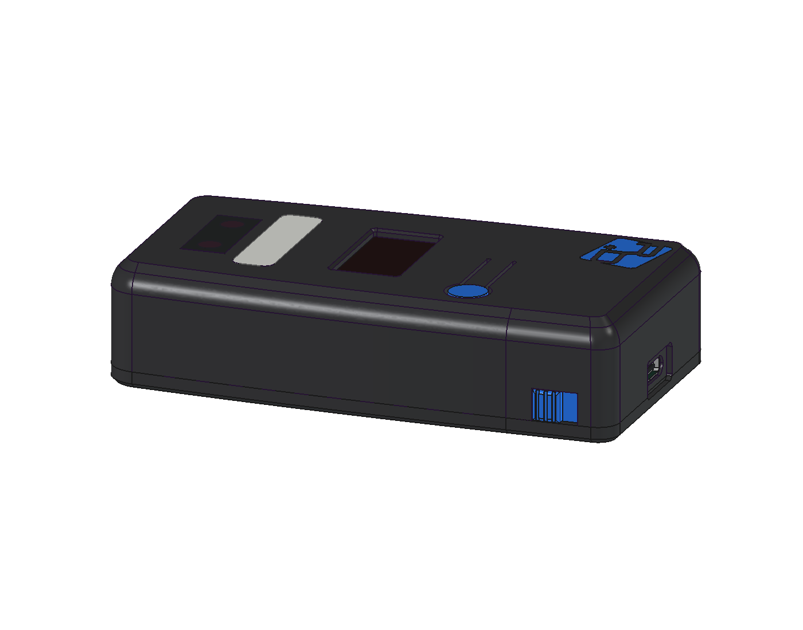
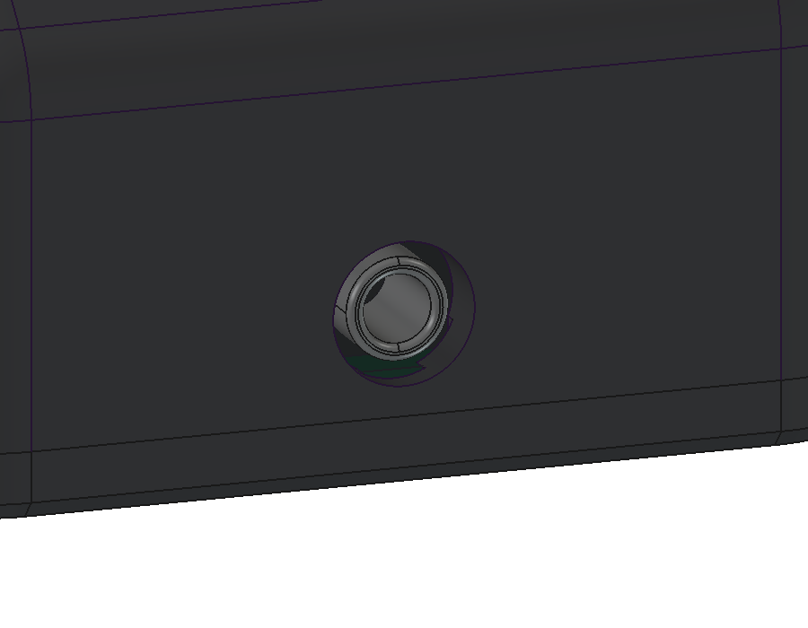
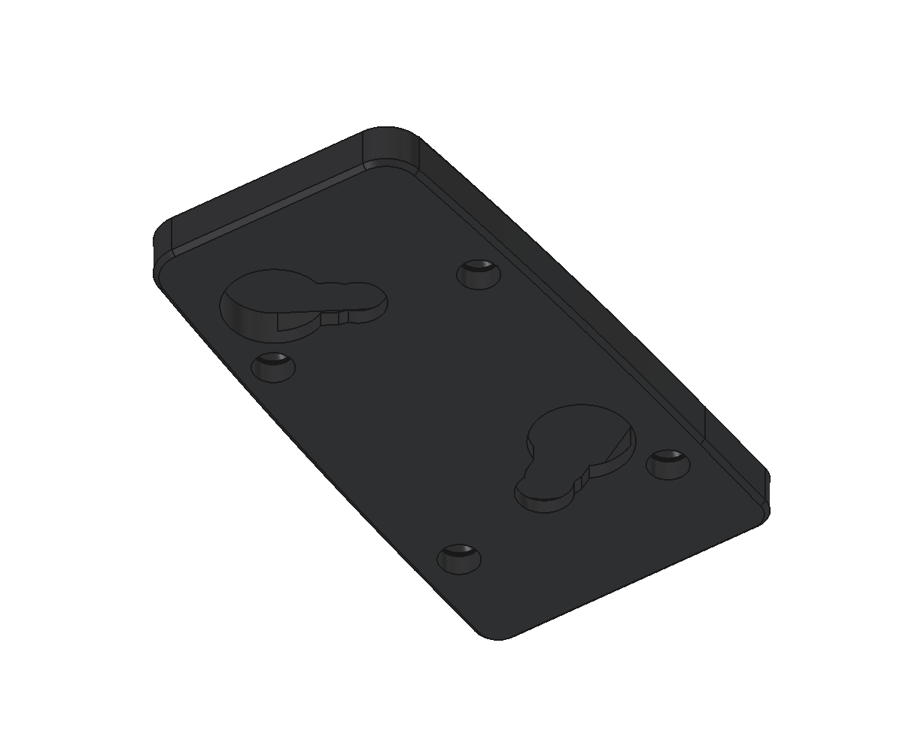
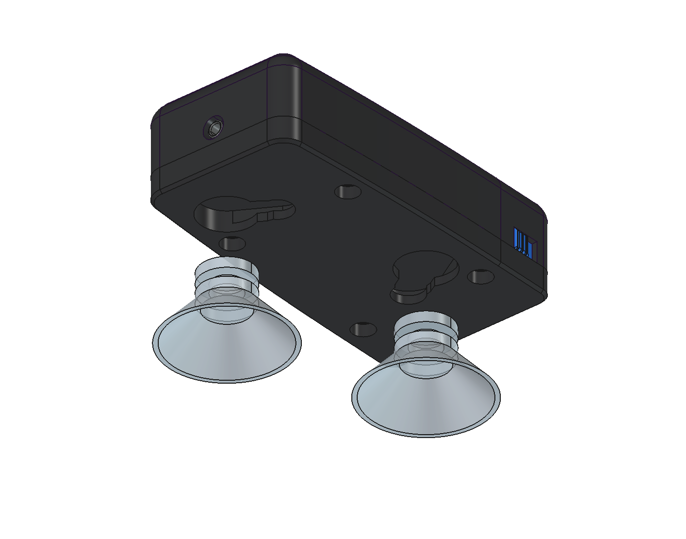
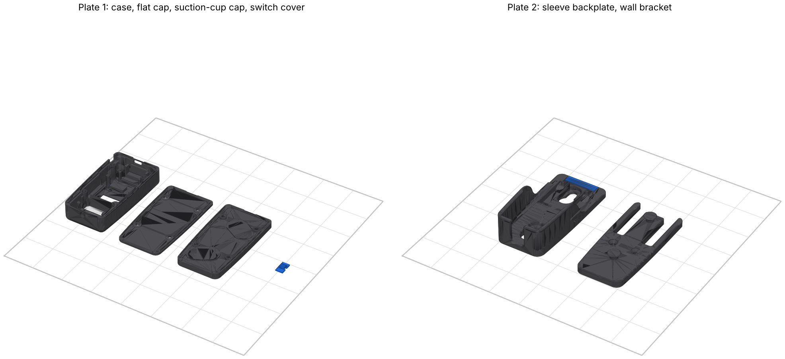

# Enclosed case

The DTT case, 50 mm wide at the USB-C end and curving in to 44 mm at the jack,
with a 5 mm round all round the top edge and a blue switch cover that slides S1.
The PCB drops into a pocket in the housing and a flat rear cover caps it. The
original four PCB screws hold it together, flush in countersinks in the cap. It
replaces the loop backing, and slides into the [snap backplate](../snap-backplate/).

| | |
| --- | --- |
|  |  |
|  |  |
|  |  |
|  |  |

## Suction-cup rear cover

Swap the rear cap for `Rear-Cover-Cups-Black` to stick the case straight on
a wall with two suction cups. Push each cup's head in through the round hole
and slide it along its slot until it clicks. The slots run sideways in
opposite directions, so the case can't come off its cups whichever way you
pull it. They rise 30° so both cups end up on the centreline and the case's
weight keeps them clicked in. The keyholes fit a stem with a Ø15 x 3 mm head
and a Ø8.5 x 2.5 mm groove. The cap is 4 mm thicker so the heads fit under
the PCB, with a roof over each, and the case no longer fits the snap backplate.

| | |
| --- | --- |
|  |  |
|  | |

## Print

| Part | File | Colour | Orientation |
| --- | --- | --- | --- |
| Housing | `parts/Housing-Black.stl` (+ `Housing-Diffuser-White.stl` in white, `Housing-Inlays-Blue.stl` (logo and button) in blue) | black | top face down |
| Rear cap | `parts/Rear-Cover-Black.stl` | black | outer face down |
| Suction-cup rear cap (instead) | `parts/Rear-Cover-Cups-Black.stl` | black | outer face down |
| Switch cover | `parts/Switch-Cover-Blue.stl` | blue | flange face down |

Or open [`print/DTT-Enclosed-Print.3mf`](print/DTT-Enclosed-Print.3mf) in Bambu
Studio: plate 1 is the case with both rear caps (delete the one you don't
need), plate 2 the snap backplate and wall bracket, already turned to their
print faces. Blue is filament 1, the white diffuser 2 and black 3; it takes
your current printer and process presets. `print/make_3mf.py` rebuilds it from
the STLs.

## Hardware

| Qty | Part |
| --- | --- |
| 4 | The original short self-tapping PCB screws, 0408LTFB (#4 × 1/2" Torx flat head) |
| 1 | Double-sided foam tape, about 20 × 30 × 0.8 mm, for the battery |
| - | Hot glue, for the sensor |

## Assemble

1. With the housing upside down, push the OLED module in, glass first and
   header toward the jack, until both clips click over its board. No glue.
2. Press the distance sensor into its mount, connector toward the screen,
   pushing on its two silver screws until it sits flush. Hot-glue it.
3. Stick the foam tape on the battery and press it into its bay, leads toward
   the screen, its other end against the stop.
4. Drop the switch cover into its channel from inside, grip outwards.
5. Plug the battery and harness into the PCB. Put the PCB in jack end first,
   tilted, with the jack's nose in its hole, then lower the USB-C end into the
   pocket. S1's lever drops into the switch cover from underneath.
6. Press the cap on; its tongue holds it in place. Drive the four screws into
   the original bosses. Snug them; do not strip the bosses.

Size: 50.0 (44.0 at the jack end) × 95.2 × 22.3 mm (26.3 with the suction-cup cap).

## Source

- `build_enclosed_case.py` builds the parts from `../DTT.FCStd`. Dimensions are
  in `PARAMS`. `top_round` is the round along the top edge. It turns into a
  45° face for its last 1.5 mm (`round_stop`), so it prints top face down
  without support. Under it the walls are filled out to 1.6 mm from inside. Set `outline` to `"conformal"`
  for walls that follow the PCB's three widths (50 / 48 / 44 mm); its step
  corners keep a 1.2 mm fillet. Set `lean` to `(3.0, 2.5)` for sides that
  curve in 3 mm toward the top. The snap backplate only fits the upright taper.
- `make_assembly.FCMacro` writes `DTT-Enclosed.FCStd`, `DTT-Enclosed.step`,
  `parts/` and `images/`: `xvfb-run -a freecad make_assembly.FCMacro`.
- The PCB is unchanged; the screws use its existing 3.6 mm holes.

## Check on a test print

- S1 actuator position and travel. The cover follows the KiCad F.Fab drawing
  (actuator at Y 82.4, 1.5 mm wide) and allows 3.2 mm of travel. The old CAD
  switch model put the actuator 5 mm further along, so check the real part.
- The switch cover slides freely (0.15 mm clearance), stays in the window,
  and its base hides the window at both ends of its travel.
- The PCB goes in nose first and drops flat into its pocket.
- The cap's tongue (0.6 × 1.6 mm) drops into the housing groove without forcing
  (0.2 mm a side) and holds the cap before the screws go in.
- The screw heads sit flush in the 82° countersinks (5.9 mm). The screws
  reach 8 mm into the bosses.
- USB-C and 3.5 mm plugs seat fully through the 1.6 mm thicker end walls. The
  USB-C opening is 9.2 × 3.6 mm, in a 13 × 7 × 1 mm recess for the plug's
  overmould.
- The button: a 4 mm black bar to a blue round pad straight over S2, with a
  plain post 1.2 mm above its plunger, as before.
- The screen window (23.4 × 12.4 mm) sits on the lit area, and the distance
  sensor's lenses on the centreline.
- The battery sits snug between the posts and the tape holds it.
- Suction-cup cap: the cups click in and sit tight (`cup_snap`, `cup_land`),
  and the heads slide under the roofs. Each roof is a 15.6 mm bridge onto
  2 mm walls (`cup_roof`); check it doesn't sag onto the heads.
- The OLED clips: the module clicks in and its glass sits flat on the plate.
  The 20° catches are set to lift the board 0.1 mm past its seat, so the
  strips stay sprung against it.

The CAD checks are geometric only. Clamp force, thread hold and drop
strength need a physical test.
