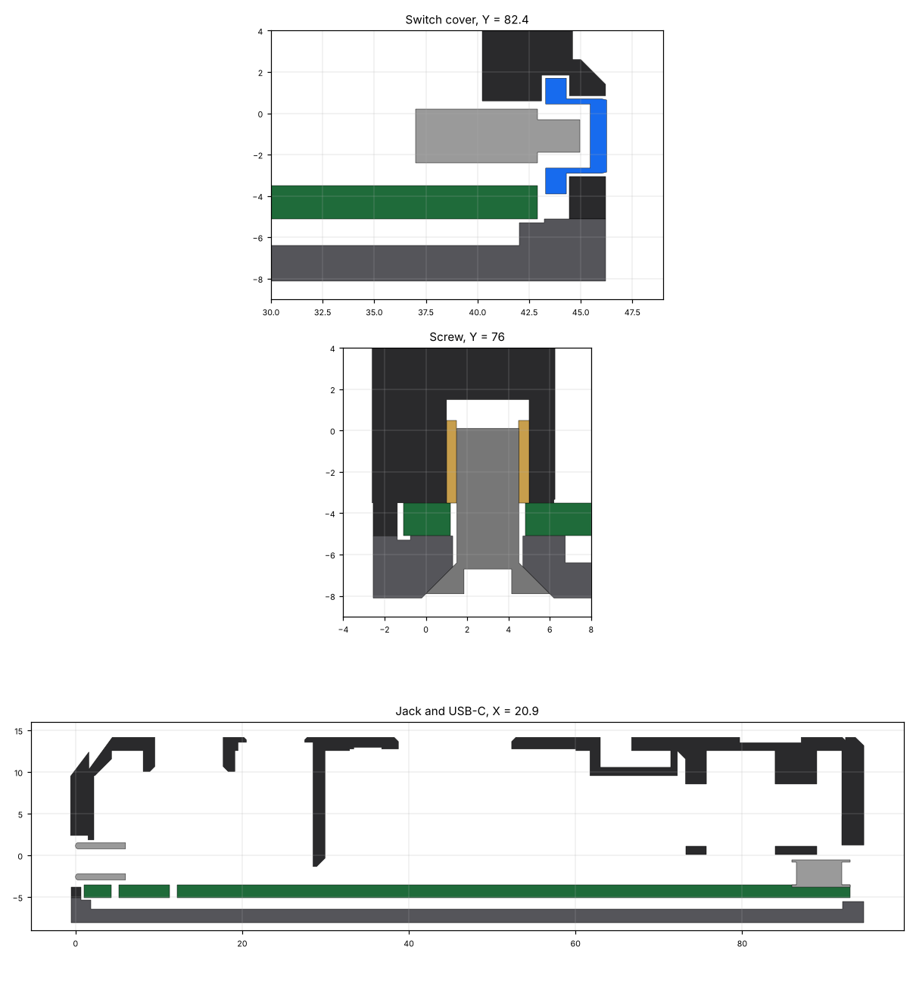

# Enclosed case

The DTT case with a wall around the PCB edge, a blue switch cover that slides
S1, and a rear cover over the back of the PCB. Four countersunk M3 screws sit
flush in the rear cover and clamp the PCB to heat-set inserts in the housing.
It replaces the loop backing and the four 0408LTFB screws.

## Print

| Part | File | Colour | Orientation |
| --- | --- | --- | --- |
| Housing | `parts/Housing-Black.stl` (+ `Housing-Diffuser-White.stl`, `Housing-Logo-Inlay.stl`) | black | top face down |
| Rear cover | `parts/Rear-Cover-Black.stl` | black | outer face down |
| Switch cover | `parts/Switch-Cover-Blue.stl` | blue | flange face down |

## Hardware

| Qty | Part |
| --- | --- |
| 4 | M3 × 8 countersunk hex socket screw (ISO 10642 / DIN 7991) |
| 4 | M3 × 4 heat-set insert for a 4.0 mm hole |

## Assemble

1. Press the four inserts into the housing bosses with a soldering iron.
2. With the housing upside down, drop the switch cover into its slot from
   inside, grip outwards.
3. Fit the PCB so the S1 actuator enters the pocket in the switch cover.
4. Fit the rear cover and the four screws. Snug them; do not crush the PCB.

Size: 48.8 × 95.2 × 22.9 mm.

## Source

- `build_enclosed_case.py` builds the parts from `../DTT.FCStd`. Dimensions are
  in `PARAMS`.
- `make_assembly.FCMacro` writes `DTT-Enclosed.FCStd`, `DTT-Enclosed.step`,
  `parts/` and `images/`: `xvfb-run -a freecad make_assembly.FCMacro`.
- The PCB is unchanged; the screws use its existing 3.6 mm holes.

## Check on a test print

- S1 actuator position and travel. The cover follows the KiCad F.Fab drawing
  (actuator at Y 82.4, 1.5 mm wide) and allows 3.2 mm of travel. The old CAD
  switch model put the actuator 5 mm further along, so check the real part.
- The switch cover slides freely (0.15 mm clearance) and stays in the window.
- Inserts hold in the 6.4 mm bosses, and the screw heads sit flush.
- USB-C and 3.5 mm plugs seat fully through the thicker end walls.

The CAD checks are geometric only. Clamp force, insert pull-out and drop
strength need a physical test.
