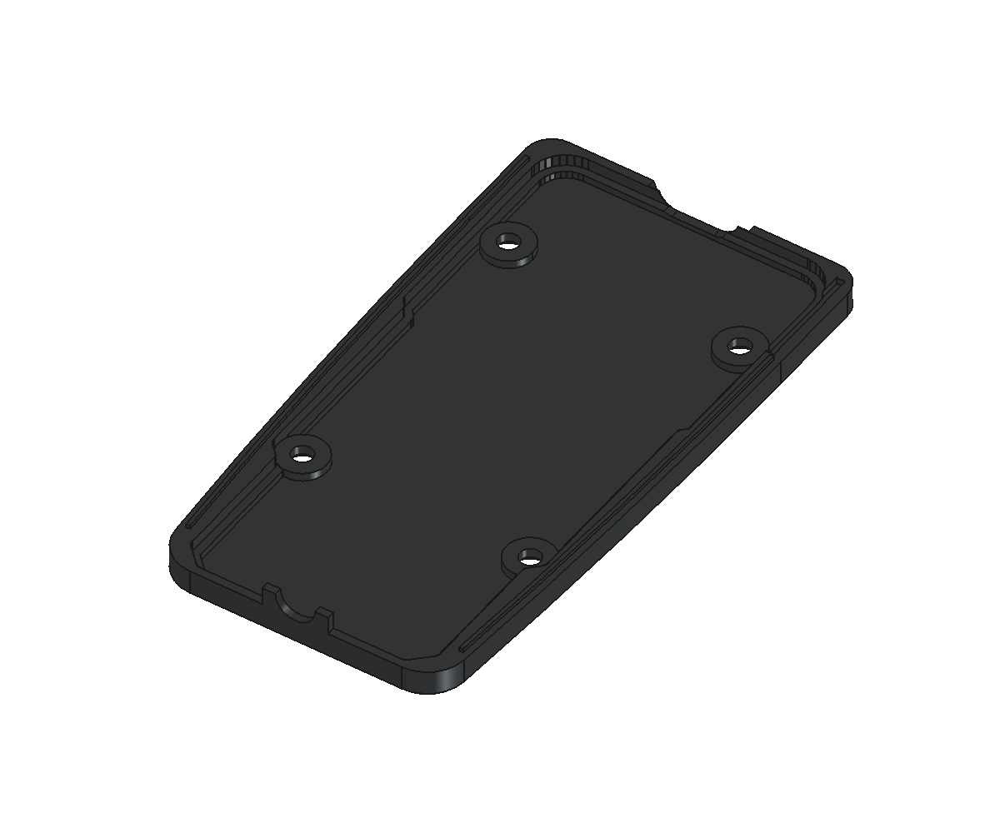
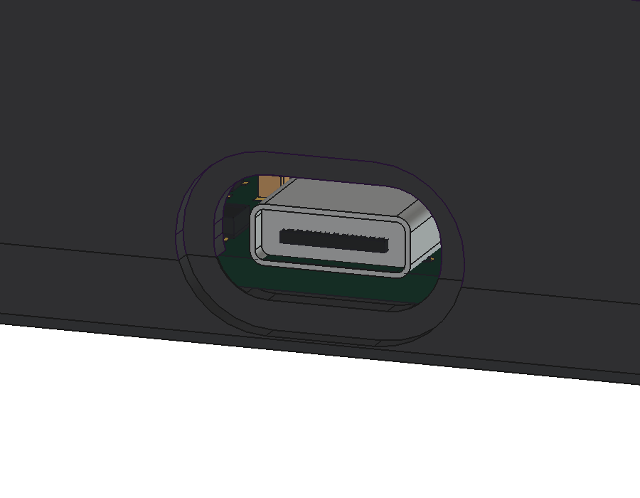

# Enclosed case

The DTT case, 50 mm wide at the USB-C end and curving in to 44 mm at the jack,
with a blue switch cover that slides S1 and a rear cover tray that holds the
PCB from its top face down. The original four PCB screws hold it together,
flush in countersinks in the rear cover. It replaces the loop backing, and
slides into the [snap backplate](../snap-backplate/).

| | |
| --- | --- |
|  |  |
|  |  |
|  |  |
|  |  |

## Print

| Part | File | Colour | Orientation |
| --- | --- | --- | --- |
| Housing | `parts/Housing-Black.stl` (+ `Housing-Diffuser-White.stl` in white, `Housing-Inlays-Blue.stl` (logo and button) in blue) | black | top face down |
| Rear cover | `parts/Rear-Cover-Black.stl` | black | outer face down |
| Switch cover | `parts/Switch-Cover-Blue.stl` | blue | flange face down |

## Hardware

| Qty | Part |
| --- | --- |
| 4 | The original short self-tapping PCB screws, 0408LTFB (#4 × 1/2" Torx flat head) |

## Assemble

1. With the housing upside down, push the OLED module in, glass first, until
   the two clips click over its board. No glue.
2. Drop the switch cover into its slot from inside, grip outwards.
3. Fit the PCB so the S1 actuator enters the pocket in the switch cover.
4. Fit the rear cover and drive the four screws into the original bosses.
   Snug them; do not strip the bosses.

Size: 50.0 (44.0 at the jack end) × 95.2 × 22.3 mm.

## Source

- `build_enclosed_case.py` builds the parts from `../DTT.FCStd`. Dimensions are
  in `PARAMS`.
- `make_assembly.FCMacro` writes `DTT-Enclosed.FCStd`, `DTT-Enclosed.step`,
  `parts/` and `images/`: `xvfb-run -a freecad make_assembly.FCMacro`.
- The PCB is unchanged; the screws use its existing 3.6 mm holes.

## Check on a test print

- S1 actuator position and travel. The cover follows the KiCad F.Fab drawing
  (actuator at Y 82.4, 1.5 mm wide) and allows 3.2 mm of travel. The old CAD
  switch model put the actuator 5 mm further along, so check the real part.
- The switch cover slides freely (0.15 mm clearance), stays in the window,
  and its base hides the window at both ends of its travel.
- The rear cover's tongue drops into the housing groove without forcing
  (0.2 mm a side).
- The screw heads sit flush in the 82° countersinks (5.9 mm). The screws
  reach 8 mm into the bosses.
- USB-C and 3.5 mm plugs seat fully through the 1.6 mm thicker end walls.
- The button feel: a plain bar with a round pad over the plunger. Its tray
  now stays 5 mm clear of the screen board.
- The OLED clips: the module clicks in and its glass sits flat on the plate.
  The lips are set to lift the board 0.3 mm past its seat, so the beams stay
  sprung against it.

The CAD checks are geometric only. Clamp force, thread hold and drop
strength need a physical test.
