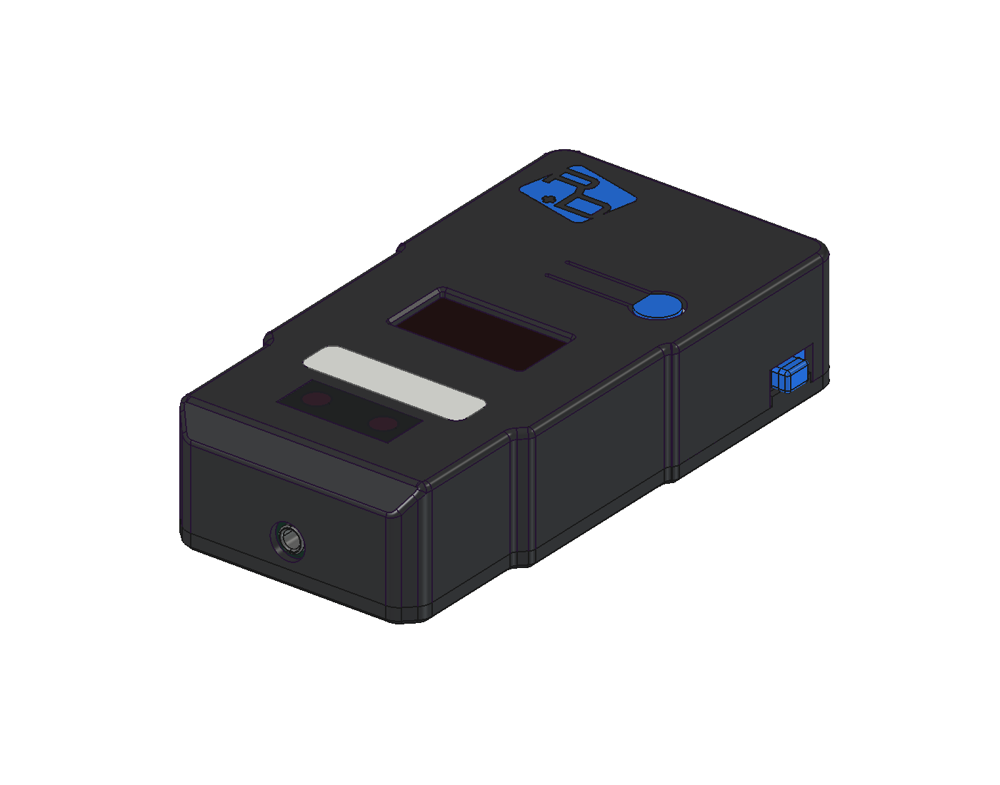
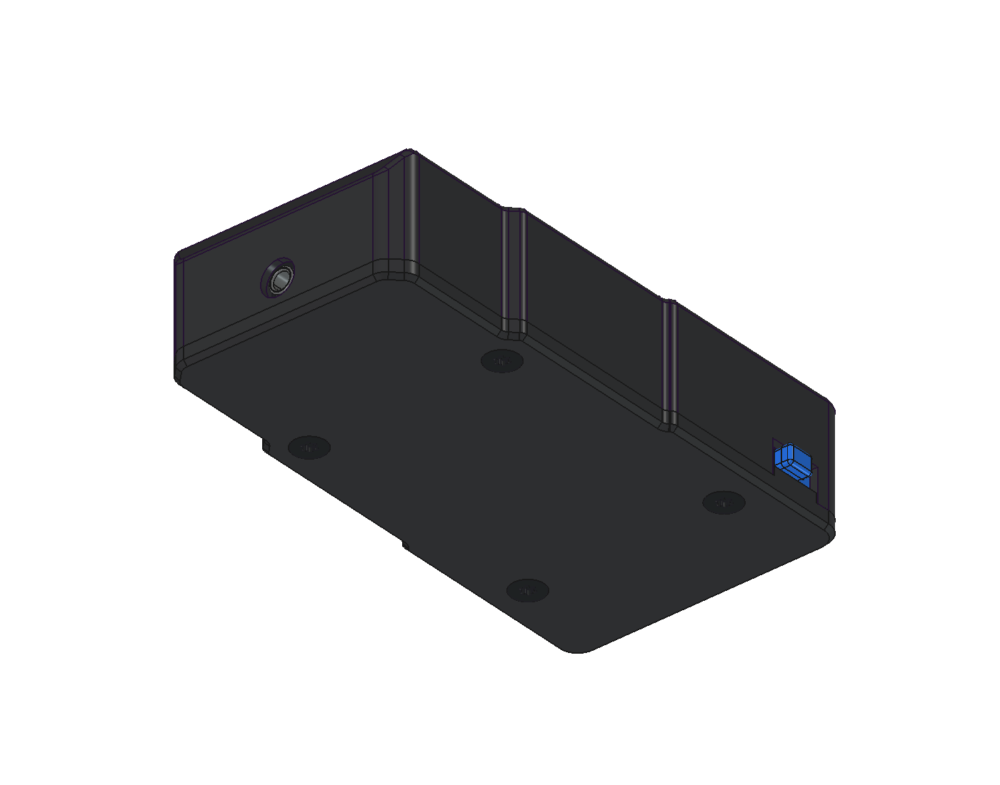
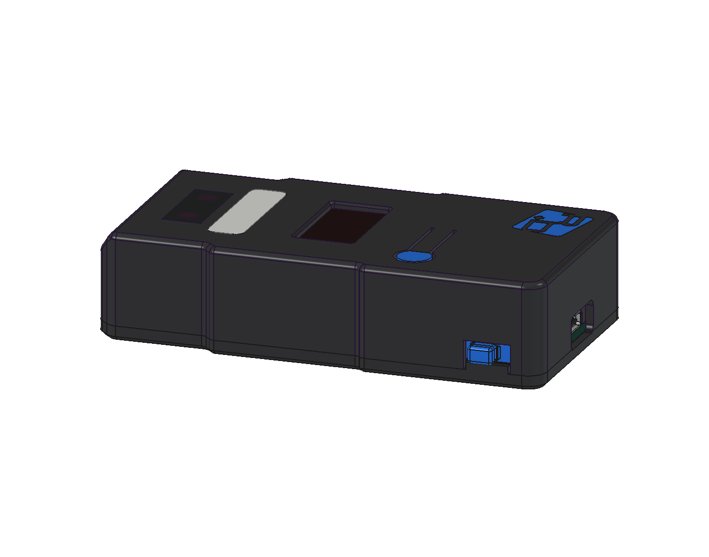
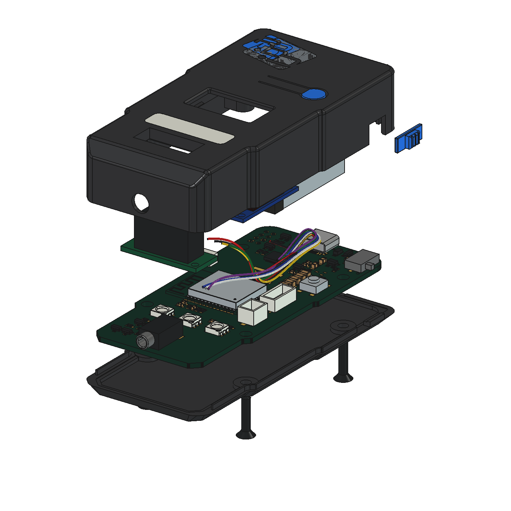

# Enclosed case

The DTT case, 50 mm wide at the USB-C end and curving in to 44 mm at the jack,
with a 5 mm round all round the top edge and a blue switch cover on S1.
The PCB drops into a pocket in the housing and a flat rear cover caps it. The
original four PCB screws hold it together, flush in countersinks in the cap. It
replaces the loop backing, and slides into the [snap backplate](../snap-backplate/).

| | |
| --- | --- |
|  |  |
|  |  |
|  |  |
|  |  |

## Suction-cup rear cover

Swap the rear cap for `Rear-Cover-Cups-Black` to stick the case straight on
a wall with two suction cups. Push each cup's head in through the round hole
and slide it along its slot until it clicks. The slots run sideways in
opposite directions, so the case can't come off its cups whichever way you
pull it. They rise 30° so both cups end up on the centreline and the case's
weight keeps them clicked in. The keyholes fit a stem with a Ø15 x 3 mm head
and a Ø8.5 x 2.5 mm groove. The cap is 4 mm thicker so the heads fit under
the PCB, with a roof over each, and the case no longer fits the snap backplate.

| | |
| --- | --- |
|  |  |
|  | |

## Stepped version

The same case with the original housing's outline: sides that step in with the
PCB (50 / 48 / 44 mm) and the sloped jack end. Everything inside is the same.
It doesn't fit the snap backplate; use the suction-cup rear cover. Its files
are in [`stepped/`](stepped/).

| | |
| --- | --- |
|  |  |
|  |  |

## Print

| Part | File | Colour | Orientation |
| --- | --- | --- | --- |
| Housing | `parts/Housing-Black.stl` (+ `Housing-Diffuser-White.stl` in white, `Housing-Inlays-Blue.stl` (logo and button) in blue) | black | top face down |
| Rear cap | `parts/Rear-Cover-Black.stl` | black | outer face down |
| Suction-cup rear cap (instead) | `parts/Rear-Cover-Cups-Black.stl` | black | outer face down |
| Switch cover | `parts/Switch-Cover-Blue.stl` | blue | flat face down |

Or open [`print/DTT-Enclosed-Print.3mf`](print/DTT-Enclosed-Print.3mf) in Bambu
Studio: plate 1 is the case with both rear caps (delete the one you don't
need), plate 2 the snap backplate and wall bracket, already turned to their
print faces. Blue is filament 1, the white diffuser 2 and black 3; it takes
your current printer and process presets.
[`print/DTT-Enclosed-Stepped-Print.3mf`](print/DTT-Enclosed-Stepped-Print.3mf)
is the stepped case, with both rear caps. `print/make_3mf.py` rebuilds both
from the STLs.

## Hardware

| Qty | Part |
| --- | --- |
| 4 | The original short self-tapping PCB screws, 0408LTFB (#4 × 1/2" Torx flat head) |

## Assemble

1. With the housing upside down, push the OLED module in, glass first and
   header toward the jack, until both clips click over its board. No glue.
2. Press the distance sensor into its window, connector toward the screen,
   until its two mounting ears sit on their posts, a pin in each ear's hole,
   and its three snaps click under its board. No glue.
3. Slide the battery through its tray's two rings, leads toward the screen,
   up to the stop. No tape.
4. With S1's lever at its jack end, push the switch cover onto it as far as
   it goes, grip outwards. It fits either way up.
5. Plug the battery and harness into the PCB. Put the PCB in jack end first,
   tilted, with the jack's nose in its hole, then lower the USB-C end into the
   pocket. The switch cover goes into its channel with it.
6. Press the cap on; its tongue holds it in place and its tab closes the
   window under the switch cover. Drive the four screws into
   the original bosses. Snug them; do not strip the bosses.

Size: 50.0 (44.0 at the jack end) × 95.2 × 22.3 mm (26.3 with the suction-cup
cap). The switch cover's grip stands 0.4 mm proud of the side.

## Source

- The case is modelled in Onshape (document "Deep Throat Trainer", tab "DTT
  Enclosed Case"). `build_enclosed_case.py` mirrors it feature for feature in
  FreeCAD and builds the files here. Change Onshape first, then the script.
  The stepped version is built by the script and imported into the same
  document (tab "DTT Enclosed Case, stepped", with its own assembly).
- `build_enclosed_case.py` builds the parts from `../DTT.FCStd`. Dimensions are
  in `PARAMS`. `top_round` is the round along the top edge. It turns into a
  45° face for its last 1.5 mm (`round_stop`), so it prints top face down
  without support. The inside stays 1.2 mm in from it (`round_wall`). Set
  `lean` to `(3.0, 2.5)` for sides that curve in 3 mm toward the top. The snap
  backplate only fits the upright taper.
- `DTT_CASE=stepped` builds the stepped version into `stepped/`: walls 3 mm
  outside the original housing's outline, a 1.2 mm fillet on the top edges and
  the original's sloped jack end, with a 1.2 mm wall under it.
- The housing is built from nothing but its outer shape and the parts that go
  in it, as a short list of features in order (`build_housing`). The hidden
  "Housing features" group in `DTT-Enclosed.FCStd` shows each one.
- `make_assembly.FCMacro` writes `DTT-Enclosed.FCStd`, `DTT-Enclosed.step`,
  `parts/` and `images/`: `xvfb-run -a freecad make_assembly.FCMacro`.
  With `DTT_CASE=stepped` in front it writes the same into `stepped/`.
- The PCB is unchanged; the screws use its existing 3.6 mm holes.

## Check on a test print

- S1's lever position and travel. The channel follows the KiCad F.Fab drawing
  (lever at Y 82.4, 1.5 mm wide) and the datasheet's 2 mm of travel toward
  USB-C, with 0.3 mm to spare at each end. Check the real part.
- The switch cover: its plate (12.4 × 4.8 × 1.1 mm) slides freely in its
  channel, 0.2 mm a side and 0.3 above and below, and hides the window at
  both ends of its travel. S1's lever has 0.2 mm of play each way in its
  socket along the travel.
- The PCB goes in nose first, with the switch cover on S1's lever, and drops
  flat into its pocket. 45° lead-ins on the channel's mouth bring the plate
  in from hard against S1.
- The cap's tongue (0.6 × 1.6 mm) drops into the housing groove without forcing
  (0.2 mm a side) and holds the cap before the screws go in. Its tab goes
  into the window without catching its ends or the PCB's edge, fills it up to
  the plate's lower edge and sits 0.3 mm under the plate.
- The screw heads sit flush in the 82° countersinks (5.9 mm). The screws
  reach 8 mm into the bosses, whose pilot holes have the original's four ribs
  (2.65 mm, 2.30 across the ribs).
- USB-C and 3.5 mm plugs seat fully and the USB-C plug latches. The jack's
  end wall is 1.3 mm. At USB-C a 13.4 × 7 mm recess with 1.5 mm corners,
  the lower ones at 45°, takes the plug's overmould back to the PCB's edge,
  0.2 to 0.5 mm from the receptacle's face depending on where the board sits
  in its pocket. It takes the largest overmould USB allows (12.35 × 6.5 mm)
  if its ends are round or its corners 1.5 mm or more, and boxy ones with
  1 mm corners up to 12 × 6 mm. Above the PCB a wall closes the recess, with
  a notch round the receptacle (0.4 mm beside it, 0.3 above).
- The button: a 4 mm black bar to a blue round pad straight over S2, with a
  plain post 1.2 mm above its plunger, as before. A floor under the bar stops
  it 2 mm down.
- The screen window (23.4 × 12.4 mm) sits on the lit area, and the distance
  sensor's lenses on the centreline. The sensor seats as in the original
  housing: its case in the window, its two mounting ears on pinned posts, and
  its three snaps clicked under its board, lenses flush with the top face.
- The battery slides into its tray's two rings (20 × 7.5 mm openings, as the
  original's) up to the stop on the end wall, and stays put. The openings
  are exactly the cell's nominal width, and each ring's lower bar prints as
  a 20 mm bridge; check the cell goes in and the bridges don't sag into the
  opening.
- Suction-cup cap: the cups click in and sit tight (`cup_snap`, `cup_land`),
  and the heads slide under the roofs. Each roof is a 15.6 mm bridge onto
  2 mm walls (`cup_roof`); check it doesn't sag onto the heads.
- The OLED clips: the module clicks in and its glass sits flat on the plate.
  The 20° catches are set to lift the board 0.1 mm past its seat, so the
  strips stay sprung against it.

The CAD checks are geometric only. Clamp force, thread hold and drop
strength need a physical test.
