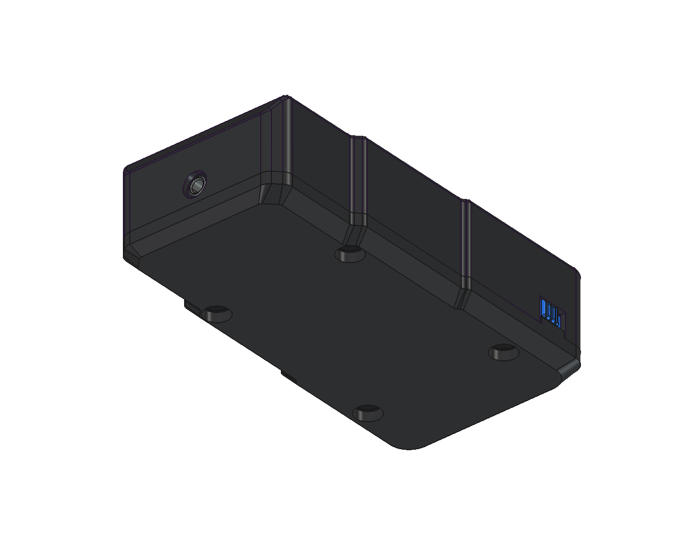
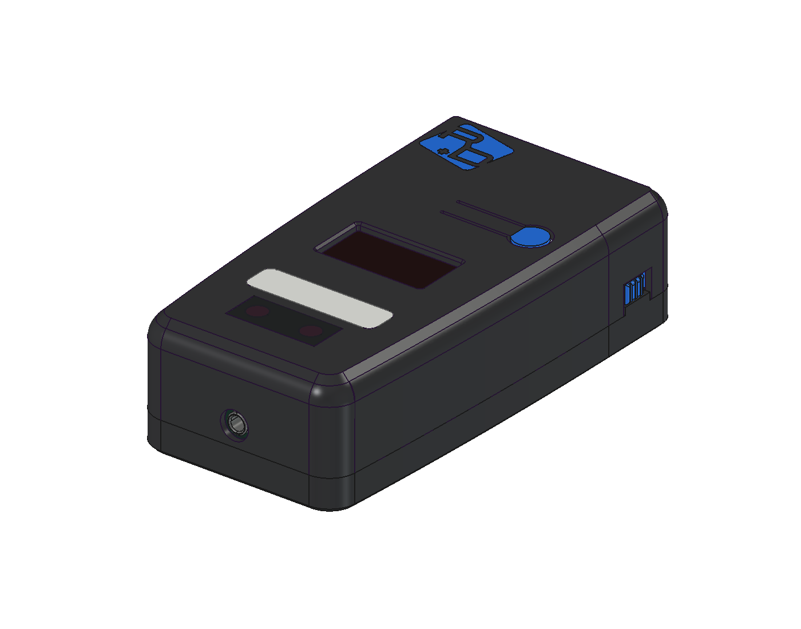

# Enclosed case

The DTT in a closed printed case with the original housing's stepped outline
(50 / 48 / 44 mm wide). The PCB drops into a pocket in the housing and the
rear cover caps it, held by the original four PCB screws. The rear cover takes
two suction cups, and a blue switch cover slides on S1.

| | |
| --- | --- |
|  |  |


CAD: [Deep Throat Trainer on Onshape](https://cad.onshape.com/documents/978fb540998b53d0bad39e52/w/1cab0485bce1680c37cb2d1f/e/3f6288e68cfc7e8a43ba48ec),
kept in sync with the files here.

## Variants

| Smooth rear cover | Slanted case |
| --- | --- |
|  |  |

- **Smooth rear cover** (`parts/Rear-Cover-Smooth-Black.step`): its back lofts
  3 mm in to the PCB's outline, so the original loop Velcro and backboards fit.
- **Slanted case** ([`slanted/`](slanted/)): the sides curve in from 50 mm at
  USB-C to 44 mm at the jack. Same inside, same rear cover.

## Print

Open [`3mf/DTT-Enclosed.3mf`](3mf/DTT-Enclosed.3mf) in Bambu Studio. Plate 1 is
the stepped case with both rear covers (print the one you want), plate 2 the
slanted case. Filament 1 is blue, 2 white (the diffuser), 3 black. Use 0.30 mm
layers on a 0.30 mm first layer: the screen clips are set for it.

## Assemble

You need the four original PCB screws (0408LTFB) and two suction cups with a
Ø15 × 3 mm head on a Ø8.5 × 2.5 mm neck.

1. Housing upside down: push the OLED in, glass first, header toward the jack,
   until both clips click.
2. Press the distance sensor into its window, connector toward the screen,
   until its three snaps click.
3. Slide the battery through its two rings, leads toward the screen, up to
   the stop.
4. With S1's lever at its jack end, push the switch cover onto it, grip
   outwards.
5. Plug in the battery and harness. Put the PCB in jack end first, tilted,
   then lower the USB-C end. The switch cover goes into its channel with it.
6. Press the rear cover on and snug the four screws into the original bosses.
7. Push each suction cup's head into its round hole and slide it along the
   slot until it clicks.

Size: 50.0 × 95.2 × 26.3 mm (25.3 with the smooth rear cover).

## Files

`DTT-Enclosed.step` is the assembly and `parts/` holds each printed part;
`slanted/` has the same for the slanted case. `tools/` rebuilds them from
`../DTT.FCStd` in FreeCAD:

```sh
cd tools
xvfb-run -a freecad make_assembly.FCMacro                   # stepped
DTT_CASE=slanted xvfb-run -a freecad make_assembly.FCMacro  # slanted
python3 make_3mf.py                                         # 3mf/DTT-Enclosed.3mf
```
