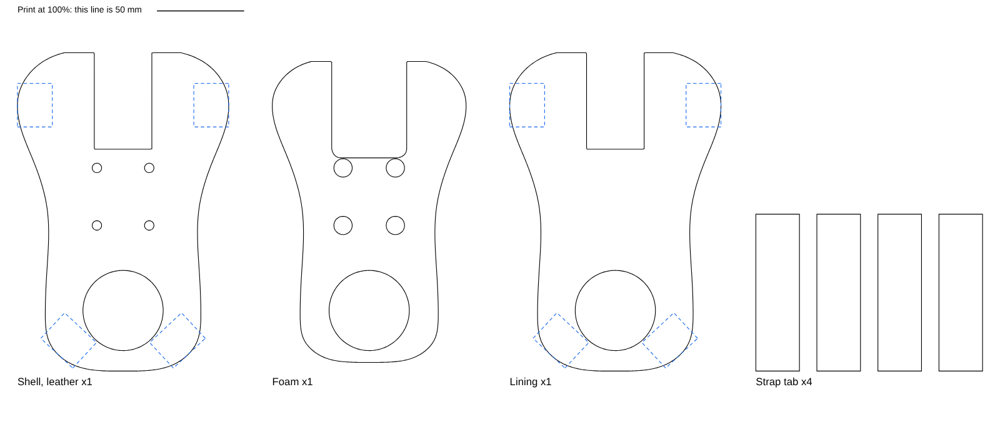

# Building the harness

The printed core sits on a sewn leather panel. Four D-ring tabs hold
adjustable 1 in (25 mm) straps.

## Cut list

Use the `-Pattern.svg` (print it at 100% and check the 50 mm line) or the
`-Pattern.dxf` for a laser cutter. Both are in
[production-exports](../../production-exports/cad/harness-mount/).

| Piece | Material | Qty | Size |
| --- | --- | --- | --- |
| Shell | 1.5 to 2 mm leather | 1 | pattern |
| Foam | 3 mm closed-cell foam (EVA or neoprene) | 1 | pattern |
| Lining | 1 mm garment leather, suede or neoprene | 1 | pattern |
| Strap tab | leather or webbing, 25 mm wide | 4 | 25 x 90 mm |
| Waist strap | 1 in nylon webbing | 2 | 450 mm |
| Leg strap | 1 in firm elastic | 2 | 560 mm |

The strap lengths fit the reference body. For a different size, add or take
off half the difference in hip measurement on each waist strap.

## Hardware

| Part | Qty |
| --- | --- |
| 1 in D-ring | 6 |
| 1 in tri-glide slide | 4 |
| 1 in side-release buckle | 1 |
| 1 in swivel snap hook | 2 |
| 5 mm Chicago screw, 8 to 10 mm | 4 |
| Printed core and ring | 1 |

## Assembly

1. **Tabs:** fold each tab round a D-ring and stitch across close to the ring.
2. **Shell:** punch the four 5 mm screw holes and the ring hole. Glue the foam
   to the back of the shell, with its pockets over the screw holes.
3. **Panel:** lay the shell face down and put the tabs on the dashed marks,
   rings outward. Lay the lining on top. Stitch 4 mm in from the edge, from
   the top of one hip ear round the bottom to the other, through the tab ends.
   Leave the top edge open as a pocket, and close it with two snaps. Burnish
   the edges.
4. **Core:** drop the ring into the socket from the back. Set the core on the
   front of the panel with the Chicago screw posts through the core and the
   shell. Do up the screws from inside the pocket, where the lining covers
   them.
5. **Waist straps:** thread both loose D-rings onto one strap. Sew the buckle
   halves on with 30 mm loops. Thread the other end of each strap through a
   slide, round its hip D-ring and back through the slide. Heat-seal the cut
   ends.
6. **Leg straps:** loop one end through a bottom D-ring and sew it 30 mm back.
   Thread the other end through a slide, the snap hook's eye and back through
   the slide.

## Wear

Buckle the waist at the back with the loose D-rings either side of the
buckle. Bring each leg strap down the leg crease and under the cheek, clip it
to its D-ring, then tighten the slides.
