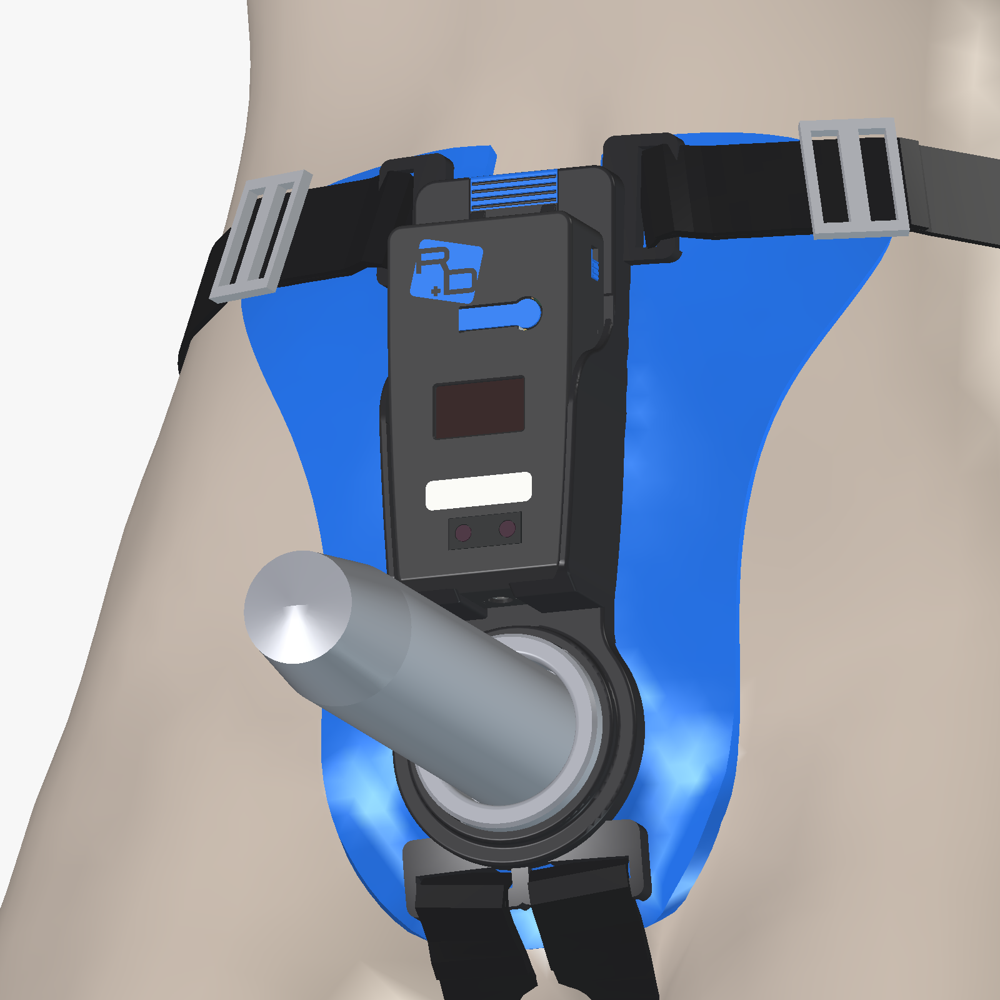

# Building the harness

The printed core sits on a sewn leather panel. Four slots printed on the core
hold adjustable 1 in (25 mm) straps, so the straps start over the foam and no
hardware touches the skin.

## Cut list

Use the `-Pattern.svg` (print it at 100% and check the 50 mm line) or the
`-Pattern.dxf` for a laser cutter. Both are in
[production-exports](../../production-exports/cad/harness-mount/).

| Piece | Material | Qty | Size |
| --- | --- | --- | --- |
| Shell | 1.5 to 2 mm leather | 1 | pattern |
| Foam | 3 mm closed-cell foam (EVA or neoprene) | 1 | pattern |
| Lining | 1 mm garment leather, suede or neoprene | 1 | pattern |
| Waist strap | 1 in nylon webbing | 2 | 490 mm |
| Leg strap | 1 in firm elastic | 2 | 710 mm |

The slot positions and strap lengths come from a cloth sim of the panel and
straps on the reference body ([cloth_sim.py](cloth_sim.py)). For a different
size, add or take off half the difference in hip measurement on each waist strap.

## Hardware

| Part | Qty |
| --- | --- |
| 1 in tri-glide slide | 4 |
| 1 in side-release buckle | 1 |
| 5 mm Chicago screw, 8 to 10 mm | 4 |
| Printed core and ring | 1 |

## Assembly

1. **Shell:** punch the four 5 mm screw holes and the ring hole. Glue the foam
   to the back of the shell, with its pockets over the screw holes.
2. **Panel:** lay the lining on the back of the shell and stitch 4 mm in from
   the edge, from one hip corner round the point to the other. Leave the top
   edge open as a pocket, and close it with two snaps. Burnish the edges.
3. **Core:** drop the ring into the socket from the back. Set the core on the
   front of the panel inside the dashed outline, with the Chicago screw posts
   through the core and the shell. Do up the screws from inside the pocket.
4. **Waist straps:** sew a buckle half to one end of each strap with a 30 mm
   loop. Thread a slide onto the other end, then take the end under the hip
   slot's bar, up through the slot and back through the slide. Heat-seal the
   cut ends.
5. **Leg straps:** take one end under a bottom slot's bar, up through the slot
   and sew it 30 mm back on itself. Thread the other end through a slide,
   round the waist strap 120 mm from the buckle and back through the slide.
   Bar-tack the loop to the waist strap so it can't slide in toward the
   buckle; there it would pull the strap into a thong.

## Wear

Buckle the waist at the back. Bring each leg strap down the leg crease and
under the cheek, loop it over the waist strap, then tighten the slides.
