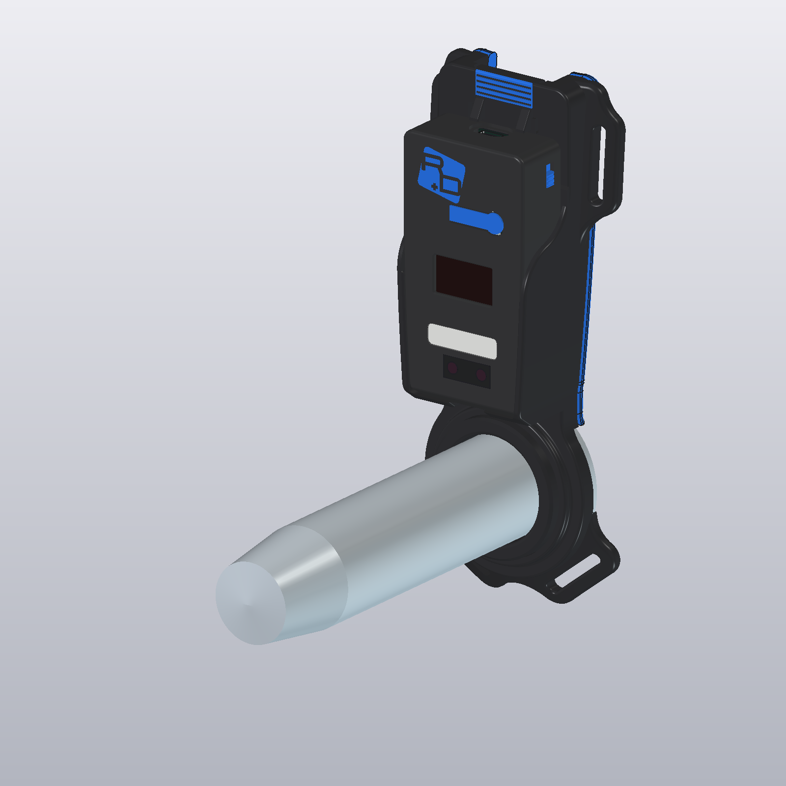
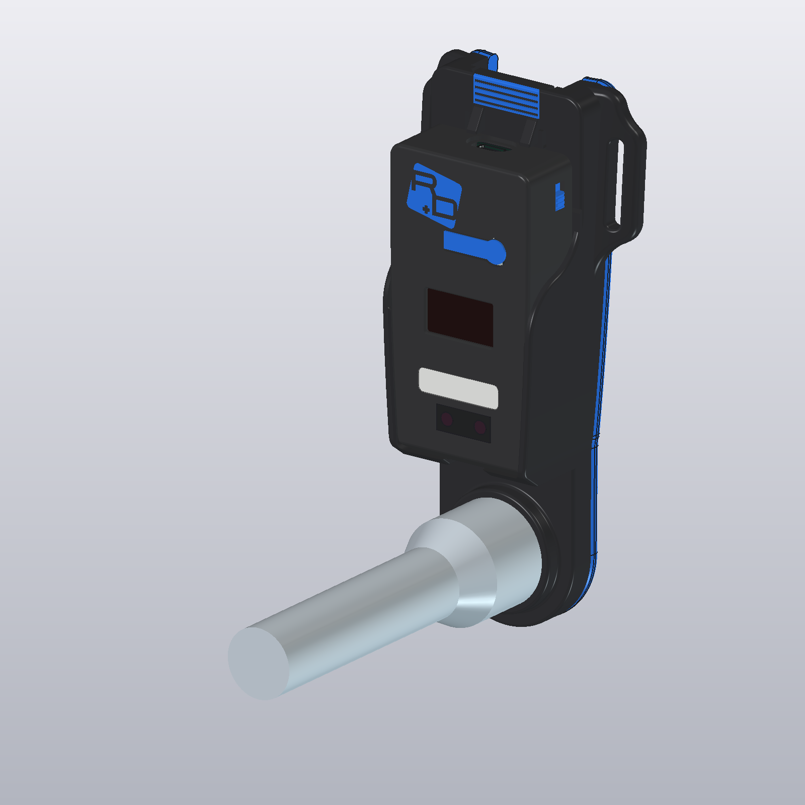
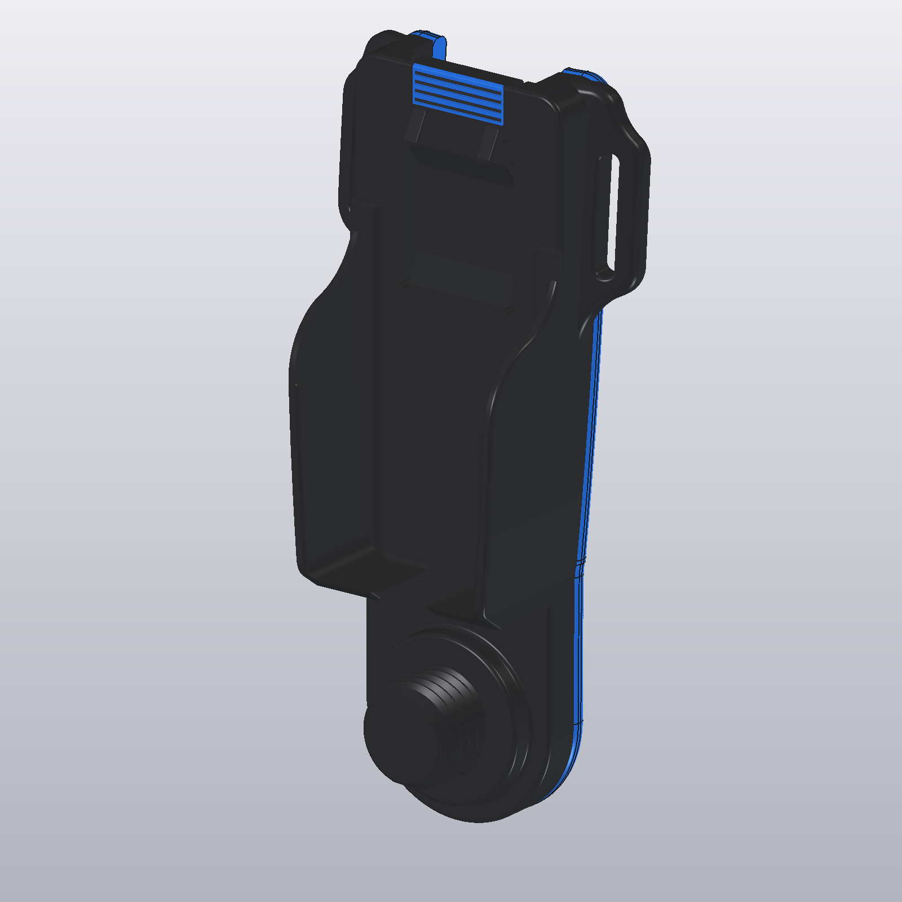

# DTT strap-on harness mount (concept)

The [snap backplate](../snap-backplate/) as a strap-on plate: the
[enclosed case](../enclosed-case/) clicks in USB-C end up, and the toy sits
right under its jack end, in front of the distance sensor. Two toy interfaces.

| O-ring | 24 mm thread |
| --- | --- |
|  |  |
|  |  |
|  |  |
|  |  |

The plate stays flat only under the DTT and round the toy. Everywhere else its
rear curves to sit over the pubic mound: the waist wings sweep about 11 mm
back round the hips, the top 7 mm up the belly, and the leg tabs about 13 mm
back between the legs. A 5 mm TPU pad follows the curve under the middle of
the plate, clear of the strap slots so the webbing can't peel it.

## Use

- **O-ring:** for flared-base dildos, the usual strap-on fit. Drop the ring
  into the socket from the body side, then push the toy through it from
  behind. Rings for 1.25, 1.5 and 1.75 in toys fit the same socket.
- **24 mm thread:** for the OSSM Double Double and other 24 mm threaded
  mounts. Push the printed screw into the hex pocket from the body side and
  thread the toy on from the front.
- **Straps:** 1 in (25 mm) webbing. The side slots take the waist strap, the
  bottom slots take two jock-style leg straps.
- **Pad:** push the four pins into the plate rear, then press the pad on.
- **DTT:** slides in and releases as on the snap backplate. Use a right-angle
  3.5 mm plug with the O-ring version.

## Print

- **Plate:** rear face down on tree supports, at least 4 walls, PETG. For two
  colours, load the `-Black` and `-Blue` STLs as one object.
- **Pad and pins:** TPU 95A (an external spool, not the AMS), 2 walls, 15%
  gyroid for a soft feel, pad on tree supports.
- Rings flange down, the screw on its flat. Files are in
[production-exports/cad/harness-mount](../../production-exports/cad/harness-mount/).

## Source

`build_harness_mount.py` reuses the snap backplate builder and adds the plate
outline, slots and toy interfaces. Dimensions are in `PARAMS` there and in the
snap builder. Run from the repository root:
`freecad hardware/cad/harness-mount/build_harness_mount.py`.

## Check on a test print

- Ring fit in the socket (`SocketClear`) and toy hold for your toy's base.
- Strap slots for your webbing (`SlotLen`, `SlotT`).
- The body curve (`PadRX`, `PadRUp`, `PadRDown`) is an estimate: try it on.
- Pin fit in the plate and the pad (`PegHoleD`).
