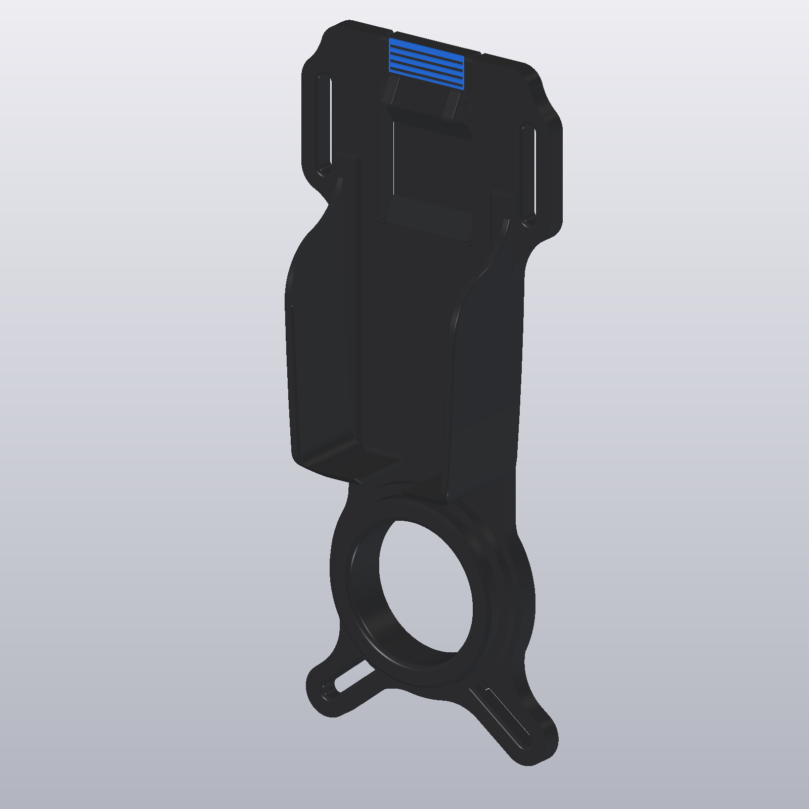
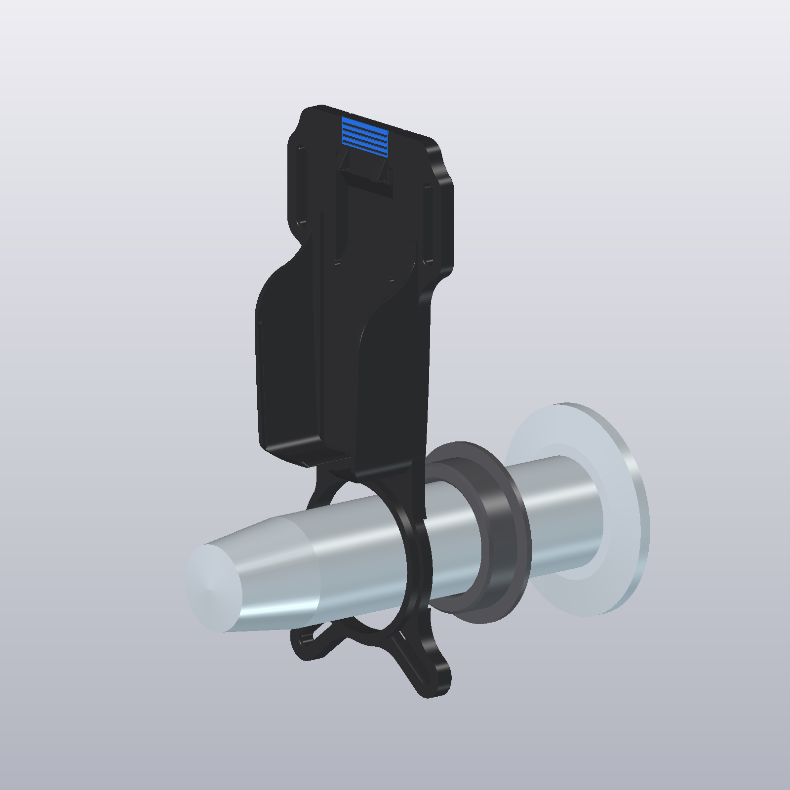
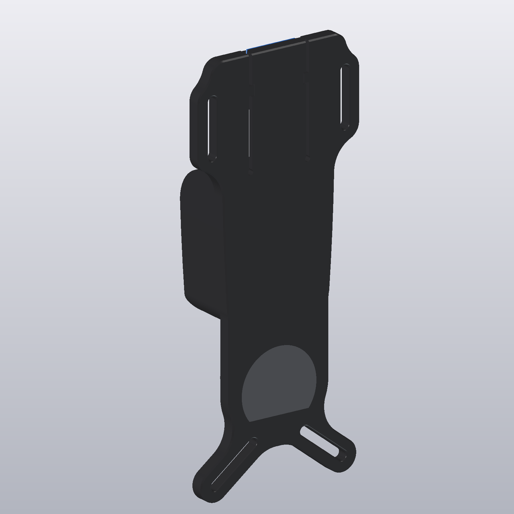

# DTT strap-on harness mount (concept)

The [snap backplate](../snap-backplate/) as a strap-on plate: the
[enclosed case](../enclosed-case/) clicks in USB-C end up, and the toy sits
right under its jack end, in front of the distance sensor. Two toy interfaces.

| O-ring | 24 mm thread |
| --- | --- |
|  |  |
|  |  |
|  |  |

## Use

- **O-ring:** for flared-base dildos, the usual strap-on fit. Drop the ring
  into the socket from the body side, then push the toy through it from
  behind. Rings for 1.25, 1.5 and 1.75 in toys fit the same socket.
- **24 mm thread:** for the OSSM Double Double and other 24 mm threaded
  mounts. Push the printed screw into the hex pocket from the body side and
  thread the toy on from the front.
- **Straps:** 1 in (25 mm) webbing. The side slots take the waist strap, the
  bottom slots take two jock-style leg straps.
- **DTT:** slides in and releases as on the snap backplate. Use a right-angle
  3.5 mm plug with the O-ring version.

## Print

Plate rear face down, no supports, at least 4 walls, PETG. For two colours,
load the `-Black` and `-Blue` STLs as one object. Rings flange down, the screw
on its flat. Files are in
[production-exports/cad/harness-mount](../../production-exports/cad/harness-mount/).

## Source

`build_harness_mount.py` reuses the snap backplate builder and adds the plate
outline, slots and toy interfaces. Dimensions are in `PARAMS` there and in the
snap builder. Run from the repository root:
`freecad hardware/cad/harness-mount/build_harness_mount.py`.

## Check on a test print

- Ring fit in the socket (`SocketClear`) and toy hold for your toy's base.
- Strap slots for your webbing (`SlotLen`, `SlotT`).
- Comfort of the plate rear on the body; a foam pad may help.
