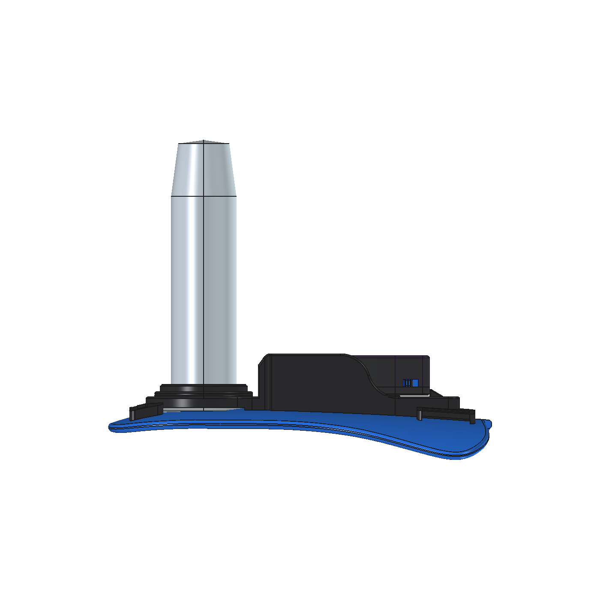
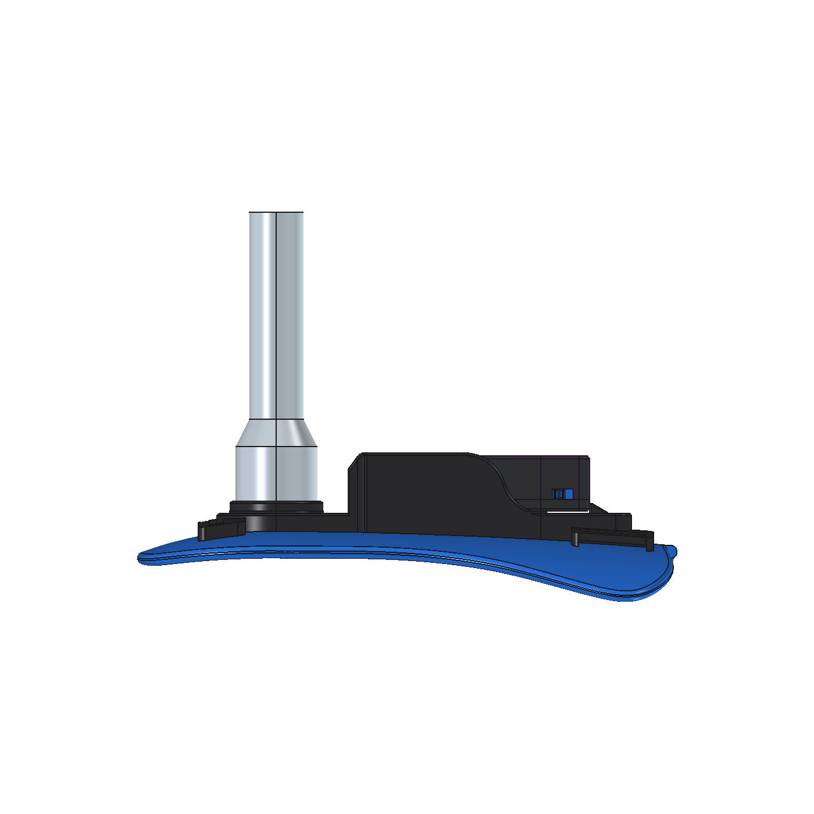
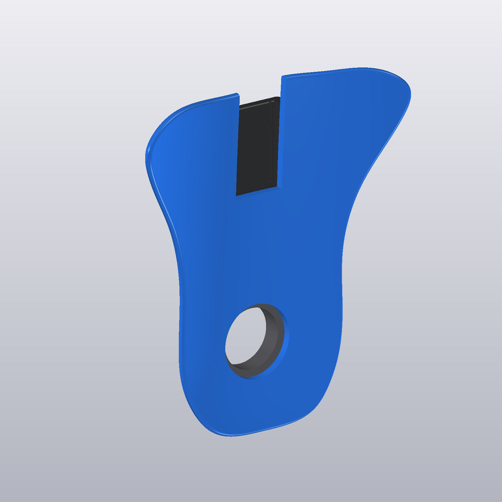
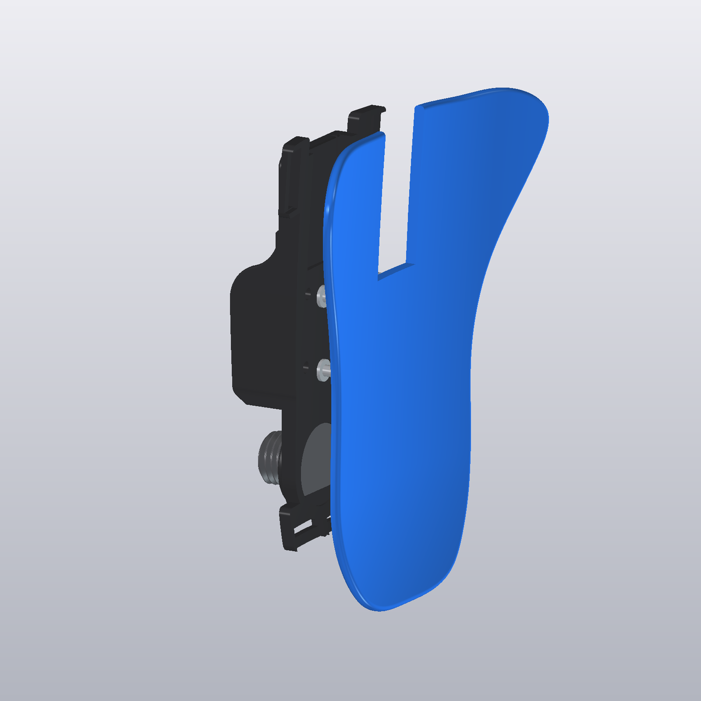
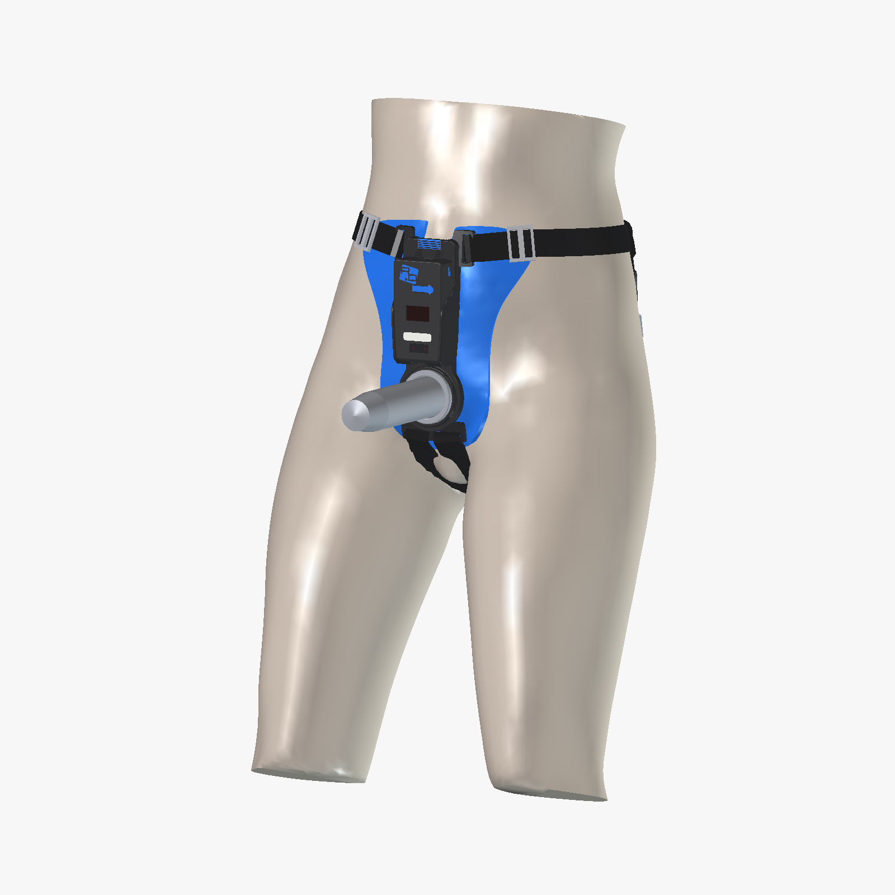
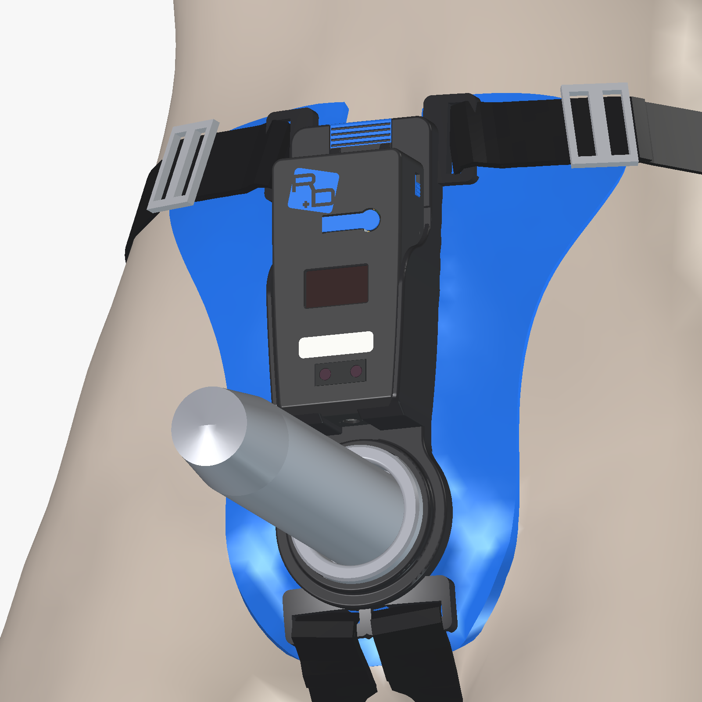
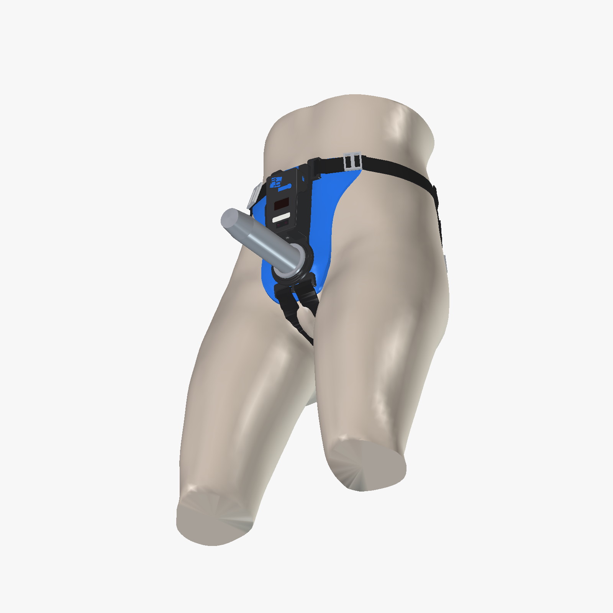
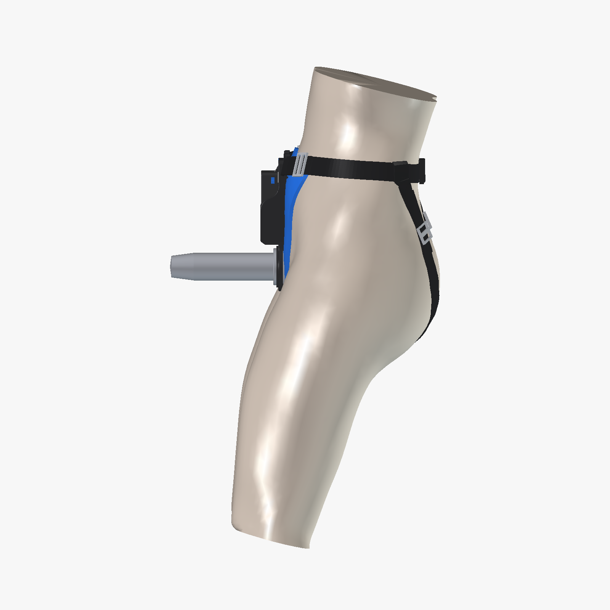
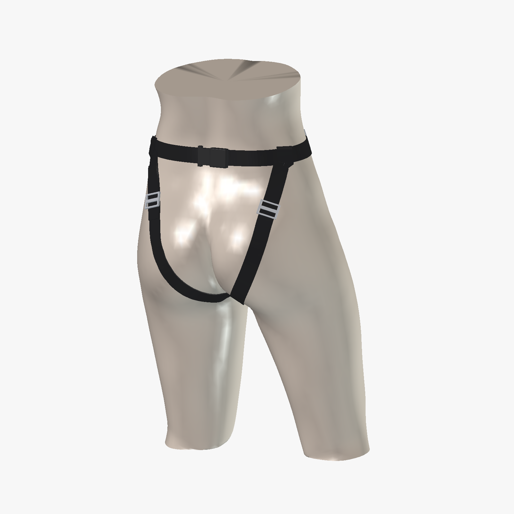

# DTT strap-on harness mount (concept)

The [snap backplate](../snap-backplate/) as a strap-on plate: the
[enclosed case](../enclosed-case/) clicks in USB-C end up, and the toy sits
right under its jack end, in front of the distance sensor. Two toy interfaces.

| O-ring | 24 mm thread |
| --- | --- |
|  |  |
|  |  |
|  |  |
|  |  |

Like the comfortable soft harnesses (Joque, RodeoH, Aslan Jaguar), the only
hard part is small: a printed core that is just the cradle and the toy ring.
It sits on a padded leather panel curved to the pubic mound. The straps
thread through slots printed on the core, so the foam is between every
buckle and the skin.

Worn, on MakeHuman's CC0 average female body. `cloth_sim.py` drapes the
panel and pulls the straps taut on it, which is where the strap slots come
from; `render_on_body.py` draws the result. Worn this way the toy points
about 14° down.

| Front | Close | Low | Side | Back |
| --- | --- | --- | --- | --- |
|  |  |  |  |  |

## Use

- **O-ring:** for flared-base dildos, the usual strap-on fit. Drop the ring
  into the socket from the body side, then push the toy through it from
  behind. Rings for 1.25, 1.5 and 1.75 in toys fit the same socket.
- **24 mm thread:** for the OSSM Double Double and other 24 mm threaded
  mounts. Push the printed screw into the hex pocket from the body side and
  thread the toy on from the front.
- **Panel and straps:** a plain sewn leather panel, 1 in straps through four
  slots on the core (waist at the sides, legs under the ring), slides to
  adjust and a side-release buckle at the back. See [BUILD.md](BUILD.md) for
  the cut list, pattern, hardware and assembly.
- **DTT:** slides in and releases as on the snap backplate. Use a right-angle
  3.5 mm plug with the O-ring version.

## Print

- **Core:** rear face down on tree supports, at least 4 walls, PETG. For two
  colours, load the `-Black` and `-Blue` STLs as one object.
- Rings flange down, the screw on its flat. Files are in
[production-exports/cad/harness-mount](../../production-exports/cad/harness-mount/).

## Source

`build_harness_mount.py` reuses the snap backplate builder and adds the plate
core, panel and toy interfaces. `render_on_body.py` renders it worn. Dimensions are in `PARAMS` there and in the
snap builder. Run from the repository root:
`freecad hardware/cad/harness-mount/build_harness_mount.py`.

## Check on a test print

- Ring fit in the socket (`SocketClear`) and toy hold for your toy's base.
- The body curve (`PadRX`, `PadRUp`, `PadRDown`) is an estimate: try it on.
- Chicago screw length for the core plus your leather (`ScrewHoleD`).
