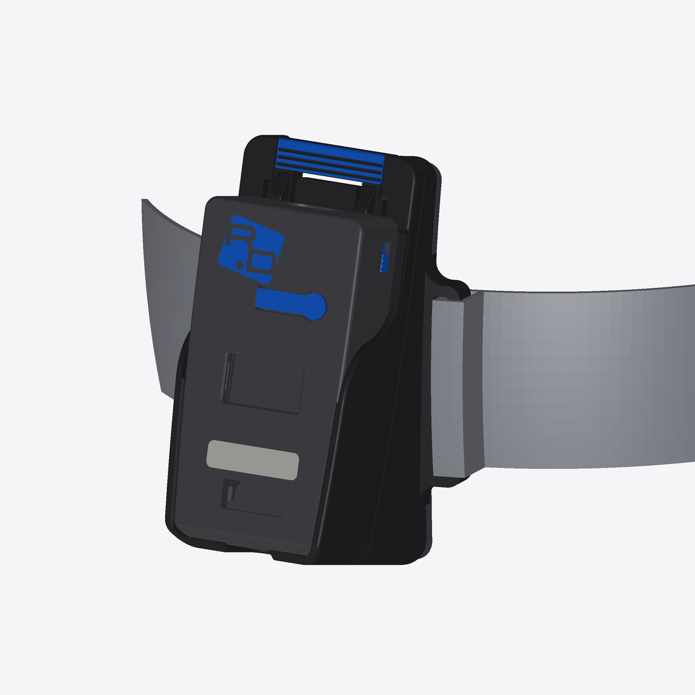
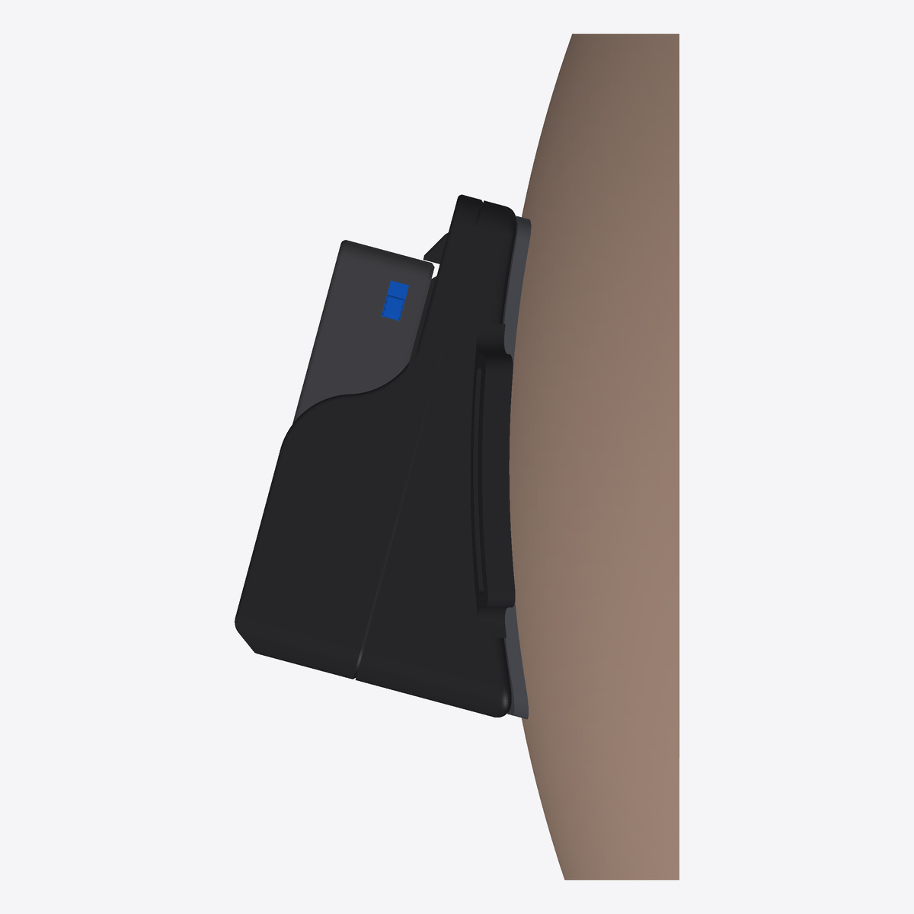
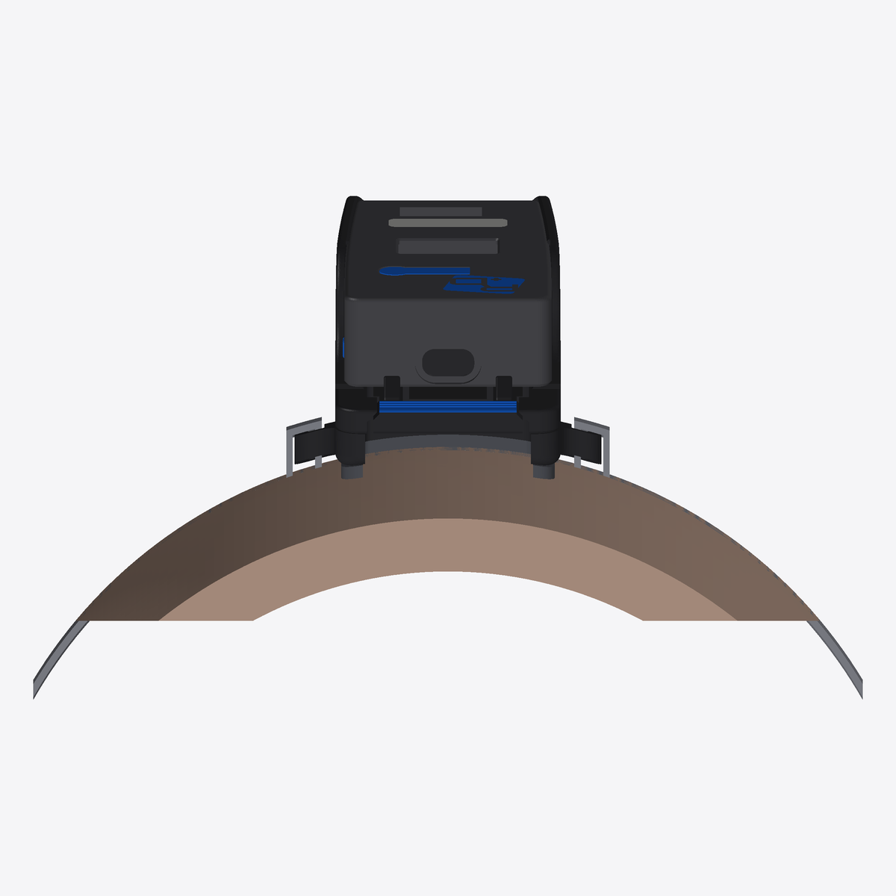

# DTT jock mount (concept)

The snap backplate's cradle, worn on a jockstrap waistband. The case sits on the
pubic mound with the jack end down, so the distance sensor looks straight out
over the base of the penis and measures the partner's head moving up and down.
The cradle leans out 15° at the bottom on a wedge, so the beam points up
over an erect shaft. The back is curved to sit on the pubic mound: 120 mm
across the hips and 300 mm from the penis base up. It can be used to measure fellatio, or the
wearer's own hand.

| Mount | Body side | From the side | From the waist |
| --- | --- | --- | --- |
|  |  |  |  |

## Use

- **Band:** thread the waistband (up to 50 mm wide) over each outer bar and down
  through its slot, so the band runs behind the plate.
- **Fit and release:** as on the backplate. Slide the case in jack end first
  until the lever clicks, then press the blue tab to slide it out. The back pad
  is notched round the lever, so the tab can still be pressed while it's worn.

## Print

- **Mount:** rear face down, with tree supports under the curved back, at least
  4 walls. For two colours, load the `-Black` and `-Blue` STLs as one object.
- **Pad:** cut 3 mm adhesive-backed EVA or neoprene foam with the `-Pad.dxf`
  template, or print `-Pad.stl` flat in TPU 95A. It's optional. It only covers
  the back of the plate, not the band ears, so it can't peel where the band
  wraps.

The files are in
[production-exports/cad/jock-mount](../../production-exports/cad/jock-mount/).

## Source

`build_jock_mount.py` reuses `../snap-backplate/build_snap_backplate.py` and
`../enclosed-case/DTT-Enclosed.FCStd` without changing them. Every dimension is
in `PARAMS`. Run `freecadcmd hardware/cad/jock-mount/build_jock_mount.py` from
the repository root, then `python3 hardware/cad/jock-mount/render_jock_mount.py`
for the images.

## Check on a test print and a wearer

- Body curve (`BodyR`, `BodyRLong` and `BodyApexY` are all assumed).
- Band slot fit on a real jockstrap (`BandW`, `SlotT`).
- Whether the 15° tilt keeps the shaft out of the beam (`Tilt`). Less tilt
  makes the wedge thinner.
- Comfort with and without the pad (`PadT`).
