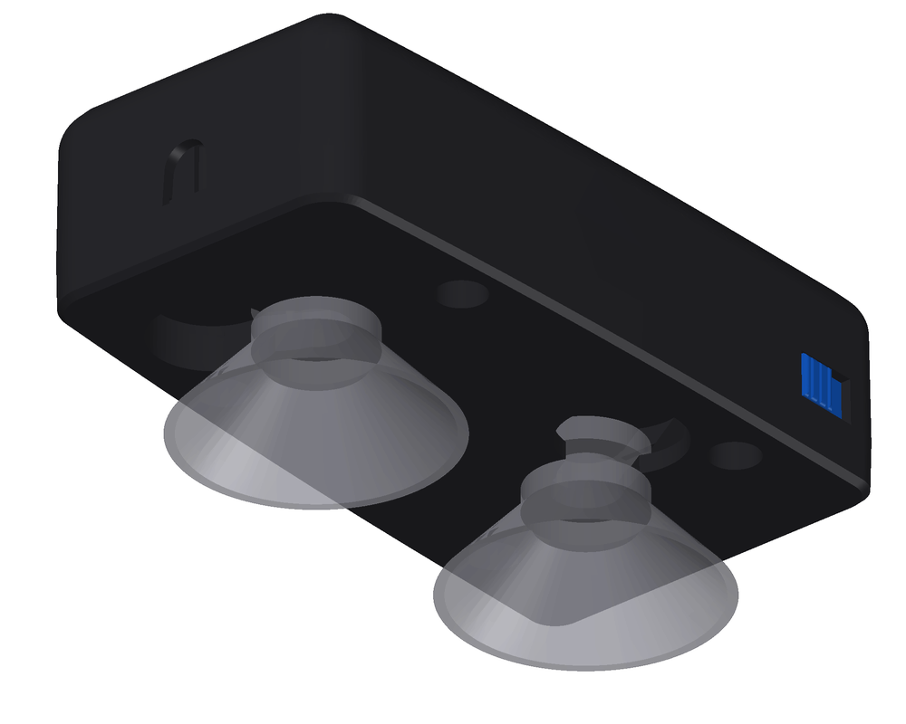
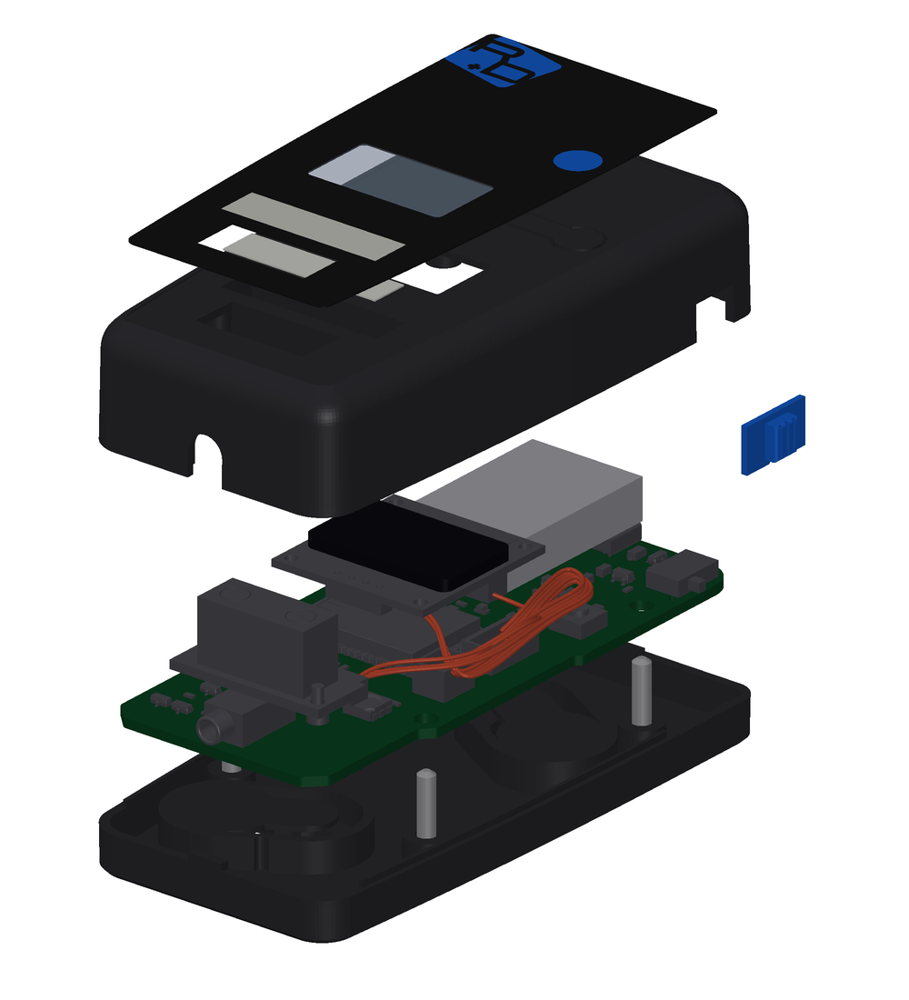
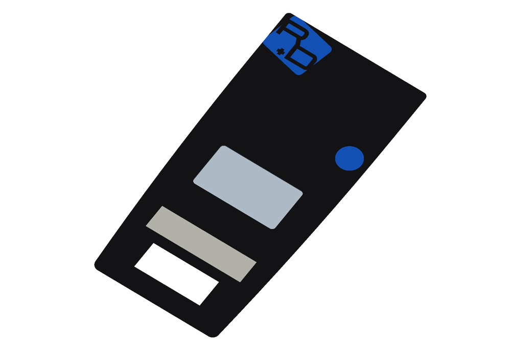
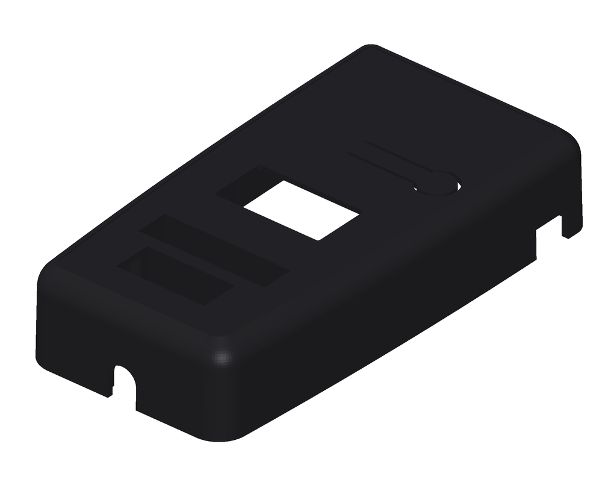
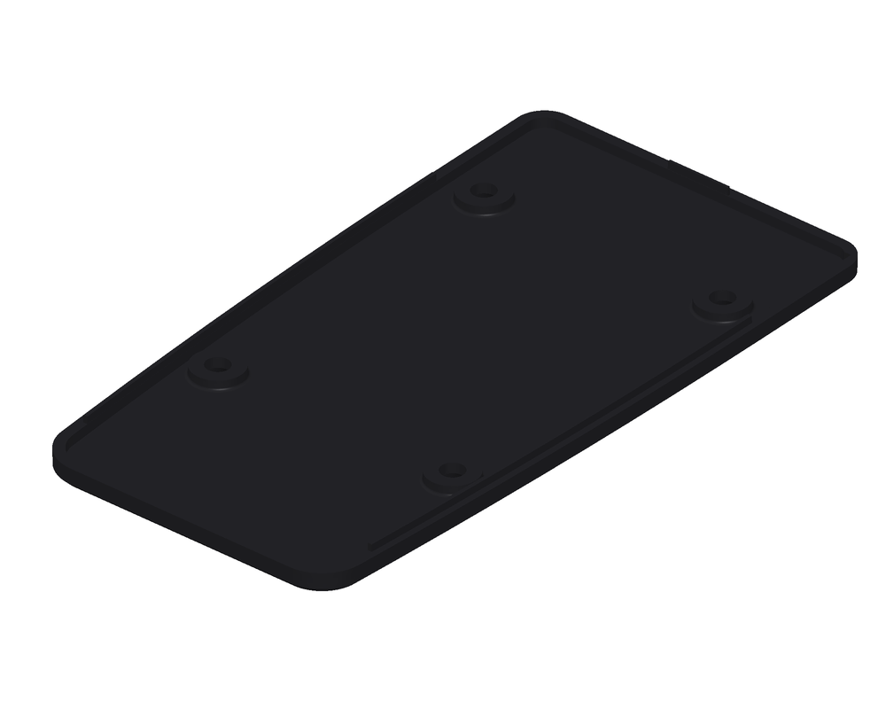

# Molded case (first pass)

The [enclosed case](../enclosed-case/) redrawn for injection moulding: same
outside, PCB, screws and suction cups, but a uniform 1.6 mm wall, 1° draft,
and no slides. The PCB is unchanged.

| | |
| --- | --- |
|  |  |
|  |  |
|  |  |
|  |  |

Undercuts (red), before and after:

 

## What changed for moulding

| Printed (PR #13) | Moulded |
| --- | --- |
| Printed body filled out from the original housing | One 1.6 mm shell, 1° draft in and out |
| OLED snap strips | 4 heat-staked posts through the OLED's holes |
| Battery snap clips | Locating ribs and double-sided tape on lands |
| Ribs standing up from the seam | Ribs hang from the plate, full height |
| Round jack hole, closed USB-C opening | U notches open to the parting line; tabs on the cap fill them |
| Cup chamber roofs (undercut) | Lands formed through windows in the roof; the roof still covers each keyhole |
| Tongue and groove | Lip joint on the long sides |
| Solid 3 mm / 7 mm cap | 1.6 mm tray with bosses |
| Button tray | Gone; S2 stops the pad, post now 0.3 mm over it |
| Blue inlays, white diffuser part | One printed top overlay |

## Top overlay

The whole flat top is one printed film from a label converter, in a 0.3 mm
recess so its edge can't catch. It carries the colour, so the housing is a
plain one-shot black moulding (no two-shot, no diffuser part).

- 0.18-0.25 mm hard-coated PET (or PC), matte, gloss over the screen.
  PET stands up to lube and alcohol wipes better.
- Printed on the back: two coats of black, the product blue (logo, button
  pad), a clear screen window and a white window over the LEDs.
- Under the white window, a die-cut opal diffuser film (e.g. Makrofol DE,
  Lexan 8B35) is laminated in. It drops into the light window, so the three
  LEDs read as one bar.
- Die cuts: the outline and a hole over the distance sensor (a film over it
  would ruin the reading).
- Solid over the button, so nothing has to line up and the slot is sealed.
  The film is bonded to the pad and bar, with no adhesive in a band 1 mm past
  each side of the U slot, so it bends there. The pad moves about 0.5 mm.
- 3M 467/468 adhesive, none under the windows or over the button slot.
- `parts/Overlay.dxf` has one layer per cut, print colour, diffuser patch
  and no-adhesive area.

The switch cover stays a moulded blue part. Match it to the printed blue
against one colour standard.

## Tool notes

- Housing and caps open along Z, parting line at the seam (PCB back).
  Switch cover opens along X.
- Gate: sub gate inside the USB-C end wall (housing), centre of the floor
  inside (caps). Ejectors on the bosses, rib ends and the rim.
- Shrink 0.5-0.7 % (PC/ABS); sizes here are the moulded part.

## Hardware

| Qty | Part |
| --- | --- |
| 4 | 0408LTFB #4 thread-forming screws (as PR #13) |
| 2 | Sensor screws, assumed M2 thread-forming |
| 2 | Double-sided tape strips, 0.15 mm, battery |
| 1 | Top overlay with diffuser patch (`parts/Overlay.dxf`) |

## Assemble

1. OLED onto its posts, heat-stake the 4 posts.
2. Sensor: two screws into its bosses.
3. Battery onto its lands with tape.
4. Switch cover in its channel; plug in the battery and harness.
5. PCB straight down (the jack and USB-C notches are open below).
6. Cap, then the 4 screws.
7. Peel and stick the overlay into its recess.

## Source

`build_molded_case.py` (FreeCAD 1.1, `freecadcmd build_molded_case.py`)
imports the enclosed case's builder for the outline and positions; sizes are
in `PARAMS`. `dfm_check.py` / `dfm_maps.py` give the draft and undercut
maps; `overlay_dxf.py` writes the overlay drawing; `render_molded.py` makes the renders. `DTT-Molded.FCStd` (from
`xvfb-run -a freecad make_assembly.FCMacro`) and `DTT-Molded.step` are the
assembly with the cup cap; the plain cap is hidden in the FCStd.

## Still open

- Draft on cut openings (viewport, windows, PCB pocket) and the switch cover.
- Boss and pilot sizes from the screw maker; OLED hole size for the stakes.
- Light bleed from the LEDs into the sensor (the chimney stops at z 4).
- Overlay proofs: 2-3 diffuser densities over the real LEDs; press feel over the
  button (film thickness, no-adhesive band width); adhesion on the recess floor (polish it, SPI B-1).
- Distance sensor: the CAD models the Sharp IR sensor, the docs say
  ultrasonic. The die-cut hole suits either.
- A moulder's review: gate, cooling, and a mould-flow run.

The checks are geometric only. Fit, stake strength and thread hold need parts.
