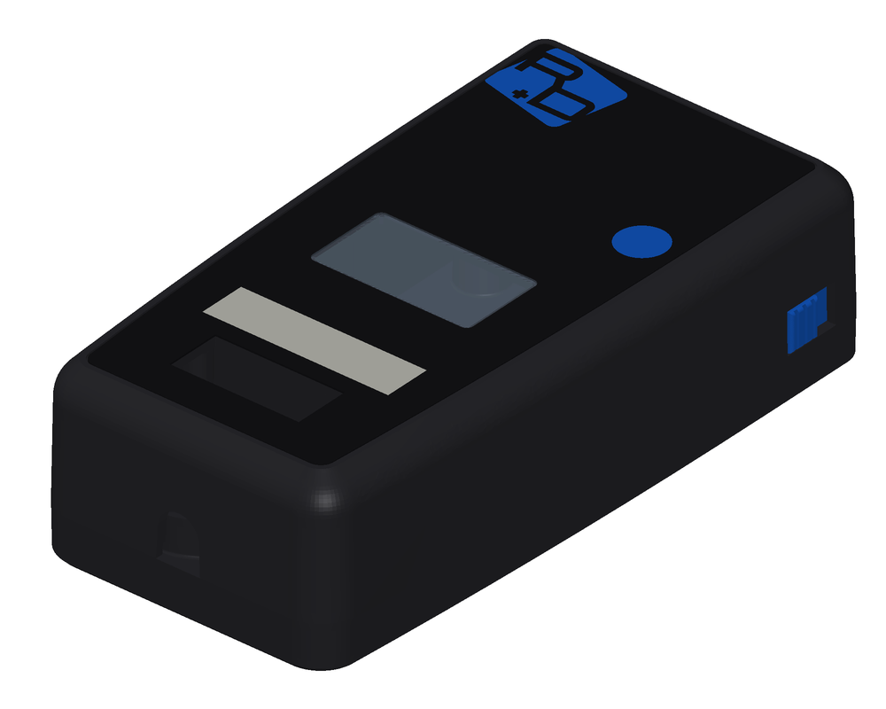
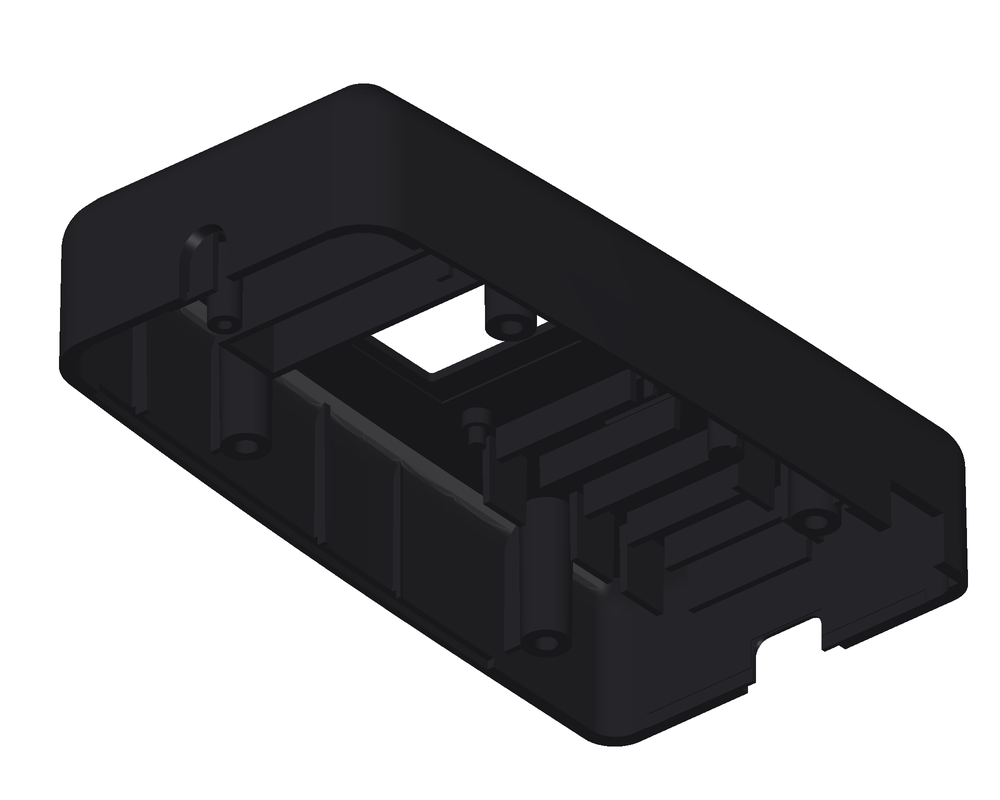
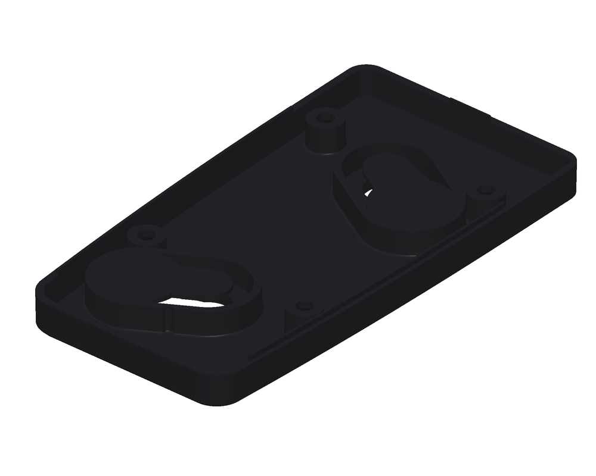
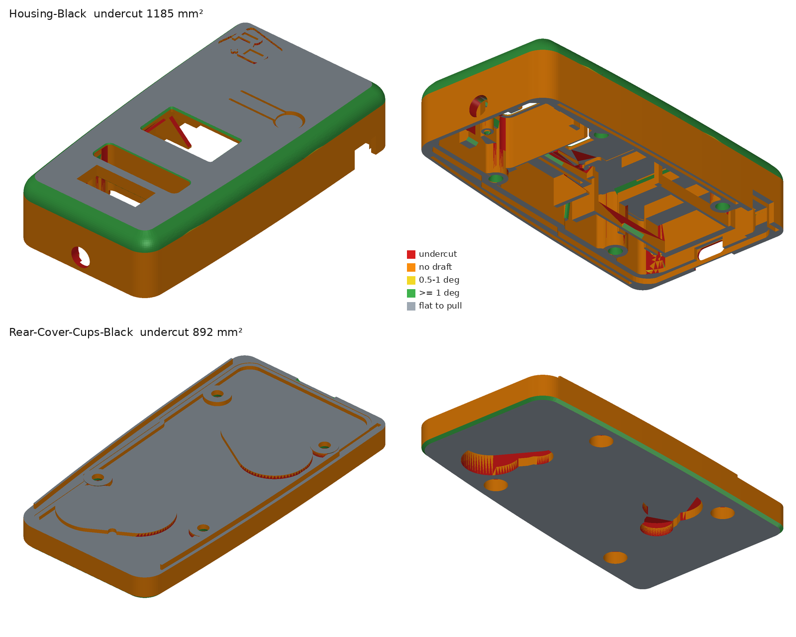
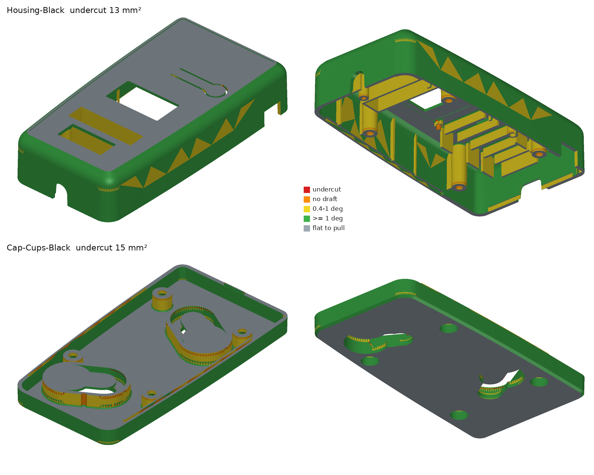

# Molded case (first pass)

The [enclosed case](../enclosed-case/) redrawn for injection moulding: same
outside, PCB, screws and suction cups, but a uniform 1.6 mm wall, 1° draft,
and no slides. The PCB is unchanged.

| | |
| --- | --- |
|  |  |
|  |  |
|  |  |

Undercuts (red), before and after:

 

## What changed for moulding

| Printed (PR #13) | Moulded |
| --- | --- |
| Printed body filled out from the original housing | One 1.6 mm shell, 1° draft in and out |
| OLED snap strips | 4 heat-staked posts through the OLED's holes |
| Battery snap clips | Locating ribs and double-sided tape on lands |
| Ribs standing up from the seam | Ribs hang from the plate, full height |
| Round jack hole, closed USB-C opening | U notches open to the parting line; tabs on the cap fill them |
| Cup chamber roofs (undercut) | Lands formed through windows in the roof; the roof still covers each keyhole |
| Tongue and groove | Lip joint on the long sides |
| Solid 3 mm / 7 mm cap | 1.6 mm tray with bosses |
| Button tray | Gone; S2 stops the pad, post now 0.3 mm over it |

## Colour

- Housing: black PC/ABS, two-shot with a blue second shot for the logo and
  button pad (0.8 mm deep). For a few hundred units, pad-printing the logo
  on a one-shot black housing is cheaper; the pad then needs a separate blue cap.
- Switch cover: separate blue part (PC/ABS or POM).
- Diffuser: separate white/translucent part, pushed in from inside onto its ledge and glued.

## Tool notes

- Housing and caps open along Z, parting line at the seam (PCB back).
  Switch cover opens along X.
- Gate: sub gate inside the USB-C end wall (housing), centre of the floor
  inside (caps). Ejectors on the bosses, rib ends and the rim.
- Shrink 0.5-0.7 % (PC/ABS); sizes here are the moulded part.

## Hardware

| Qty | Part |
| --- | --- |
| 4 | 0408LTFB #4 thread-forming screws (as PR #13) |
| 2 | Sensor screws, assumed M2 thread-forming |
| 2 | Double-sided tape strips, 0.15 mm, battery |
| - | Glue for the diffuser |

## Assemble

1. Diffuser in from inside. OLED onto its posts, heat-stake the 4 posts.
2. Sensor: two screws into its bosses.
3. Battery onto its lands with tape.
4. Switch cover in its channel; plug in the battery and harness.
5. PCB straight down (the jack and USB-C notches are open below).
6. Cap, then the 4 screws.

## Source

`build_molded_case.py` (FreeCAD 1.1, `freecadcmd build_molded_case.py`)
imports the enclosed case's builder for the outline and positions; sizes are
in `PARAMS`. `dfm_check.py` / `dfm_maps.py` give the draft and undercut
maps; `render_molded.py` makes the renders. `DTT-Molded.FCStd` (from
`xvfb-run -a freecad make_assembly.FCMacro`) and `DTT-Molded.step` are the
assembly with the cup cap; the plain cap is hidden in the FCStd.

## Still open

- Draft on cut openings (viewport, windows, PCB pocket) and the switch cover.
- Boss and pilot sizes from the screw maker; OLED hole size for the stakes.
- Light bleed from the LEDs into the sensor (the chimney stops at z 4).
- A moulder's review: gate, cooling, and a mould-flow run.

The checks are geometric only. Fit, stake strength and thread hold need parts.
