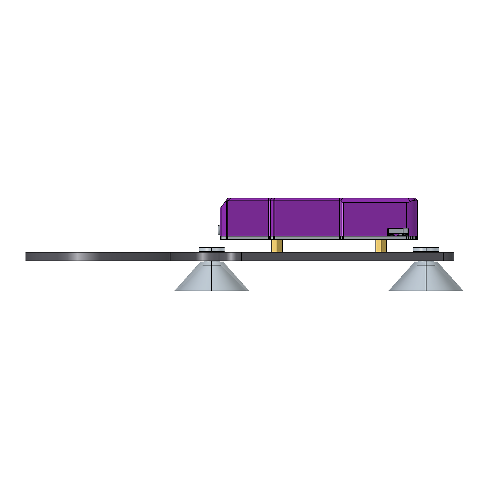
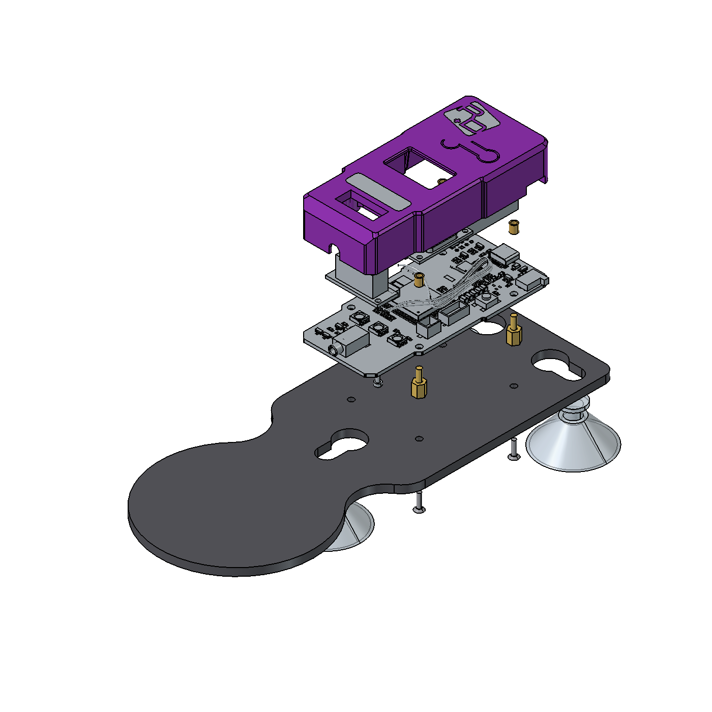
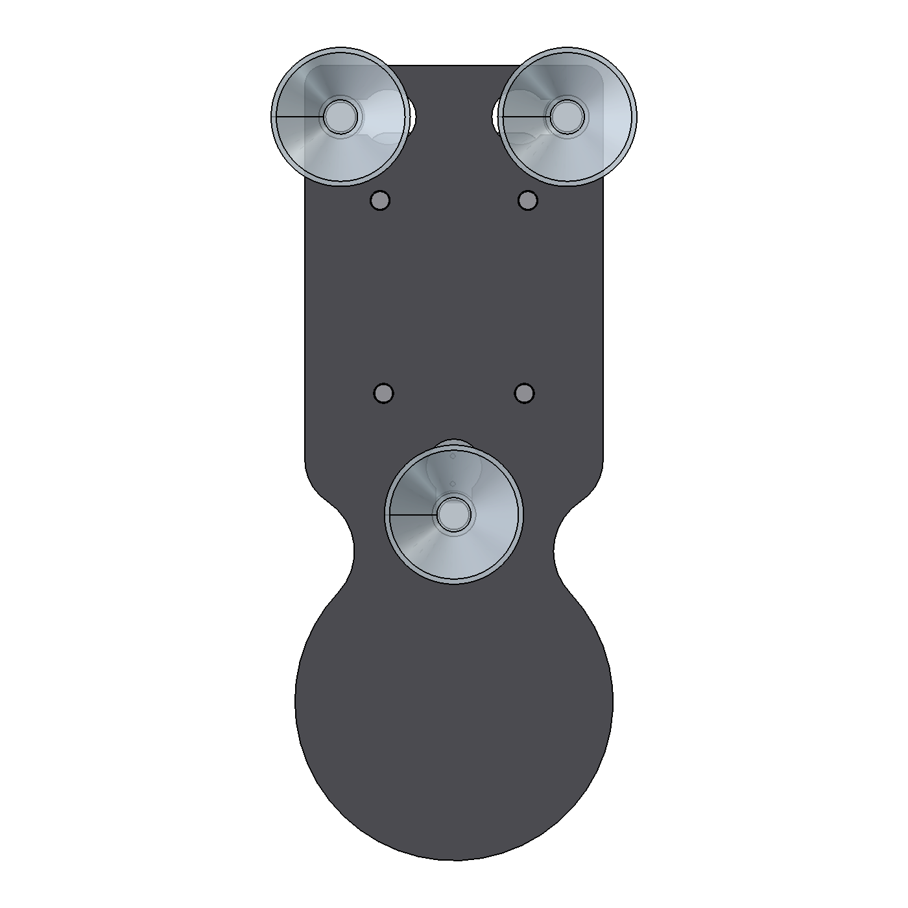

# DTT screw mount

The DTT screws to a printed backplate that carries three suction cups, two upper
and one lower. Four M2.5 male-female hex standoffs clamp the PCB to heat-set
inserts in the housing. The plate screws go into the standoff female threads,
so the plate comes off without releasing the PCB.



| Exploded | Backplate rear |
| --- | --- |
|  |  |

## Files

- [DTT.FCStd](../DTT.FCStd): editable model. The `MountParameters` spreadsheet
  drives the bosses, insert holes, standoffs, plate, keyholes and cup proxies.
  The plate outline, keyholes and cups follow the three-cup backplate reference
  model `DTT-Backplate-Proxy.FCStd`.
- [build_screw_mount.py](build_screw_mount.py): rebuilds the mount geometry,
  exploded copies, exports and previews from the spreadsheet. Run from the
  repository root: `freecad hardware/cad/screw-mount/build_screw_mount.py`.
  Set `DTT_BOARD_STEP` to a `kicad-cli pcb export step --board-only` file to
  refresh the PCB solid.
- [DTT.step](../DTT.step): assembly STEP.
- [Print and plate exports](../../production-exports/cad/screw-mount/):
  `DTT-Outer-Body` and `DTT-Backplate` as STEP and STL, and `DTT-Backplate.dxf`
  (hole, countersink, keyhole and outline pattern).
- [Body + diffuser 3MF](../../production-exports/cad/integrated-diffuser/DTT-Outer-Body-Print-in-Place.3mf)
  includes the new bosses.
- [PCB mounting holes](PCB-Mounting-Holes.png) and [board overview](PCB-Mounting-Overview.png).

## Architecture

```
wall | suction cups | backplate (4 mm) | 6 mm hex standoff | PCB 1.6 mm | housing boss + insert
         plate screw M2.5x8 CSK ─────►  female thread 4 mm
                                        male thread 6 mm ──────────────► insert M2.5 x 4
```

- **Pulling:** plate, countersunk screw, standoff, insert, housing boss. The
  PCB is clamped between the hex shoulder and the boss face and is not in the
  tensile path.
- **Twisting and handling:** four screws on a 37 x 48.5 mm pattern take shear
  through the standoffs, which sit in 2.9 mm PCB holes against printed bosses.
- **PCB support:** each hole is clamped flat between a 5 mm hex and a 5.0 mm
  boss face on the housing rim plane. Copper keepouts cover both bearing faces
  (front r2.75, back r3.1, extended to the board edge), so the clamp bears on
  laminate and mask only.
- **Servicing:** the plate screws go into brass threads, not plastic. The
  PCB stays clamped while the plate is off. Heat-set inserts take repeated
  standoff removal.

Considered and rejected:

- **Screws through the PCB into the housing, plate under the screw heads:** the
  PCB carries the wall load and loosens every time the plate comes off.
- **Plate screws into separate housing bosses:** the housing outline matches
  the PCB, so there is no room for bosses outside the board.
- **Self-tapping screws into printed plastic (the previous PCB screws):** the
  threads wear out with repeated servicing.

## BOM

| Qty | Part | Specification |
| --- | --- | --- |
| 4 | Heat-set insert | M2.5 x 4 mm, knurl OD 3.6 mm, for a 3.2 mm hole |
| 4 | Hex standoff, male-female | M2.5, 5 mm AF, 6 mm body, 6 mm male thread, female thread at least 5 mm deep, brass |
| 4 | Countersunk screw | M2.5 x 8, ISO 10642 hex socket (or ISO 7046 Phillips), A2 stainless |
| 1 | Backplate | Printed, PETG or PLA, 100 % infill around the screw holes |
| 3 | Suction cup | Stud-mount, Ø35 mm, stem Ø7.5 mm, head Ø12 x 1.8 mm |

The full device BOM is [hardware/bom.csv](../../bom.csv).

## Dimensions

Verified values come from the rev4 KiCad source or the assembly datum.
Reference values come from the backplate reference model, whose thickness and
cup sizes are estimates; measure them before printing a plate. Edit them in
`MountParameters`; the plate, keyholes and cups follow. Plate coordinates are
from the bottom centre of the plate.

| Parameter | Value | Basis |
| --- | --- | --- |
| PCB holes (KiCad) | 130.000, 75.986 / 167.167, 75.986 / 166.283, 124.486 / 130.883, 124.486 | verified |
| PCB hole | Ø2.9 NPTH | design |
| Boss | r3.1, face r2.5, 0.6 mm chamfer, face on rim plane Z −3.63 | design |
| Insert hole | Ø3.2 x 5 deep | insert supplier |
| Standoff body (PCB back to plate front) | 6.0 | design |
| Screw thread engagement in standoff | 4.0 | design |
| Male thread engagement in insert | 4.0 of 6.0 (2 mm through the PCB) | design |
| Plate thickness | 4.0 | reference (estimate) |
| Plate outline | 200 tall; upper section 75 wide with R5 top corners and R12.5 shoulders; R15 waist 50 wide; Ø80 lower pad | reference |
| Device position | centred, housing top 17 below the plate top | reference |
| Plate screw holes (plate coordinates) | ±18.58, 166.0 / ±17.70, 117.5 | follows the PCB holes |
| Upper cup stems | ±28.5, 187 | reference |
| Lower cup stem | 0, 87 | reference |
| Cup | Ø35 rim, 14 deep from the plate rear | reference (estimate) |
| Cup stem and head | stem Ø7.5, head Ø12 x 1.8, 0.4 above the plate front | reference (estimate) |
| Keyhole | entry Ø14, slot 9 wide, 12 travel; upper slots outward, lower slot down | reference |
| Countersink | Ø5.0 x 90° | design |

If `PlateT` changes, change `PlateScrewL` so engagement stays 4 mm
(`PlateScrewL = PlateT + 4`) and buy that screw length.

## Assembly

1. Press the four inserts into the housing bosses with a soldering iron at
   about 230 °C (PETG) until each sits 0.2 mm below the boss face. Let them
   cool before loading.
2. Fit the PCB into the housing. Screw a standoff through each PCB hole into
   its insert until the hex seats on the board. Torque about 0.2 N·m by hand;
   do not use a driver.
3. Push each cup head through its keyhole entry from the rear, then slide the
   upper cups outward and the lower cup down into the ends of their slots.
4. Place the plate on the PCB side and drive the four countersunk screws into
   the standoffs from the plate rear, about 0.3 N·m. The screws sit clear of
   the cups, so the cups can stay in place.

Disassembly is the reverse. Remove the plate screws to take the device off the
plate; the PCB stays clamped. Remove the standoffs only to take the PCB out.

An existing plate of the reference shape can be reused: drill four Ø2.9 holes
with Ø5.0 countersinks on the rear to the DXF pattern. Otherwise print
`DTT-Backplate`.

## Printing

- **Housing:** rim down, as in the 3MF. The boss faces print on the bed and
  the insert holes open there, so the faces are flat and need no support.
- **Backplate:** flat on either face; the keyholes and holes go straight
  through. Use at least 4 perimeters.

## Validation

Geometric checks in the FreeCAD model:

- All new solids are valid and closed.
- No unintended intersections between the housing, PCB, inserts, standoffs,
  plate, cups and plate screws. Each insert overlaps its hole by its knurl
  interference (8.5 mm³), as intended.
- Smallest clearances: standoff thread to housing 0.35 mm; plate screw head
  to countersink 0.18 mm; S1 switch body to the top-right boss 0.34 mm.
- The housing fit items listed in [the CAD README](../README.md) are unchanged.
- Screw engagement: 4.0 mm of the 5 mm standoff female thread; standoff male
  thread 4.0 mm in the 4 mm insert, with 1 mm run-out below it.
- Installation access: plate screws drive from the plate rear, clear of all
  three cups (11.9 mm at the closest). Standoffs turn with a 5 mm nut driver
  from the PCB side before the plate goes on.
- Cup heads on the plate front: the lower head reaches 2 mm under the PCB
  bottom edge with 3.8 mm to the board; the upper heads sit outside the
  device outline.
- PCB: DRC shows the seven documented findings and nothing new; all nets
  connected. The schematic is unchanged.
- Native model, STEP, STL, DXF and 3MF are generated by one script run.

Physical checks still needed:

- Measure the real plate thickness and cup stem and head sizes against the
  reference values, then update `MountParameters` and re-run the builder.
- Fit print: insert hole size, boss face flatness, and keyhole fit on the
  printer and filament used.
- Insert pull-out and torque-out in the printed housing.
- Female thread depth of the purchased standoffs (at least 5 mm).
- THT lead protrusion on the PCB back under 6 mm, so leads clear the plate.
- Suction hold and plate flex with the device on a wall.
