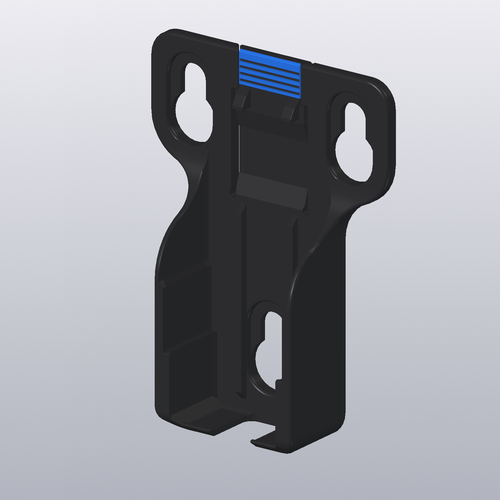

# DTT snap backplate (concept)

A printed backplate with a track that the unmodified DTT module slides into,
held by a sprung printed release lever. The plate holds three suction cups, two
upper and one lower, or hangs on an optional printed wall bracket that is
screwed or stuck to the wall. The module needs no changes beyond removing the
hook-and-loop backing. The toy's own suction base sticks straight to the
mounting surface and does not touch the plate.

| Printed part | Rear (wall side) | Side |
| --- | --- | --- |
|  |  |  |

CAD previews: [assembled](Snap-Backplate-Assembled.png), [front](Snap-Backplate-Front.png).

## Files

- [DTT-Snap-Backplate-Concept.FCStd](DTT-Snap-Backplate-Concept.FCStd): the DTT
  assembly with the `Snap backplate` part, cup proxies, the wall bracket with
  its screw proxies (hidden, since it replaces the cups) and a
  `Snap backplate parameters` sheet listing every value and its basis.
- [build_snap_backplate.py](build_snap_backplate.py): builds the concept from
  `hardware/cad/DTT.FCStd`, which it does not modify, and renders the previews.
  Edit `PARAMS` and re-run from the repository root:
  `freecad hardware/cad/snap-backplate/build_snap_backplate.py`.
- [Print exports](../../production-exports/cad/snap-backplate/), in assembly
  orientation:
  - `DTT-Snap-Backplate.step`: the black body and the blue touch point as two
    coloured bodies.
  - `DTT-Snap-Backplate-Black.stl` and `DTT-Snap-Backplate-Blue.stl`: the two
    colours, for a two-colour print.
  - `DTT-Snap-Backplate.stl`: the whole part, for a one-colour print.
  - `DTT-Snap-Backplate-Wall-Bracket` (STEP and STL): the wall bracket, for
    mounting without the cups.

## Form

The track and the plate are one form: the intersection of a plan outline and a
side elevation, with the module cavity cut out of it.

- **Plan:** the body is flush with the track walls. It flares into two
  round-ended wings (R14 blends, R8 corners) that carry the upper cups.
- **Side:** a hood at the jack end leans at the housing's own end slope. The
  top then runs flat along the module, 0.8 mm above its front face. From Y 44 it
  drops to the plate in one S-curve, reaching it at Y 78, just below the side
  switch.
- **Edges:** one R1 fillet runs around the whole outer top edge (hood, walls,
  curve and wings). It is half the 2 mm wall, so the wall tops stay square. The bed edge has a 0.6 mm chamfer. Keyhole front edges are
  rounded 0.8 mm.
- **Release lever:** part of the plate outline at the top edge, between two
  slots, with grip grooves across the press tab.
- **Colour:** the print is black. The touch point is blue: the front of the
  lever's press tab, from just past the teeth to the top edge, as a 0.6 mm deep
  inlay. The four grip grooves are 0.9 mm deep, with straight walls and a round
  bottom, so they cut through the blue and their bottoms are black. The teeth
  stay black. The blue in the
  renders (RGB 0.09/0.42/0.93) is a placeholder for the product blue.

## How it holds the module

- **Track:** the module slides in from the USB-C end, jack end first, until it
  sits in the hood. The cavity follows the housing sections (bottom to Y 23,
  mid to Y 44, then wide) with 0.2 mm clearance. It carries a 0.6 mm lip over
  the top chamfer, and a 0.6 mm hood lip over the housing's sloped jack end. The
  housing steps wider toward the USB-C end, so each band is only passed by its
  own section or narrower ones. The lips and the mid band end at Y 44, where the
  wall starts to swoop down, through one 45° taper, so the swoop is a plain 2 mm
  wall. The side switch S1 (Y 79.4 and above) is open from the side and front.
- **Support:** the PCB back rides on two skids (X 11-13 and 29-31, Y 5-64,
  45° end ramps), 2.6 mm above the plate. They sit between the tracks swept by
  the PCB screw heads and clear of the jack and the connectors with through-hole
  leads. The screw heads (1.5 mm proud) pass under the board, and the lower
  cup head sits in a recess under it.
- **Release lever:** two 1.5 mm slots run from Ø2.5 relief holes under the
  module (Y 66) out through the plate's top edge. They free a 24 mm wide lever.
  The flex zone (Y 66-86) is thinned to 2 mm from the front through 6 mm ramps,
  so the lever's rear stays on the print bed. The press tab beyond it is full
  thickness and carries the two teeth (X 10.5-14.5 and 27.5-31.5, either side of
  the USB-C plug) and four grip grooves. Each tooth has a 30° lead-in ramp that
  the module pushes down on the way in. Its stop face springs up 1.2 mm behind
  the board's USB-C edge, with 0.2 mm clearance. Peak strain is about 0.7 %:
  1.4 mm deflection at the teeth, 20 mm flex zone, 2 mm thick.
- **Over-travel stop, toward the wall:** a fixed finger runs from the plate
  across each lever slot, on the print bed, into a pocket in the rear of the
  lever beside the teeth (X 7-9.9 and 32.1-35, Y 92.6-96.6). The pocket roof
  rises at 45° toward the slot, so it prints without a bridge. The finger top
  runs parallel to it, 1.8 mm below, so the finger is 1.7 mm tall over the slot
  and 0.8 mm at its tip. Pressing the tab moves the roof down until it lands on
  the fingers. The teeth have then moved 1.66 mm, 0.46 mm past release, and the
  lever strain is 0.85 %. Each finger sees about 10 MPa bending per 10 N of
  press force.
- **Pull-out stop:** a rail from the plate runs along each side of the press
  tab, from just past the stop pockets (Y 98) out to the top edge, where it
  takes the same R1 round as the plate. It reaches across the slot and 0.9 mm
  over the lever's front edge, flush with the front. Its underside rises at 45°
  toward its tip, so it prints without support. The lever's front corner under
  it is cut back to a parallel 45° face, 1.0 mm below, with 0.5 mm clearance at
  the tip. Pulling the tab outward lands its top end on the rails after 1.0 mm,
  when the teeth have moved 0.50 mm. Each rail sees about 1.2 MPa bending per
  10 N. The rails are black and frame the blue inlay. They stop short of the
  stop pockets because the 4 mm lever edge can't take the rail's front cut and
  a pocket from the rear at the same place.
- **Release:** unplug USB-C, press the tab toward the wall and slide the module
  out toward the USB-C end.
- The jack, USB-C, side switch and buttons stay open.

## Plate, cups and wall bracket

- Plate 4 mm thick, about 86 x 112 mm overall.
- Upper cup stems at X 21 ± 28, Y 97, in the wings beside the module's USB-C
  end. The lower cup sits under the module, with its stem at X 21, Y 28 and its
  head 1.2 mm under the PCB.
- Keyholes fit the measured cup stem: a Ø15 head flange 3 mm thick, then a
  Ø8.5 groove 2.5 mm long. Each keyhole has a Ø15.6 entry for the head and an
  8.9 mm slot for the groove. A Ø15.6 recess from the front runs over the whole
  slide, leaving 2.2 mm of plate under it, so the plate sits in the groove with
  0.3 mm slack and the head sits in the recess, 1.4 mm proud of the plate
  front.
- All keyholes run upward from the entry, so the hanging load seats the stems
  at the closed ends. The plate web around the upper keyholes is 6 mm (5.2 mm
  above them, at the top edge), so the wings don't snap where they join the
  body when the plate is pushed onto the cups.
- Fit the cups before sliding the module in.
- Wall bracket, in place of the cups: one 5 mm printed piece that carries a
  stud for each of the three keyholes, so their spacing is fixed for you.
  - It follows the plate outline 1 mm inside it, so it hides behind the plate.
    A notch leaves the lever and its slots free (X 6.5-35.5, from Y 63.75), so
    the lever can move toward the wall. The tab end moves up to 3.3 mm before
    the stop lands, and the bracket gives it 5 mm.
  - Each stud has a Ø8.4 neck in the 8.9 mm keyhole slot and a Ø13 head that
    sits in the head recess. The head's underside is a 45° cone that starts
    0.3 mm in front of the keyhole land. The stud tops are level with the cup
    heads, so the lower one is 1.2 mm under the PCB.
  - Fix it with two #6 or #8 drywall screws at X 21 ± 12, Y 46: Ø4.5 holes
    with a 90° countersink Ø9 and a 0.4 mm counterbore, so a #6 head sits
    0.7 mm below the bracket face. Use screws of at least 25 mm (1 in). The
    plate covers the screws.
  - Or stick it up with adhesive picture-hanging strips (such as Command
    strips) on the flat rear instead of the screws. The body below the notch
    is about 46 x 63 mm. Run the strips up from the bottom edge, with the pull
    tabs hanging below it, so they can be pulled once the plate is lifted off.
  - Fit the bracket level, hang the plate on the studs (heads through the
    entries, then down 12 mm), and slide the module in. Lift the plate 12 mm to
    take it off.

| Parameter | Value | Basis |
| --- | --- | --- |
| PCB rear face | Z −5.1 | verified (DTT.FCStd) |
| Housing width | 38 / 42 / 44 by section, top chamfer 0.99-1.41 | verified |
| Plate front to PCB rear | 2.6 | design |
| Track | 0.2 clearance, 0.6 lips, 2.0 wall at the widest section | design |
| Side profile | flat top 0.8 above the module, S-curve Y 44-78, R1 outer edge | design |
| Skids | X 11-13 and 29-31, Y 5-64 | design |
| Release lever | X 9-33 from Y 66, flex zone 2.0 thick to Y 86, teeth 1.2 rise, 30° ramp | design |
| Over-travel stop | fingers 4.0 wide, 0.9 into the lever, 45° roof and finger top with 0.5 land, 1.8 travel, 0.5 clearance | design |
| Pull-out stop | rails Y 98 to the top edge, 0.9 over the lever edge, 0.4 tip, 45° faces, 1.0 travel, 0.5 clearance | design |
| Plate | 4.0 thick | reference (estimate) |
| Cup | stem and head Ø15, head 3.0 thick, groove Ø8.5 x 2.5 | reference (measured) |
| Cup body | Ø35, rim 14 behind the plate | reference (estimate) |
| Keyhole | entry Ø15.6, slot 8.9, head recess Ø15.6 to a 2.2 land, 12 travel upward | design |
| Blue touch point | X 9-33, Y 99.5 to the top edge, 0.6 deep from the front | design |
| Grip grooves | 4 at 2.0 pitch, 1.0 wide, 0.9 deep | design |
| Wall bracket | 5.0 thick, plate outline inset 1.0, lever notch with 1.0 clearance | design |
| Studs | neck Ø8.4, 0.3 from the land to the head, head Ø13 with a 45° underside, top level with the cup heads | design |
| Bracket screws | X 21 ± 12, Y 46; Ø4.5 hole, 90° countersink Ø9, 0.4 counterbore | design |
| Screw | #6 drywall, head Ø8.3, shank Ø3.5 | reference (estimate) |

Every value and its basis is in `PARAMS` in the builder.

## Validation (geometric, in the model)

- The printed part is one valid solid. The black and blue bodies are one valid
  solid each and add up to it exactly.
- At rest there are no intersections with the housing, PCB or PCB screws,
  with either the cups or the wall bracket and its screws in place. Smallest
  gaps: track to housing 0.2 mm, lower cup head or lower stud to PCB 1.2 mm,
  cup stems to plate 0.1 mm (the 0.3 mm groove slack split either side),
  studs to plate 0.25 mm. The skids touch the PCB
  rear by design, and the bracket face touches the plate rear. Seated bracket
  screw heads sit 0.7 mm below the bracket face.
- The wall bracket is one valid solid.
- Sweep check: the module was stepped out along the track in 3 mm steps over
  its full travel (0-96 mm). Nothing it carries below the housing collides with
  the plate, track, cups or wall bracket. The only contact is with the release
  lever, which is meant to deflect.

## Needs physical checks

- Lever: tooth engagement and release force on a test print; tune `ToothRise`
  and `LatchT`.
- Stop fingers print free of the lever (elephant foot can bridge the 0.5 mm
  gaps; tune `StopClear`). The 45° faces of both stops print clean and free of
  each other (tune `StopGap` and `PullGap`).
- Slide fit of the track on the printer used; tune `WallClear`.
- THT lead protrusion on the PCB back under 2 mm along the skid tracks, and
  under 1.2 mm over the lower cup head (X 13.5-28.5, Y 20.5-35.5). The J5
  jack's leads are in that track; trim them if they stand proud further.
- The USB-C plug overmold fits in the 13 mm gap between the teeth.
- The cup stems snap into the keyholes and hold without rattling; tune
  `KeyLandT` (2.4 for a snug fit, 11 or 12 layers at 0.2 mm) and `KeySlotW`.
  Suction hold on a wall.
- The plate hangs on the bracket studs without rattling (tune `StudGap`), and
  the stud heads print cleanly. Bracket screw heads seat below the face.
  Drywall bugle heads are not exactly 90°; tune `ScrewCskD` and `ScrewSink`.
- Adhesive strips hold the bracket, plate and module on the intended walls.

## Printing

Print rear face down in PETG with at least 4 perimeters and no supports. The
lever's rear stays on the bed. The overhangs are the 0.6 mm lips (45°/55°), the
hood lip, which runs parallel to the housing slope at 54°, and the 0.6 mm bed
chamfer. The lever stops have 45° faces, so there are no bridges.

Print the wall bracket flat, wall side down, in black. The studs print
upright with no supports.

For two colours, load `DTT-Snap-Backplate-Black.stl` and
`DTT-Snap-Backplate-Blue.stl` together as one object with two parts, and give
the blue part the blue filament. The blue inlay is the top 0.6 mm of the press
tab, so both colours share only three layers (Z 3.4-4.0 mm above the bed).
Use the same material for both colours. For one colour, print
`DTT-Snap-Backplate.stl`.
