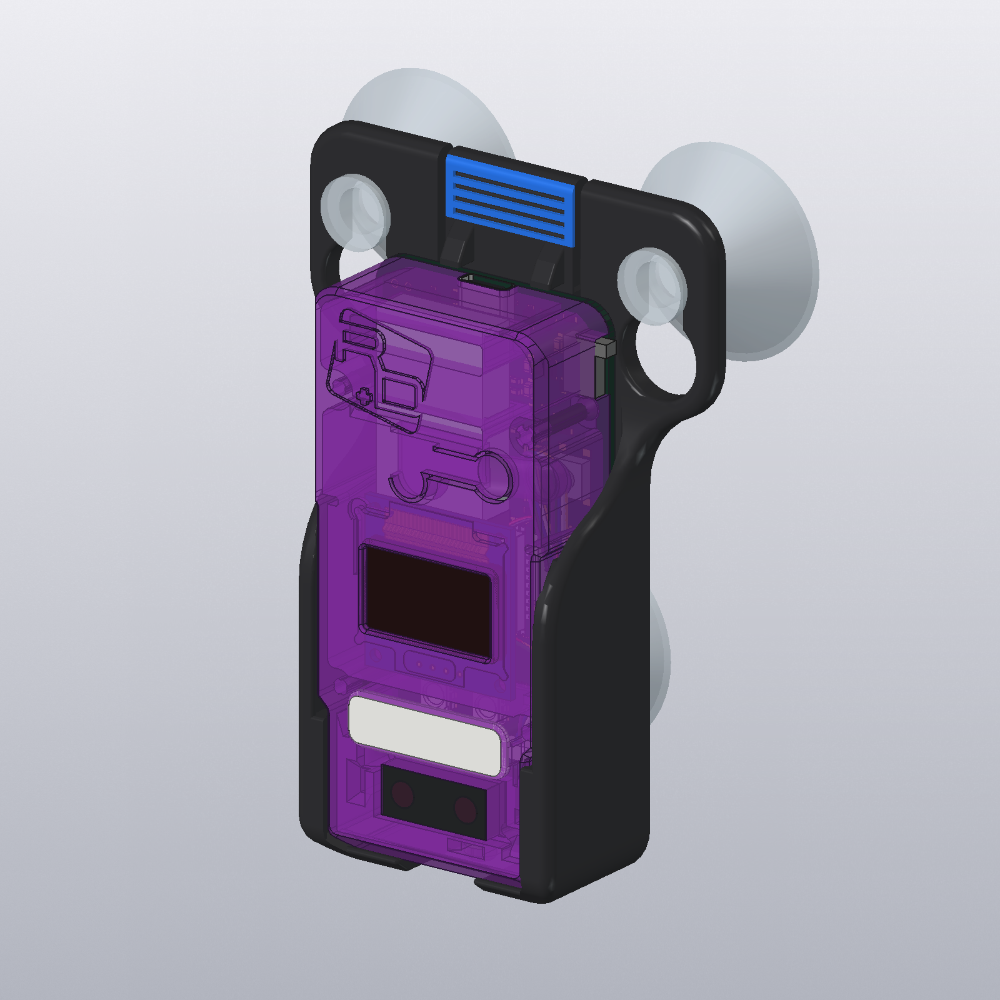
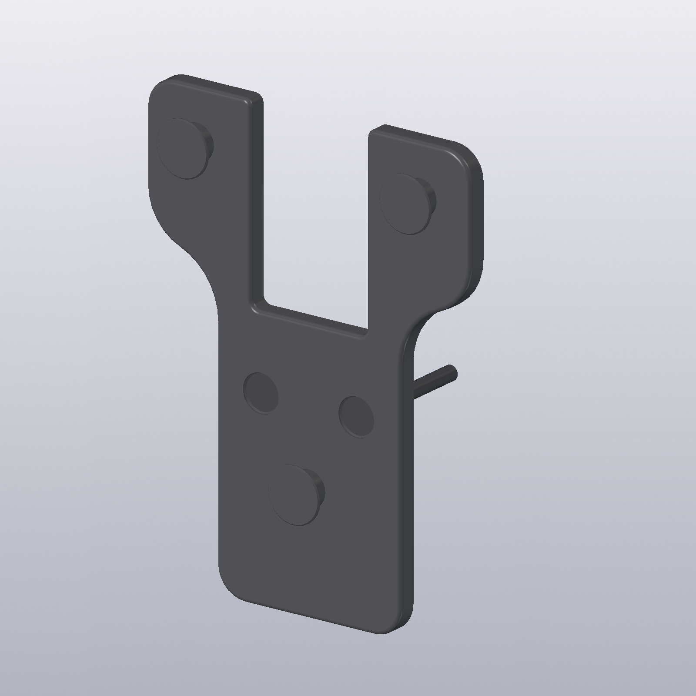
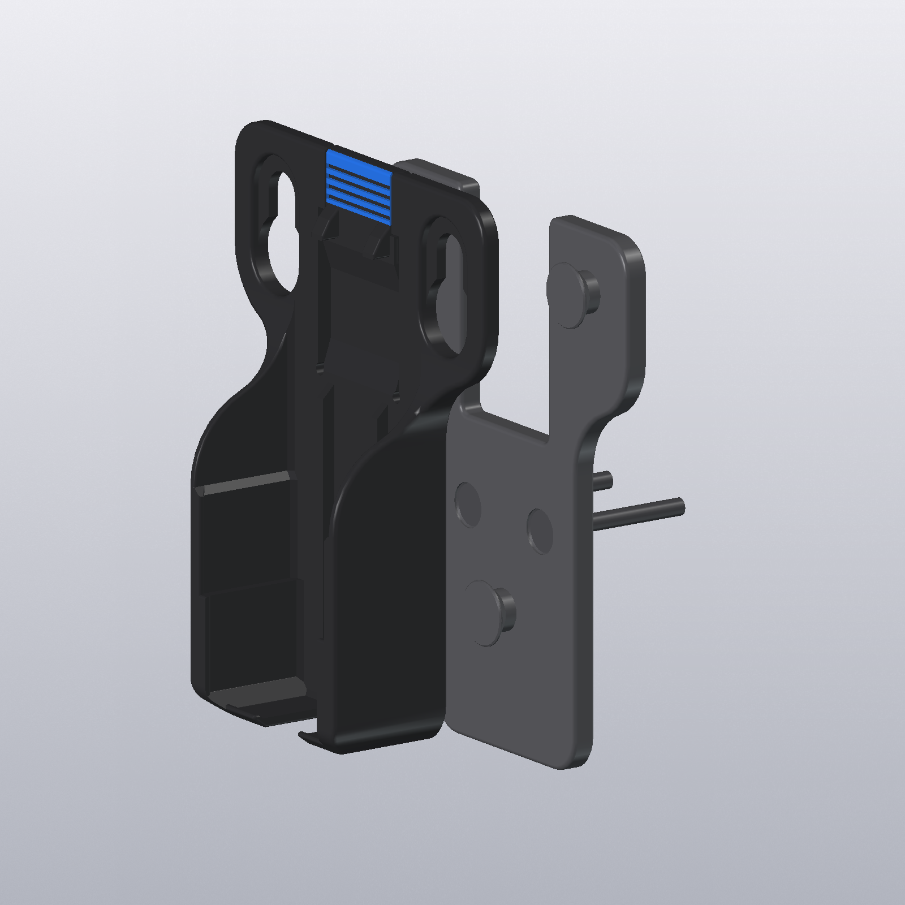
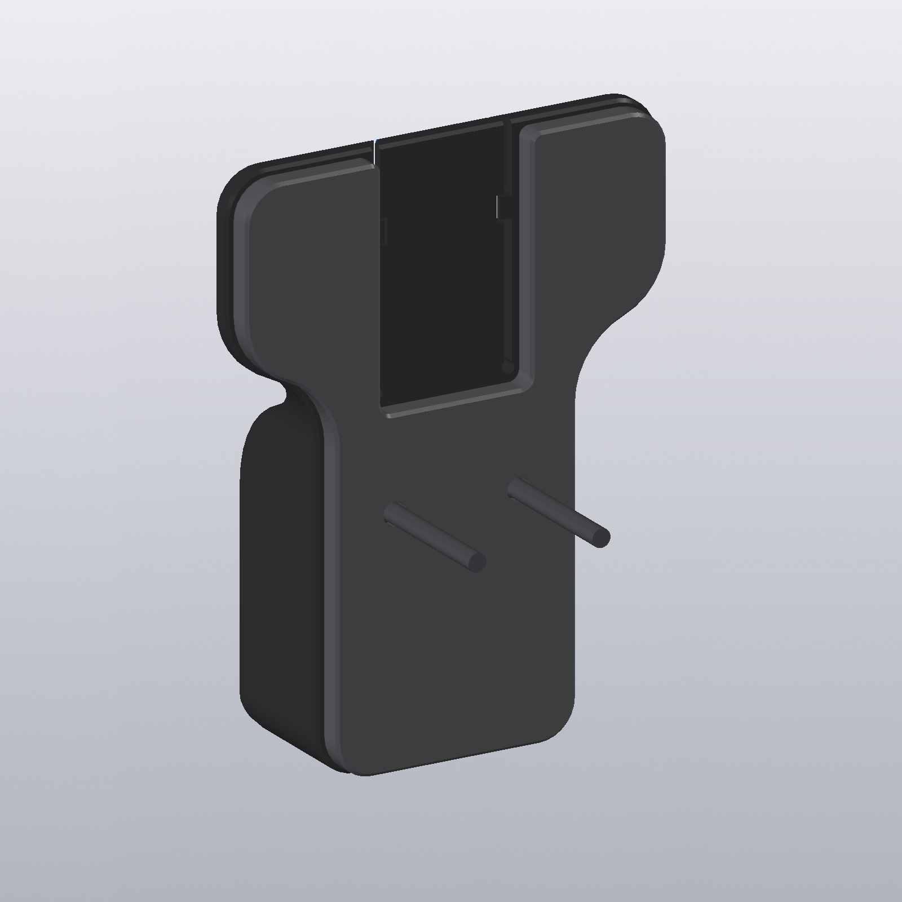

# DTT snap backplate (concept)

A printed backplate the DTT module slides into and clicks onto. The module only
loses its hook-and-loop backing. Mount the plate on three suction cups, or hang
it on the wall bracket.

| Backplate | Wall side | Side |
| --- | --- | --- |
|  |  |  |

| Wall bracket | Hanging the plate | On the bracket, wall side |
| --- | --- | --- |
|  |  |  |

## Use

- **Fit:** slide the module in, jack end first, until the lever clicks behind
  the USB-C edge.
- **Release:** unplug USB-C, press the blue tab toward the wall and slide the
  module out.
- **Suction cups:** snap the three cups into the keyholes before fitting the
  module. The keyholes fit a stem with a Ø15 x 3 mm head and a Ø8.5 x 2.5 mm
  groove.
- **Wall bracket:** instead of the cups. Fix it level with two #6 or #8 screws,
  at least 25 mm long, or with Command strips on its back. Hang the plate on the
  studs and push it down 12 mm. To take it off, lift it 12 mm.

## Print

- **Backplate:** rear face down, no supports, at least 4 walls. Use PETG (PLA is
  fine for a fit test). For two colours, load the `-Black` and `-Blue` STLs as
  one object with two parts. For one colour, use `DTT-Snap-Backplate.stl`.
- **Bracket:** wall side down, black, no supports.

The files are in
[production-exports/cad/snap-backplate](../../production-exports/cad/snap-backplate/).

## Source

`build_snap_backplate.py` builds everything from `hardware/cad/DTT.FCStd`
without modifying it. Every dimension and its basis is in `PARAMS`. Run it from
the repository root with `freecad hardware/cad/snap-backplate/build_snap_backplate.py`.
It writes `DTT-Snap-Backplate-Concept.FCStd`, the exports and these images.

## Check on a test print

- Lever click and release force (`ToothRise`, `LatchT`).
- Track slide fit (`WallClear`).
- Stop fingers print free of the lever (`StopClear`).
- Cups and bracket studs seat without rattling (`KeyLandT`, `KeySlotW`, `StudGap`).
- PCB through-hole leads stay under 1.2 mm over the lower cup.
