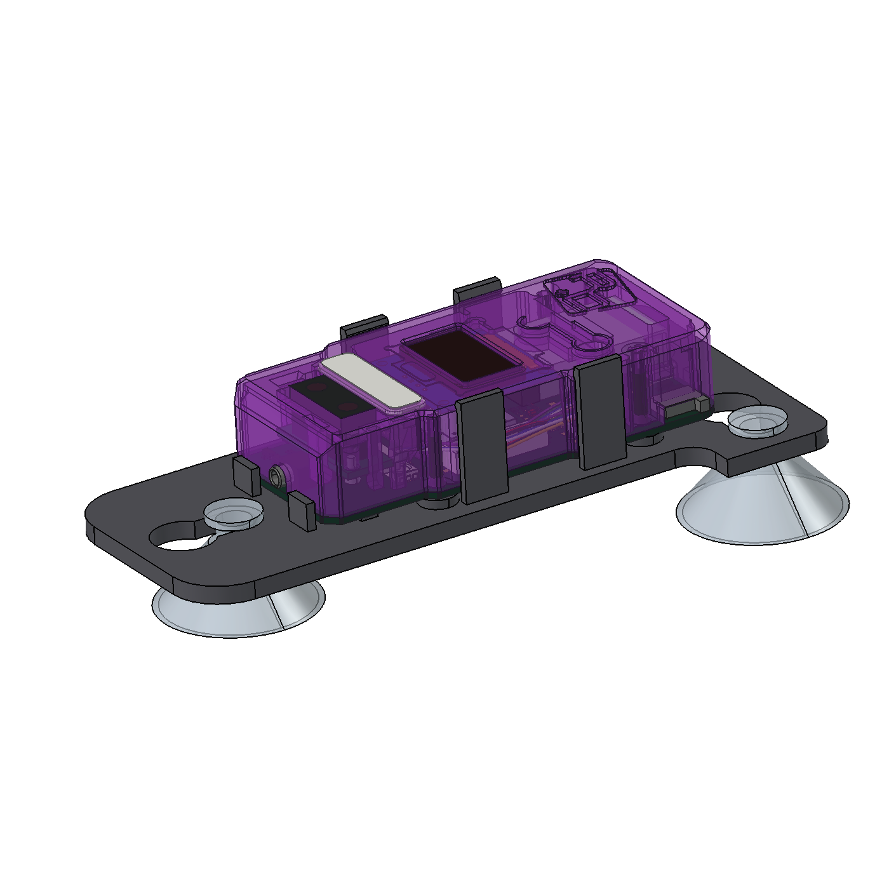

# DTT snap backplate (concept)

A printed backplate that the unmodified DTT module clicks into. The plate holds
three suction cups, two upper and one lower. The module needs no changes beyond
removing the hook-and-loop backing. The toy's own suction base sticks straight
to the mounting surface and does not touch the plate.

| Printed part | Rear (wall side) | Side |
| --- | --- | --- |
|  |  |  |

## Files

- [DTT-Snap-Backplate-Concept.FCStd](DTT-Snap-Backplate-Concept.FCStd): the DTT
  assembly with the `Snap backplate concept` part, cup proxies and a
  `Snap backplate parameters` sheet listing every value and its basis.
- [build_snap_backplate.py](build_snap_backplate.py): builds the concept from
  `hardware/cad/DTT.FCStd`, which it does not modify. Edit `PARAMS` and re-run
  from the repository root: `freecad hardware/cad/snap-backplate/build_snap_backplate.py`.
- [Print exports](../../production-exports/cad/snap-backplate/):
  `DTT-Snap-Backplate` as STEP and STL, one piece, in assembly orientation.

## How it holds the module

- **Rest and location:** the PCB back rests on seven 4 mm pads and four seat
  rings, 2 mm above the plate. The rings surround the existing 0408LTFB PCB
  screw heads (1.5 mm proud of the board) with 0.3 mm clearance, so the heads
  locate the module on the plate and nothing presses on them.
- **Retention:** four cantilever arms, two per side, rise beside the housing
  walls and hook 0.6 mm over the top chamfer. Arm thickness 1.8 mm and free
  length about 21 mm; the 0.8 mm snap deflection is about 0.5 % strain in PETG.
  A lead-in on each lip lets the module push straight in.
- **Ends:** two low stops at each end hold the module along its length. They sit
  either side of the 3.5 mm jack and the USB-C port, which stay open, as do the
  side switch and the buttons.
- **Release:** spread one pair of arms and lift that side out.

## Plate and cups

- Plate 4 mm thick, 75 x 144 mm overall: a 75 mm wide upper section the height of
  the upper cups, then a 54 mm body (housing width plus 5 mm each side) with
  R12 bottom corners.
- The upper cups follow the reference backplate: stems ±28.5 from the
  centreline, 13 below the plate top, keyholes sliding outward. The module top
  end sits 17 below the plate top, as on the reference.
- The lower cup stem sits 11 below the module's jack end. Its keyhole runs
  upward from the entry, so the hanging load seats the stem at the closed end.
- Cup heads sit on the plate front outside the module footprint, clear of the
  arms and stops.

| Parameter | Value | Basis |
| --- | --- | --- |
| PCB rear face | Z −5.1 | verified (DTT.FCStd) |
| Housing width | 38 / 42 / 44 by section, top chamfer 0.99-1.41 | verified |
| Plate front to PCB rear | 2.0 | design |
| Seat ring | ID 5.4, OD 8.5 around Ø4.8 screw heads | design |
| Arm | 1.8 thick, 10 wide, 0.6 lip, 0.2 wall clearance | design |
| Plate | 4.0 thick | reference (estimate) |
| Cup | Ø35, stem Ø7.5, head Ø12 x 1.8 | reference (estimate) |
| Keyhole | entry Ø14, slot 9, upper slots 12 outward, lower slot 12 upward | reference / design |

## Validation (geometric, in the model)

- The printed part and cup proxies are valid solids.
- No intersections with the housing, PCB, PCB screws or cups. Smallest gaps:
  arms to housing 0.2 mm, seat rings to screw heads 0.3 mm, cup heads to the
  plate 0.4 mm. Pads and rings touch the PCB rear by design.
- Cup proxies have more than 3 mm to every module part.

## Needs physical checks

- Snap force and retention of the arms on a test print; tune `HookEngage` and
  `ArmT`.
- THT lead protrusion on the PCB back under 2 mm, or the leads touch the plate.
- Plate thickness and cup stem and head sizes against the real cups.
- Suction hold with the module on a wall.

## Printing

Print plate face down (wall side on the bed). The arms, pads and stops then
build upward with no supports. PETG, at least 4 perimeters.
