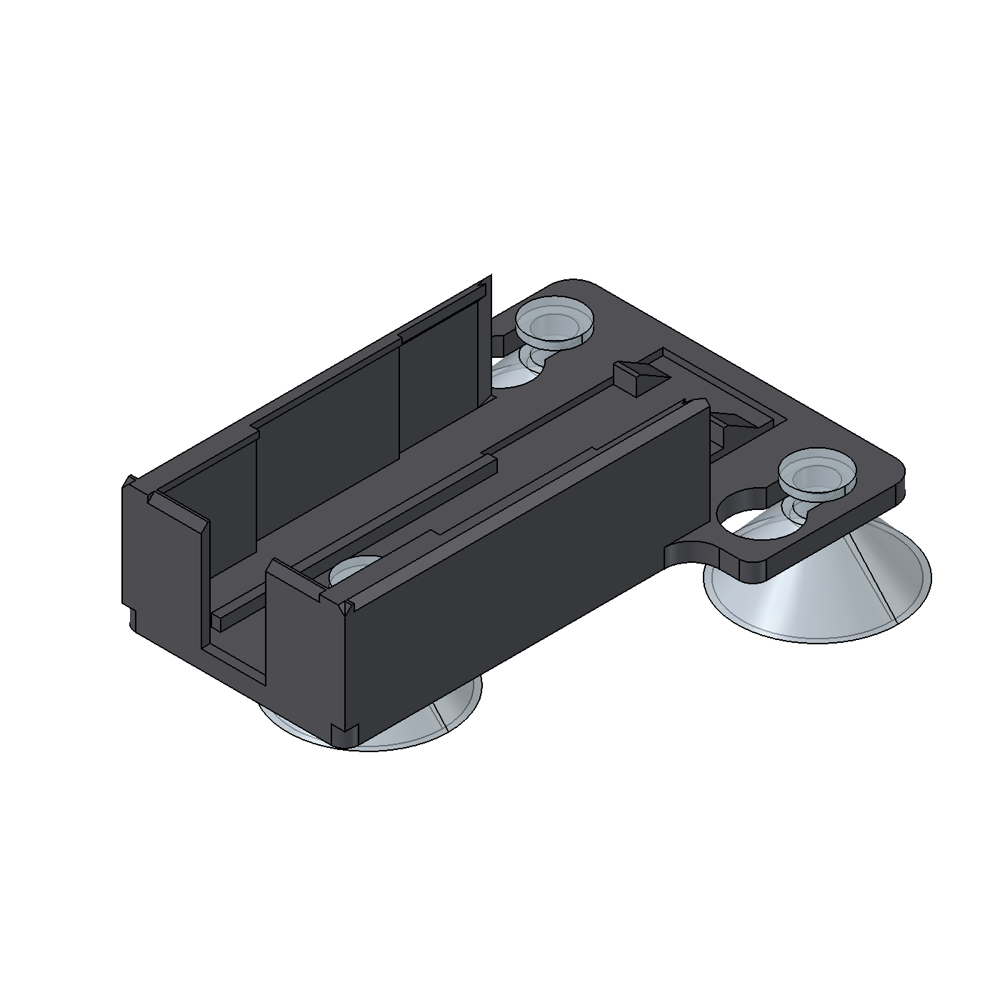
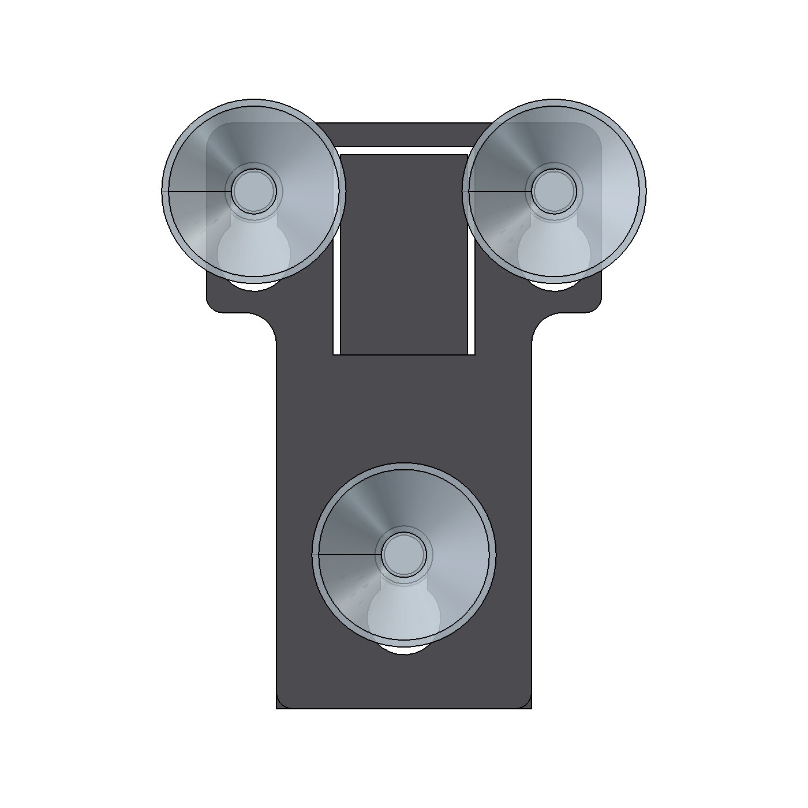

# DTT snap backplate (concept)

A printed backplate with a track that the unmodified DTT module slides into, held
by a sprung printed latch. The plate holds three suction cups, two upper and one
lower. The module needs no changes beyond removing the hook-and-loop backing. The toy's own suction base sticks straight
to the mounting surface and does not touch the plate.

| Printed part | Rear (wall side) | Side |
| --- | --- | --- |
|  |  |  |

## Files

- [DTT-Snap-Backplate-Concept.FCStd](DTT-Snap-Backplate-Concept.FCStd): the DTT
  assembly with the `Snap backplate concept` part, cup proxies and a
  `Snap backplate parameters` sheet listing every value and its basis.
- [build_snap_backplate.py](build_snap_backplate.py): builds the concept from
  `hardware/cad/DTT.FCStd`, which it does not modify. Edit `PARAMS` and re-run
  from the repository root: `freecad hardware/cad/snap-backplate/build_snap_backplate.py`.
- [Print exports](../../production-exports/cad/snap-backplate/):
  `DTT-Snap-Backplate` as STEP and STL, one piece, in assembly orientation.

## How it holds the module

- **Track:** one continuous U-shaped track. A side wall runs along each side
  from the jack end, and an end wall joins them there, with an opening for the
  3.5 mm plug. The module slides in from the USB-C end, jack end first, until
  it sits against the end wall. The outer faces are straight, with a 1.5 mm
  chamfer on the top edge. The inner faces step with the housing sections,
  keeping 0.2 mm clearance, and carry a 0.6 mm lip over the top chamfer. The
  housing steps wider toward the USB-C end, so each band of wall is only
  passed by its own section or narrower ones. The walls end at Y 78 with a
  lead-in flare. That is below the side switch S1, which protrudes from the
  right wall at Y 79.4 and above and so never reaches them.
- **Support:** the PCB back rides on two skids, 2.6 mm above the plate. They
  sit between the tracks swept by the PCB screw heads and clear of the jack
  and the connectors with through-hole leads. The screw heads (1.5 mm proud)
  and the lower cup head pass under the board.
- **Latch:** a 24 x 38 mm tongue is cut free in the plate, rooted under the
  module and thinned to 2 mm from the rear. Two teeth near its free end ride
  up a 30° ramp as the module goes in. Once the module seats, they spring up
  1.2 mm behind the board's USB-C edge. The teeth sit either side of the
  USB-C plug. Deflection is about 1.4 mm over a 34 mm span, about 0.4 %
  strain in PETG.
- **Release:** unplug USB-C, press the tab at the tongue's free end toward the
  wall and slide the module out toward the USB-C end.
- The jack, USB-C, side switch and buttons stay open.

## Plate and cups

- Plate 4 mm thick, 75 x 111 mm overall: a 75 mm upper section carrying the
  upper cups, then a 48.4 mm body flush with the outer faces of the track.
- The upper cup stems follow the reference backplate: ±28.5 from the
  centreline, 13 below the plate top, beside the module's USB-C end. The lower
  cup sits under the module, with its stem 28 mm from the jack end on the
  centreline. All keyholes run upward from the entry, so the hanging load
  seats the stems at the closed ends.
- Fit the cups before sliding the module in. The lower cup head sits under the
  PCB with 0.4 mm clearance.

| Parameter | Value | Basis |
| --- | --- | --- |
| PCB rear face | Z −5.1 | verified (DTT.FCStd) |
| Housing width | 38 / 42 / 44 by section, top chamfer 0.99-1.41 | verified |
| Plate front to PCB rear | 2.6 | design |
| Track | continuous to Y 78, outer faces X −3.2 / 45.2, 2.0 min wall, 0.6 lip, 0.2 clearance | design |
| Skids | X 11-13 and 29-31, Y 4-64 | design |
| Latch | tongue X 9-33, Y 66-104, 2.0 thick; teeth 5 wide, 1.2 rise, 30° ramp | design |
| Plate | 4.0 thick | reference (estimate) |
| Cup | Ø35, stem Ø7.5, head Ø12 x 1.8 | reference (estimate) |
| Keyhole | entry Ø14, slot 9, 12 travel upward | reference / design |

## Validation (geometric, in the model)

- The printed part and cup proxies are valid solids.
- At rest there are no intersections with the housing, PCB, PCB screws or
  cups. Smallest gaps: track to housing 0.2 mm, lower cup head to PCB 0.4 mm,
  cup heads to plate 0.4 mm. The skids touch the PCB rear by design.
- Sweep check: the module was stepped out along the track in 3 mm steps over
  its full travel. Nothing it carries below the housing collides with the
  plate, track or cups. The only contact is with the latch tongue,
  which is meant to deflect.

## Needs physical checks

- Latch: tooth engagement and release force on a test print; tune
  `ToothRise`, `LatchT`.
- Slide fit of the track on the printer used; tune `WallClear`.
- THT lead protrusion on the PCB back under 2 mm along the skid tracks, and
  under 0.4 mm over the lower cup head (X 15-27, Y 22-34), or recess the head.
- USB-C plug overmold width under 14 mm, so it fits between the teeth.
- Plate thickness and cup stem and head sizes against the real cups.
- Suction hold with the module on a wall.

## Printing

Print plate face down (wall side on the bed). The track, skids and teeth
then build upward with no supports; the lips are 0.6 mm overhangs.
PETG, at least 4 perimeters.
