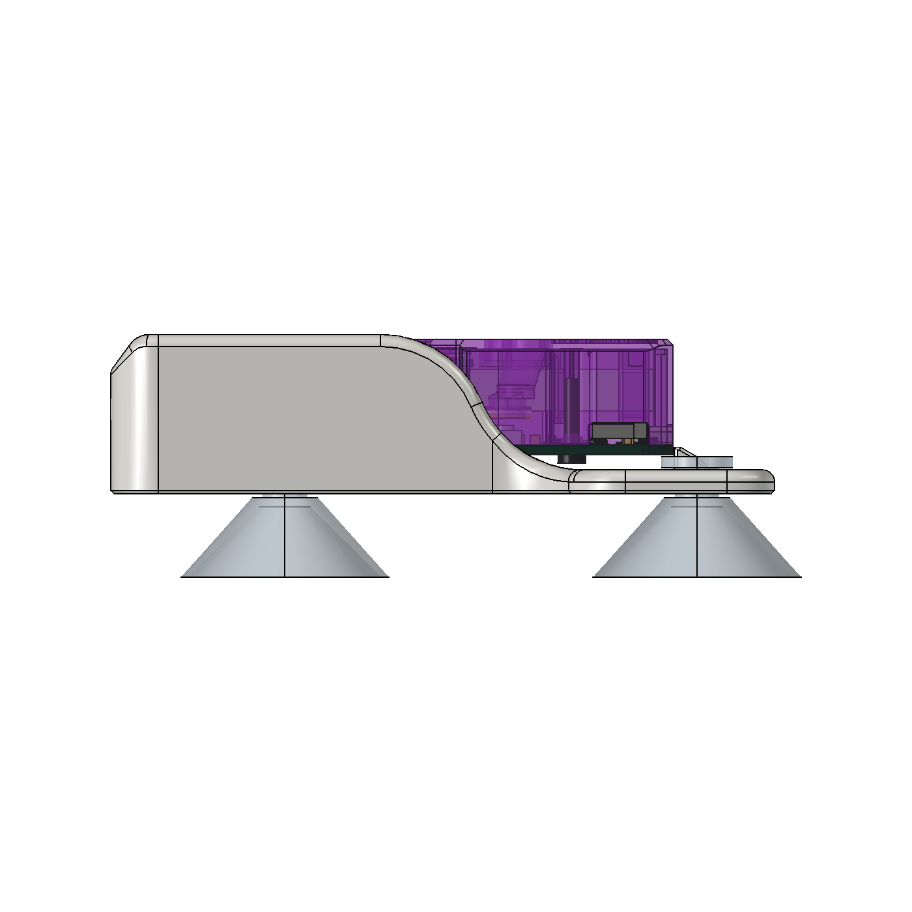

# DTT snap backplate (concept)

A printed backplate with a track that the unmodified DTT module slides into,
held by a sprung printed release lever. The plate holds three suction cups, two
upper and one lower. The module needs no changes beyond removing the
hook-and-loop backing. The toy's own suction base sticks straight to the
mounting surface and does not touch the plate.

| Printed part | Rear (wall side) | Side |
| --- | --- | --- |
|  |  |  |

CAD previews: [assembled](Snap-Backplate-Assembled.png), [front](Snap-Backplate-Front.png).

## Files

- [DTT-Snap-Backplate-Concept.FCStd](DTT-Snap-Backplate-Concept.FCStd): the DTT
  assembly with the `Snap backplate` part, cup proxies and a
  `Snap backplate parameters` sheet listing every value and its basis.
- [build_snap_backplate.py](build_snap_backplate.py): builds the concept from
  `hardware/cad/DTT.FCStd`, which it does not modify, and renders the previews.
  Edit `PARAMS` and re-run from the repository root:
  `freecad hardware/cad/snap-backplate/build_snap_backplate.py`.
- [Print exports](../../production-exports/cad/snap-backplate/):
  `DTT-Snap-Backplate` as STEP and STL, one piece, in assembly orientation.

## Form

The track and the plate are one form: the intersection of a plan outline and a
side elevation, with the module cavity cut out of it.

- **Plan:** the body is flush with the track walls. It flares into two
  round-ended wings (R14 blends, R8 corners) that carry the upper cups.
- **Side:** a hood at the jack end leans at the housing's own end slope. The
  top then runs flat along the module, 0.8 mm above its front face. From Y 44 it
  drops to the plate in one S-curve, reaching it at Y 78, just below the side
  switch.
- **Edges:** one R2 fillet runs around the whole outer top edge (hood, walls,
  curve and wings). The bed edge has a 0.6 mm chamfer. Keyhole front edges are
  rounded 0.8 mm.
- **Release lever:** part of the plate outline at the top edge, between two
  slots, with grip grooves across the press tab.
- Colour: warm pebble white (RGB 0.86/0.85/0.83).

## How it holds the module

- **Track:** the module slides in from the USB-C end, jack end first, until it
  sits in the hood. The cavity follows the three housing sections (bottom to
  Y 23, mid to Y 56, then wide) with 0.2 mm clearance. It carries a 0.6 mm lip
  over the top chamfer, and a 0.6 mm hood lip over the housing's sloped jack
  end. The housing steps wider toward the USB-C end, so each band is only passed
  by its own section or narrower ones. The lips run to about Y 50, where the wall
  top drops below the chamfer. The side switch S1 (Y 79.4 and above) is open
  from the side and front.
- **Support:** the PCB back rides on two skids (X 11-13 and 29-31, Y 5-64,
  45° end ramps), 2.6 mm above the plate. They sit between the tracks swept by
  the PCB screw heads and clear of the jack and the connectors with through-hole
  leads. The screw heads (1.5 mm proud) and the lower cup head pass under the
  board.
- **Release lever:** two 1.5 mm slots run from Ø2.5 relief holes under the
  module (Y 66) out through the plate's top edge. They free a 24 mm wide lever.
  The flex zone (Y 66-86) is thinned to 2 mm from the front through 6 mm ramps,
  so the lever's rear stays on the print bed. The press tab beyond it is full
  thickness and carries the two teeth (X 10.5-14.5 and 27.5-31.5, either side of
  the USB-C plug) and four grip grooves. Each tooth has a 30° lead-in ramp that
  the module pushes down on the way in. Its stop face springs up 1.2 mm behind
  the board's USB-C edge, with 0.2 mm clearance. Peak strain is about 0.7 %:
  1.4 mm deflection at the teeth, 20 mm flex zone, 2 mm thick.
- **Release:** unplug USB-C, press the tab toward the wall and slide the module
  out toward the USB-C end.
- The jack, USB-C, side switch and buttons stay open.

## Plate and cups

- Plate 4 mm thick, about 79 x 112 mm overall.
- Upper cup stems at X 21 ± 28, Y 97, in the wings beside the module's USB-C
  end. The lower cup sits under the module, with its stem at X 21, Y 28 and its
  head 0.4 mm under the PCB.
- All keyholes run upward from the entry, so the hanging load seats the stems
  at the closed ends. Keyhole web to the plate edge is 3.5 mm for the upper
  keyholes.
- Fit the cups before sliding the module in.

| Parameter | Value | Basis |
| --- | --- | --- |
| PCB rear face | Z −5.1 | verified (DTT.FCStd) |
| Housing width | 38 / 42 / 44 by section, top chamfer 0.99-1.41 | verified |
| Plate front to PCB rear | 2.6 | design |
| Track | 0.2 clearance, 0.6 lips, 2.0 wall at the widest section | design |
| Side profile | flat top 0.8 above the module, S-curve Y 44-78, R2 outer edge | design |
| Skids | X 11-13 and 29-31, Y 5-64 | design |
| Release lever | X 9-33 from Y 66, flex zone 2.0 thick to Y 86, teeth 1.2 rise, 30° ramp | design |
| Plate | 4.0 thick | reference (estimate) |
| Cup | Ø35, stem Ø7.5, head Ø12 x 1.8 | reference (estimate) |
| Keyhole | entry Ø14, slot 9, 12 travel upward | reference / design |

Every value and its basis is in `PARAMS` in the builder.

## Validation (geometric, in the model)

- The printed part is one valid solid.
- At rest there are no intersections with the housing, PCB, PCB screws or
  cups. Smallest gaps: track to housing 0.2 mm, lower cup head to PCB 0.4 mm,
  cup heads to plate 0.4 mm. The skids touch the PCB rear by design.
- Sweep check: the module was stepped out along the track in 3 mm steps over
  its full travel (0-96 mm). Nothing it carries below the housing collides with
  the plate, track or cups. The only contact is with the release lever, which is
  meant to deflect.

## Needs physical checks

- Lever: tooth engagement and release force on a test print; tune `ToothRise`
  and `LatchT`.
- Slide fit of the track on the printer used; tune `WallClear`.
- THT lead protrusion on the PCB back under 2 mm along the skid tracks, and
  under 0.4 mm over the lower cup head (X 15-27, Y 22-34). The J5 jack's leads
  are in that track; trim them flush or recess the head.
- The USB-C plug overmold fits in the 13 mm gap between the teeth.
- Plate thickness and cup stem and head sizes against the real cups, and
  suction hold on a wall.

## Printing

Print rear face down in PETG with at least 4 perimeters and no supports. The
lever's rear stays on the bed. The overhangs are the 0.6 mm lips (45°/55°), the
hood lip, which runs parallel to the housing slope at 54°, and the 0.6 mm bed
chamfer.
