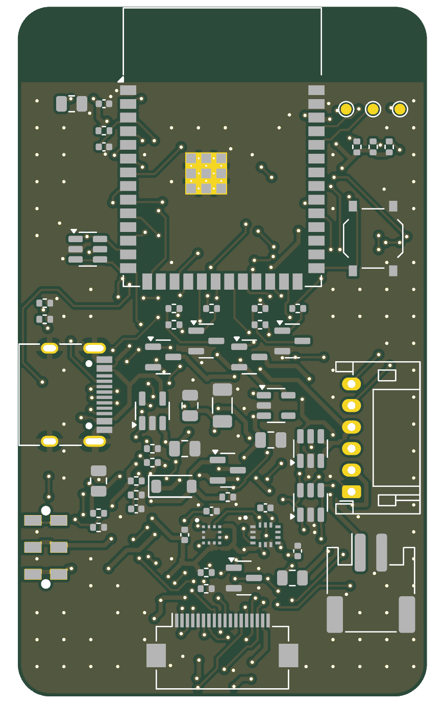
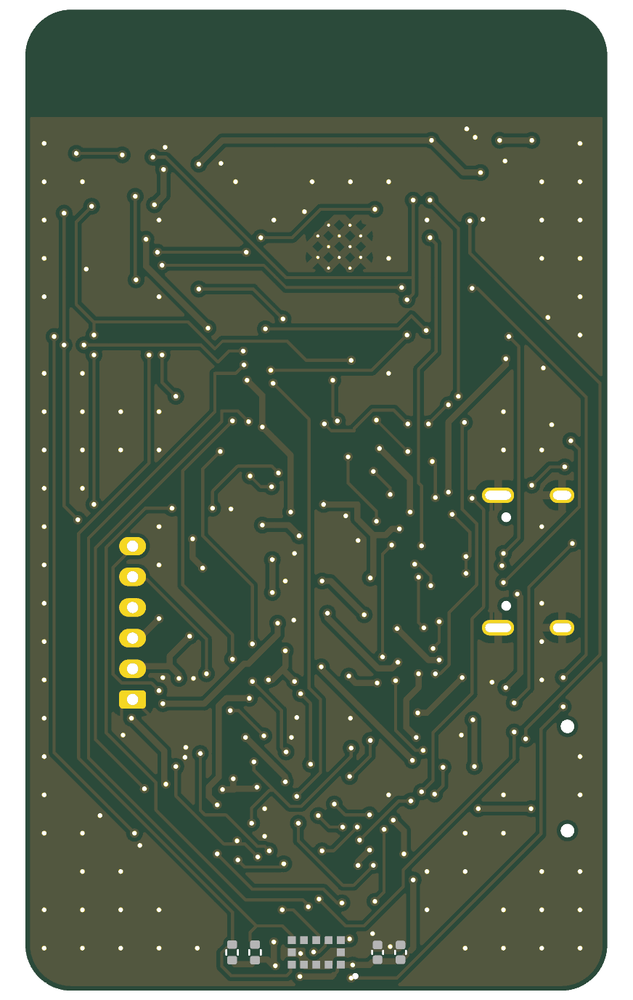

# DTT v2 PCB (rev 5)

ESP32-S3 board for the DTT v2: 2.0 in touch screen, VL53L4CD time-of-flight
sensor, LSM6DSO + LIS3MDL 9DOF IMU, and a side PH6 accessory port. No LEDs,
button or headphone jack. 38 x 64 mm (rev 4 is 44 x 92 mm).

Status: routed, KiCad 9 DRC clean (0 errors, 0 unconnected). Not yet reviewed by a
human or fabbed.

| Back | Front |
| --- | --- |
|  |  |

## Source

`build_dtt_v2.py` generates the schematic, symbols, footprint library, project
and placed board from one netlist. `route_dtt_v2.py` then routes it (grid
autorouter, 0.2 mm signals, 0.4 mm power, GND tracks plus stitched pours; about
an hour). Both overwrite the board, so after hand edits in KiCad, stop using them.

## PH6 accessory port

| Pin | Signal |
| --- | --- |
| 1 | GND |
| 2 | VSYS (0.5 A PTC) |
| 3 | OUT1, 3.3 V high-side |
| 4 | OUT2, 3.3 V high-side |
| 5 | I2C SDA |
| 6 | I2C SCL |

Existing 3.5 mm accessories use an adapter: tip GND, ring 1 OUT1, ring 2 OUT2.

## I2C addresses

Touch 0x15, ToF 0x29, IMU 0x6A, magnetometer 0x1C.

## Open items

- J3 screen FPC pinout is a placeholder until a panel is chosen; its traces
  get rerouted then.
- Screen outline (36 x 52 mm) is assumed; the board follows it.
- LCSC numbers marked `TBD` need sourcing.
- SW1 reuses the rev 4 footprint, including its tight locating-hole spacing.
